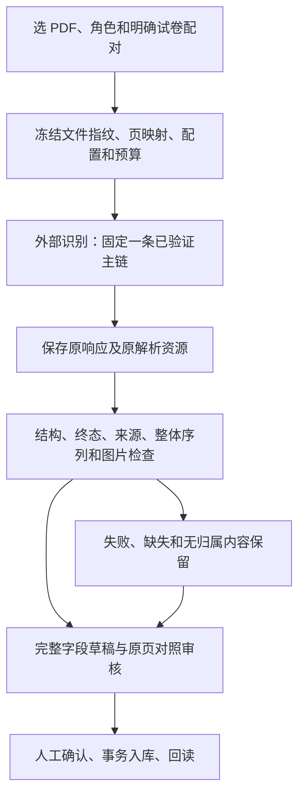

# 通用 PDF 外部识别 V2：现状审计、完整方案与 Sol 执行规格

日期：2026-10-13。状态：离线审计与设计交付；未接入生产，未证明任何候选已胜出。

## 1. 结论与本轮边界

目标是让外部服务负责读 PDF、公式转写、跨页理解、分题分字段和图像归属，软件负责调用、证据、少量确定性检查、原图保存与现有审核入库。质量达标是门槛，在达标方案中选总费用最低、速度合适且维护最简单的一条。

**采用“稳定结果协议 + 可替换外部执行器”，先验证便宜多模态直出，必要时验证托管解析 + 便宜整理。生产只启用胜出路线。** 不建设本地 OCR、块偏移重建器、语义配对、数学纠错、多模型投票或自动贵模型兜底。

审计结论：旧重型 PDF 主入口已经退役，但“相关代码全部清干净”不成立；现 V1 是已经外包理解的过渡链，也存在新的契约和接入缺口，不能只换模型名继续用。已有通用 V2 方向基本符合目标，但还不是可直接施工的完整规格。本文补齐提示词、传输协议、窗口所有权、容量与计费、整体序列检查、适配边界、旧代码处置和分阶段验收。

本轮仅新增本文及 `ai/pdf-api-first-v2-prompts/` 四个文件；忽略目录 `local-run-artifacts/pdf-api-first-v2-prompts-2026-10-13/` 保存审计探针、基线和验证。保留全部既有 dirty 和证据，不改业务代码、依赖、源 PDF、数据库、凭据，不 commit/push，不调用真实 AI/OCR。本文列出的未来文件范围不是本轮改代码或上传的授权。

分支 `stage/program-c-corrective-r1`，HEAD `71dfe18770e5161a19d38c07842d0ab865f20c92`。本轮基线记录 1189 个既有非忽略文件、1424 个既有本地证据文件的哈希。

## 2. 已有设计的审计

阅读顺序：[原 V1 规格](CODEX_TASK_PDF_MULTIMODAL_V1.md)、[MinerU 交接](PDF_V1_MINERU_API_HANDOFF_2026-10-04.md)、[隔离诊断](PDF_V1_ISOLATION_DIAGNOSIS_2026-10-04.md)、[前一份通用 V2](PDF_API_FIRST_V2_DESIGN_2026-10-13.md)，最后以本文作为下一阶段执行依据。历史文件不覆盖。

| 发现 | 问题与影响 | 本次决定 |
| --- | --- | --- |
| V1 已让模型直接理解 | 新方案若只是相同提示换模型，不能宣称架构已解决漏文 | 用历史反例和全文实测验证，模型不达标就否决 |
| MinerU 中间规划偏重块引用重建 | 把外部解析结果变回本地复杂组题系统，不符合用户取舍 | 撤销默认块偏移编译和本地语义规则，只保留原解析证据 |
| V2 没有可复用实际提示与 schema | 无法核算真实输入，也无法冻结输出契约 | 交付独立提示及 schema，版本与字节进入配置指纹 |
| V2 一体化 questions 对象没有保留支持原序 | 模型可能先按题号排序，使错误序列消失 | 传输用三条原序流，校验后机械映射完整草稿 |
| “整卷一次”未冻结容量策略 | 上下文能装下，不代表输出不截断、最便宜或最快 | 输入档位、输出预算、图片数量、负载字节一起检查 |
| 跨页只提原则 | 不知道谁输出边界题，容易重文或漏尾 | 明确 owner 页范围、上下文页、完整候选替换规则 |
| 免费/低价比较混用旧 Token | 不同图像编码、分词器、解析全文量不同 | 旧用量只作量级对照；真实价格由每次 usage 和账单核验 |
| 固定解析 API 与聊天模型混淆风险 | 给 MinerU 传 system 不等于支持自定义结果 | 固定 API 保存原格式，再由整理模型执行同一协议 |
| “模型 complete”被当作可接受状态 | 合法 JSON 仍会漏长证明或错挂图 | 模型状态仅观察，软件 gate 和人工确认各自独立 |
| 新协议接入范围不足 | Bridge、输出、编辑器、正式准入都含 V1 专用判断 | 第 11 节逐项列出，禁止伪装 V1 绕过接入 |
| 旧代码清理口径不清 | 删除文件、卸载浏览器、测试依赖、历史证据不是同一件事 | 按第 3 节分类退役，保留共享能力与受保护测试 |
| 无候选失败后的终点 | 容易无限换提示或把问题退回本地算法 | 有限候选、两轮固定对照；失败明确停止，不自动扩展 |

历史反例不能靠新提示宣告修复：河北第 6/7 原页曾在普通 OCR 中保留尾段，而结构化任务漏尾并伪报完整，也发生过尾段错挂到下一题；深圳有关键指数及源字形问题。压缩 JSON 的旧实验约省 1.43% 且质量退化，不能再次把缩字段名作为主要优化。

## 3. 旧链是否清干净：实物核查

### 3.1 已完成的退役

`architecture/pdf-v1-retired-files.json` 登记的 23 项目前均不存在：6 个专用实现、17 个纯旧实现测试。6 个实现是 `qisi-pdf-candidate-projection.js`、`qisi-pdf-import-coordinator.js`、`qisi-pdf-ocr-support-parser.js`、`qisi-pdf-question-boundary.js`、`qisi-pdf-support-block-parser.js`、`qisi-production-pdf-sources-port.js`。它们不在当前 main 脚本加载和 runtime 清单中。

当前静态路径为：正常 UI 选择 `pdf` → `app.js:1843` 创建 `PdfMultimodalProducer` → `qisi-qwen-vision-source-port.js:42` 多页请求 → V1 contract → Bridge → 审核。Bridge 在 `qisi-production-import-bridge.js:155` 拒绝非 V1 PDF 结果；输出端 `qisi-production-import-output-port.js:252` 对 V1 直通、对其他 PDF 拒绝。检查的生产路径中未发现回到上述 6 个已删实现的隐式 fallback。

### 3.2 仍在现场的代码与处置

| 类别 / 文件 | 查到的实际用途 | Sol 处置 |
| --- | --- | --- |
| `qisi-pdf-support-controlled-write.js`（约 970 行） | main 不加载，runtime=dormant；保护 smoke、边界测试、回归及旧 runner 使用 | 保留隔离；不得为“删干净”改用户保护 smoke。迁移另立范围 |
| `qisi-pdf-answer-extraction-quality.js`、`qisi-pdf-answer-only-extraction.js` | dormant；前者被 controlled-write require，两者有测试和旧 runner | 本阶段保留测试兼容，不接回新链 |
| `qisi-pdf-support-aligner.js` | 浏览器加载；共享 ImportValidationService 启动依赖并用于非 V1 路径序列检查 | 保留；V2 只复用其纯序列门禁，不能连带恢复旧解析链 |
| `qisi-pdf-safe-partial-pipeline.js` | 已缩成两个来源追踪工具，约 75 行；视觉支持调用 | 保留，不把文件名当作旧识别引擎 |
| `qisi-page-question-parser.js`、`qisi-visual-support-source.js`、`qisi-visual-question-source.js`、`qisi-batch-engine-v2.js` | main/app 仍加载/装配，显式 DOCX vision 等路径还依赖 | 不在 PDF 替换中整文件删除；新 PDF 不得调用这些语义修补能力 |
| `qisi-qwen-vision-source-port.js`、`qisi-ocr-qwen-adapter.js` | V1 传输与其他视觉能力共享；task client 还有多模型尝试能力 | V2 用单一明确执行器，不经旧自动模型列表；共享部分保留 |
| `qisi-ocr-candidate-selection-policy.js`、`qisi-ocr-reading-order.js`、`qisi-ocr-structure-extractor.js` | runtime=dormant | 留作隔离历史代码，禁止新链引用；物理删除单独做依赖迁移 |
| `qisi-ocr-engine-registry.js`、`qisi-ocr-local-adapter.js`、`qisi-ocr-shadow-mode.js` | 仍在浏览器加载 | 并非 V2 所需，但不能由“名字像 OCR”推出可删除；此次不扩大到全软件 OCR 清理 |
| 旧原始请求、gold、账本、快照、`.bm_a4_app_before.js` | 历史证据/快照，不是 main 脚本 | 原样保留，不计作活跃识别路线；不要让快照测试进入默认发现 |

**明确遗留缺陷：** `scripts/verify-personal-stable.js:64` 仍引用已删除的 `tests/pdf-support-controlled-write-answer-ownership.test.js`。其旧 `pdf-master-browser-runner.js` 步骤还期待已卸载的 controlled-write 浏览器对象。前者是已证实失效路径；后者是新链兼容性待迁移项，不能继续称为新 PDF 验收入口。`scripts/base-migration-inventory.js` 也有已删 block-parser 名称，属历史工具引用，需标注版本或更新用途。

本轮未运行这些可能涉及历史真实 API/用户服务的 runner。默认 `verify:safe` 与可选 `verify:personal-stable` 是不同入口，前者绿色不意味着后者有效。

因此当前准确说法是：**旧专用生产主链已撤掉，共享和测试兼容层仍在，工具链清理未完全收尾。** 下一阶段先修正失效验收入口；不以物理零残留作为 V2 上线前提。全部清空会涉及用户保护测试和 DOCX，需独立授权范围，不能顺带做。

### 3.3 V1 的可复现契约缺口

本次 ignored 审计脚本只构造内存合成对象，调用当前 `parseResponse → groupProposals → canonicalDraft → validateCanonical`：

1. 每个窗口只含一个合法条目，整份支持原序为 `2,1,3`。各窗口合法，汇总后仍通过 canonical 验证，三题答案/解析均被标 controlledWriteAccepted。
2. 题目 `1,2,3`，答案 `1,3`，解析 `1,2,3`。第 3 题仍被标答案/解析可接受，没有在单侧缺口后封闭。

结果见 `old-chain-audit.json`，脚本为 `audit.cjs`。这些是**当前草稿契约缺口**；所有探针草稿 manualConfirmed=false，未调用正式入库，因此不宣称已经污染生产库。V2 必须在合并前修正整体序列门禁，不能复制现 V1 的同号聚合当作完整安全验证。

另外，V1 fresh response 的终态检查允许 finishReason 缺失，而缓存要求严格 stop；新适配器必须统一明确成功终态。重复窗口、自报完整和 equal-text 合并都不能作为覆盖证明。

## 4. 最终产品链路与范围



教师仍只选择文件、角色、配对并审核。厂商、模型、窗口和 Token 不进入日常选择流程；异常页面只解释缺了什么、需重识别还是手工修订。

第一版适用：单份普通高中数学试卷，原题号可辨且唯一；question-only、full、题卷 + 一份明确配对的答案解析卷。支持向既有明确题卷导入支持文件的能力若现 UI 未有，不在本阶段新增。多份不同考试、章节重号、混合 DOCX/PDF、加密损坏 PDF、超出验证容量的超长题报告不支持或转人工，不猜 scope 或暗扩路线。DOCX+DOCX 原确定性链保持。

正常页面转成图只是输入准备，原图裁切只是资源处理，不重新做本地版面/公式识别。空白页不凭低文本量剔除；深圳第 8 页虽已有空白证据，通用算法不硬编码该页。

## 5. 候选、提示词和厂商接口

按成本先筛廉价能力，而不是默认选最贵模型：

| 顺序 | 候选 | 决策用途 |
| --- | --- | --- |
| A1 | Qwen3.7-Flash 直接视觉完整转写 | 先验证结构化支持及低输出价能否兼顾全文质量 |
| A2 | GLM-4.6V-Flash 直接视觉 | 免费对照；配额、可用性、速度或质量不合格就退出 |
| A2 的一次替代 | GLM-4.6V-FlashX | 仅免费版受服务限制时替代，不因质量失败就假定 X 更准 |
| B1 | GLM-OCR 托管解析 + 同一个合格整理模型 | A 的识别/组织混合问题仍存在时验证；先用 Qwen3.7-Flash 冻结变量 |
| B2 | MinerU 托管解析 + 同一个整理模型 | 先确认账户真实收费、接口及资源能力；不知道价格则不宣布最低价 |
| 整理降费对照 | GLM-4.7-Flash 文本整理 | 仅 B 转写质量合格后对固定 OCR 快照试一次；涉及图像归属需额外视觉证据 |

不得同时造六套产品适配器。实验脚本可顺序比较；生产只实现一个胜出执行器，需要 B 才有 parse/organize 两阶段。Ali OCR 作为报价参考，不再默认增加候选数量。具体模型 ID/地域/版本从官方接口核验并冻结，不能把商业展示名直接当 API ID。

实际交付：

- [共用 system 提示](pdf-api-first-v2-prompts/system.txt)：完整转写、跨页、题号、图片、不确定项、禁止补算和材料指令隔离。
- [直接视觉 user 模板](pdf-api-first-v2-prompts/direct-user.template.txt)：可信来源元数据 + schema + 原页图附件。
- [解析整理 user 模板](pdf-api-first-v2-prompts/organize-user.template.txt)：可信来源元数据 + schema + 原解析页/资源，必要时附原图。
- [结果 JSON Schema](pdf-api-first-v2-prompts/result.schema.json)：传输契约 `pdf-external-wire-v2.1`，版本由调用方登记，不要求模型复述。

组合方式：system 文件作为 system message；user 模板中的变量由 JSON 序列化替换一次，禁止用文档正文替换指令变量。图片不变成 Base64 文本贴进 prompt，而是使用厂商正式图像字段，每张图前有明确 source_id/page 标签。原始请求、哈希、实际模型、提示/协议版本单独登记。

`REQUEST_METADATA_JSON` 结构示例（合成两页示例，不是真实上传配置）：

```json
{"sources":[{"source_id":"src-a","scope_id":"exam-a","document_role":"full","allowed_streams":["questions","answers","solutions"],"total_pages":2,"input_pages":[1,2],"output_pages":[1,2],"context_only_pages":[]}],"assets":[]}
```

`source_id` 是调用方文件 ID，scope_id 是调用方确认的试卷组；第一版不由模型自行创建分卷 scope。页集合由软件产生，互斥关系和边界先本地校验。support 角色通过 allowed_streams 明确允许 answers、solutions 或两者，模型不能自行扩大角色。

`PARSED_PAGES_JSON` 为 `[{source_id,page,text,assets:[{asset_id,page,bbox,media_type}]}]`：text 是该解析页的完整原文，bbox 由适配器根据官方返回坐标机械换算；坐标空间未知则 null 并报问题。原 JSON/ZIP 另存，不因适配覆盖。不能只传“摘要”给整理模型。跨页一体文本必须保留原页分隔，来源信息缺失不能编造。

阿里 JSON Object 只约束合法 JSON；部分模型支持严格 JSON Schema。首选能力明确且兼容本 schema 的严格模式；不支持的关键词保留为本地校验，模型端使用兼容投影，不能无提示降级。JSON Object 模式传压缩 schema；严格模式只在 response_format 发送 schema，user 中该占位替换为“见 response_format”，避免重复。语义检查仍不可省。[阿里结构化文档](https://help.aliyun.com/zh/model-studio/qwen-structured-output)

GLM 的能力按具体模型/接口验证；不能因一个 GLM 支持 JSON 就推断所有 GLM 支持同样 strict schema。固定 MinerU/GLM-OCR 解析接口按官方参数调用，不塞通用 system 提示，不假设能返回本系统题目 JSON。解析结果进入 B 的整理提示。[MinerU API](https://mineru.net/apiManage/docs)、[GLM-OCR 接口](https://docs.bigmodel.cn/cn/guide/models/vlm/glm-ocr)

## 6. 返回契约、字段映射和整体门禁

传输顶层固定 `questions / answers / solutions / unassigned / pages / warnings`。三条流保留各自源阅读顺序，避免模型先配对排序掩盖异常；软件产物仍是前一设计的完整题目草稿，不向 UI 暴露三套业务结构。

| 返回内容 | 本地行为 |
| --- | --- |
| question_no、number_text、number_page | 验证来源与题号观察；不相信模型声称的编号就是实际原号 |
| source_id、scope_id、source_pages | 仅可来自本次可信清单；页码必须实际提供，number_page 属于 source_pages |
| type、stem、options | 机械映射题干/选项；题型枚举映射现有类型；unknown 待确认 |
| answers.text、solutions.text | 经整体序列门禁后才允许作为对应字段候选；缺失保持空并标记 |
| status | observed_complete/open_start/open_end/open_both/uncertain 是观察，不是准入 |
| figures | 验证原资源或归一化框，原位转为现有 IMAGE token，保持字段关联 |
| unassigned | 保存无法定号、缺题头、归属不明的全文/图；任务级可见，不丢弃 |
| pages | 每个输入页恰一次；内容/空白/不可读/上下文状态；不充当全文覆盖证明 |

本地契约顺序固定：

1. 先保存 raw，再确认 API 成功终态/无拒绝/无截断；解析 JSON 并检查字段形状，禁止补默认字段伪造成功。
2. 校验来源、页范围、允许流、输出所有权、图片 ID/token/框；所有字符串按普通数据处理，不作为 HTML 或可执行 LaTeX 外部命令。
3. **在任何按题号 Map、排序和去重之前**，按调用方任务页顺序收集每个来源的三条原序流；并发完成顺序不得成为原序。不同来源各自验证，再按显式试卷组比较。
4. 主试题题号先形成唯一且严格递增的 expected 序列；编号无法机械规范化、重号、倒序或范围异常时阻断受影响支持挂接。expected 本身也是 OCR 观察，不能证明未漏题；题数/原页覆盖仍需全文验收和审核。
5. 同一支持任务要求答案与解析时，验证两条完整序列对 expected 的一致性。full、可靠 prefix、已授权同缺口 subset、fail-closed 规则沿用；单侧缺口后不恢复。只有答案或只有解析角色时，按该显式允许流验证 expected，不捏造另一条流作为“相同序列”。不允许用答案/解析文本相似度纠正身份。
6. 只有已声明上下文重复的同一观察才能去重；不同原文位置的相同题号不能因文本相同而吞掉。不同候选保留冲突，不选择最长、不拼残段。
7. 模型完整、源序列合法、资源完整仍只是可审核候选；软件生成 manualConfirmed=false。缺图、缺字段、冲突、未知来源、未处理页或 unassigned 在任务和字段层可见，确认前必须处理或明确排除相应范围，不把部分结果标整卷完成。

`result.schema.json` 只约束可表达的结构，不编码所有跨字段关系。生产实现采用聚焦纯函数检查，不为本 schema 引入大型编译框架。要补的关系检查包括 bbox 四数递增、asset_id/bbox 恰一有效、option_label 与 field 对应、figure ID 全局唯一且 token 一一出现、图片页属于条目来源、各页集合一致等。

图片框坐标约定为旋正后完整页面左上原点、0..1；调用方冻结旋转、裁切框、像素尺寸及原 PDF 映射。渲染器现有 0..1000 接口只机械乘 1000，不混用相对块坐标。图内坐标、字母、箭头都要保留；合法 bbox 不等于图归属正确。下载仅接受此次服务结果清单内资源并限制协议/大小/类型，原响应 URL 不直接变成任意本机请求。

## 7. 分页、长解析和输出预算：冻结可执行策略

先尝试完整输入任务，只有在该模型的已验证图片数量、输入字节、输入/输出 Token 和时延上限内才执行。完整上下文不是强制整卷一次；深圳旧输出累计已超过 25K，旧 16,384 输出上限不能直接拿来承诺全卷输出。

实验基线配置：保留已有 renderScale=2、JPEG=0.94、裁图 scale=3，不同时降画质；候选支持时关闭不必要 thinking，temperature=0，输出上限先用 32,768（必须低于接口实际上限并符合上下文总预算）。该参数只是首轮配置，不是所有候选都支持的承诺。密集表格、极小指数和图片选项必须实际验收。

需要分组时，第一版用简单页范围所有权，不建设本地语义切题：连续 **5 个输出页 + 前后各最多 2 个上下文页**作为保守试验配置。output_pages 不重叠，input_pages 含上下文；每条流的条目由其可见原题号起始页所在任务负责。相邻任务可读同页，但不能重复输出该页起始的题。

此处修订上一设计的“默认再让模型规划分组”：为减少额外费用，第一版不强制规划调用。普通整卷与上述固定页组做有限对照，先选质量达标的一种固定配置。若必须依赖复杂动态题目规划才能成功，判定超出这一版轻量支持范围，另开规格，不让 Sol 半路设计规划引擎。

边界规则：owner 任务缺续页则保留 open_end，页首缺题头保留 unassigned。最多一次有预算的扩大连续页范围重识别，返回该题/任务的**完整新候选**，旧候选保留并标 superseded，不拼接两个 JSON 片段。扩大后仍超过容量或仍不明确，转人工/报告不支持。不能依赖模型一定自报缺失；跨页尾段的漏报必须由真实验收淘汰候选。

严格区分：同一页复读的视觉费用、同一题重复输出费用、实际原页数。深圳 21 页旧 W5/O2 产生 33 页次；新配置并不天然更省输入，可能用额外上下文换取单次完整输出。只有真实账本能决定整卷或分组谁胜出。

## 8. 异常、恢复、缓存和费用上限

| 事件 | 软件动作 | 禁止行为 |
| --- | --- | --- |
| 401/403、无额度、配置错误 | 保存失败，停止该来源后续提交 | 循环试密钥或换模型继续扣费 |
| 限流/明确未接受的临时失败 | 按服务 Retry-After，预算内最多一次重试 | 无限重试 |
| 提交后断网/超时、接受状态未知 | submission_unknown；有任务 ID 则查询原任务，无 ID 则待明确重试 | 宣称未收费、自动重复建解析任务 |
| 截断、缺 finish reason、拒绝、空结果 | raw 保留，不能作为成功缓存 | 续写半个 JSON 后当完整结果 |
| JSON/字段格式错误 | 有预算最多一次同源完整重试并传简短字段错误；计费 | 正则“修复”缺失正文，补空字段过验收 |
| 内容冲突/错图/缺页 | 保留原证据，问题草稿或范围重识别 | 偷选最长、自动挂下一题 |
| 取消 | 停止后续提交，保存已完成证据；晚到响应不能覆盖新版本 | 宣称外部已接收请求免费取消 |
| 整理失败 | 可复用有效解析快照，只重跑整理 | 重传整卷重新 OCR |
| 图片下载/裁切失败 | 保留正文与缺图状态，可独立恢复原资源 | 重新全文识别只为下载图片 |

识别成功缓存键至少包含：源字节 hash、页面映射、角色/试卷组、owner/context 范围、渲染参数、服务/模型/可获得版本、prompt/schema/config hash。B 另包含解析结果和资源清单 hash。失效/未完成结果只作证据，不作成功命中。别名版本无法固定时报告该限制。

模型输出与用户编辑分开保存；任何新识别候选、编辑、图替换或归属变化使对应确认失效。正式提交请求不复用为新导入识别结果。已经完成的旧 V1 草稿可继续查看/审核，但不通过伪造协议转换成 V2；没有原始证据的历史对象不能批量自动升级。

预算在提交前登记 attempted request，并预留“该请求估计最高输入档 + 输出上限”的费用；成功按 usage 结算，接受未知时保留预留。重试、视觉补充、解析页数、上传数及下载流量按实际计费规则分别记。无 usage 的付费请求记 unknown，不能记 0。免费额度与无优惠长期成本分列。

## 9. 深圳样例成本：可证明什么、不能证明什么

源文件：`C:/Users/Administrator/Desktop/题目与答案/广东深圳高级中学（集团）2026届高三适应性考试数学试卷 (1).pdf`；SHA256 `874e3615f89d0abaf4a2f1beb0aa7f5034bbb55bd9299a0bd6392646f5a55e21`，21 页/19 题。gold 只用于本地评分，不能发给模型。

旧请求 85–91 的真实 usage 合计：输入 70,260（其中视觉 64,779、文本含提示与元数据 5,481），输出 25,201；7 次请求、33 页次，累计请求耗时约 540.3 秒。它不是新提示的用量，不是合格全文的最低输出，也不是新网络条件下的性能基线。

下表将**同一组旧 usage**代入已查公开价，仅用于筛选数量级；不是候选真实识别报价。元/百万 Token，Qwen 按每个请求输入 ≤32K 的北京档示例。价格按执行当日账户地域再冻结。

| 候选 | 输入 / 输出价 | 旧 usage 等量折算（元/卷） |
| --- | ---: | ---: |
| 旧 Qwen3-VL-Plus | 1 / 10 | 0.322270 |
| Qwen3.7-Flash | 0.2 / 0.8 | 0.034213 |
| GLM-4.6V-Flash | 公开免费 | 名义 0；配额/可用性未测 |
| GLM-4.6V-FlashX | 0.15 / 1.5 | 0.048341 |
| Qwen3.5-OCR，仅解析 | 0.5 / 2 | 0.085532，未含整理 |
| GLM-OCR，仅解析 | 0.2 / 0.2 | 0.019092，未含整理 |
| MinerU，仅解析 | 当前账户价格未确认 | 不能填 0，另加整理 |

官方依据：[阿里价格](https://help.aliyun.com/zh/model-studio/model-pricing)、[智谱价格](https://docs.bigmodel.cn/cn/guide/start/pricing)、[阿里 OCR](https://help.aliyun.com/zh/model-studio/qwen3-5-ocr)、[MinerU API](https://mineru.net/apiManage/docs)。高优先级页额度不是“无限免费”的证明。

新提示已实际成文，不再假定“固定 1000 Token”。system 1769 个 Unicode 字符、4055 UTF-8 字节；direct 模板 384 字符、806 字节；organize 模板 498 字符、1038 字节；schema 压缩后 4165 字符。最终精确值及哈希以本轮 `prompt-metrics.json` 为准；字符/字节都不是 Token，模板变量、图标签、请求封装、实际 OCR 文本也要计费。严格 schema 若已放 response_format，不再重复塞入消息；服务实际如何计入输入以 usage 为准。

```text
每次调用成本 = 本次计费输入 Token × 对应档输入价 / 1e6
             + 本次计费输出 Token（含服务计费推理部分）× 对应档输出价 / 1e6
整卷 A = 所有直接调用 + 重试/范围重识别 + 实际另计资源费用
整卷 B = 解析调用/页费 + 全部整理调用 + 视觉补充 + 重试/资源费用
```

图片 Token 已包含在 prompt_tokens 时不得重复加。prompt/input 统计口径以该厂商定义为准。之前 B 把旧 JSON 输出当 OCR 长度、再加 1000 提示 Token 的算法撤回为假设，不作为完整报价。

整卷一次还有档位风险：仅按旧页图约 1963 Token/页估算，21 个不同页图约 41,223 Token，已超过 Qwen 示例首档 32,000；同样计费形态若成立，将用更高输入/输出单价。这只是旧图计量外推，不是新模型实测。减少请求不能直接等于降低总价。

最终选型同时报冷启动整卷费、热缓存费、失败恢复费、人工修订分钟数和总等待。API 便宜几分钱却多花教师几分钟的方案不算胜出。目标建议先设“质量达标后，API 总费比同源旧基线下降至少 50%”；这是选型门槛，不是已经达成的承诺。

并发初始为每份文档最多 2 个独立 owner 任务，服务未允许时降为 1；这是执行节流，不是自动换模型。预先渲染与缓存页图，避免每个重叠任务重复渲染；资源裁取按引用需要进行。提高并发只能减少等待，不能宣称减少 Token。开始请求前同时核对模型图片数/字节/上下文/最大输出限制和本机服务 body 上限；限额不明确的配置不得发送“碰碰运气”。记录首结果时间与整卷完成时间，大输出可能主导延迟。

## 10. 有限实验与验收，不无限调提示

### 10.1 执行顺序

S0 离线：冻结本协议/提示，机械校验；用历史反例做来源和序列 fixture；核验候选 API 模态、strict schema 子集、图片限制、输出上限、用量及定价。不得用昂贵真实请求做“健康探测”。

S1 最小反例：深圳原第 13 页、河北第 6/7 页。同源分别测 A1/A2；B 的两阶段用于识别/组织失败对照。缺少续页时应输出不完整，不能拿该 3 页证明整题完整。每条候选固定版本两次，第一次明显关键错/错挂即可提前否决，不必浪费第二轮。已明确源字形疑难保留疑难，不用正确答案提示。

S2 扩大：只有通过 S1 的候选进入深圳 10–14、19–21 和河北 4–8，共 13 个独立原页，两轮固定配置。规划调用、上下文额外页、重试及整理计入该候选费用。不为本次 gold 定制匹配规则。提示最多一次有依据的通用修订，修订后全部已过反例重测，旧失败保留。

S3 整卷：胜出候选对深圳/河北共 40 页、38 题逐题核验；至少一份未参与调参的普通卷做保留集。没有保留集材料时标明待补，不声称通用生产验收。整卷与分页最多比较两种冻结配置，画质/并发不要同时变动。

建议未来实测任务上限：全阶段合计最多 80 次计费模型/解析提交、600 处理页次、总 API 预算 20 元，先触及者停止；免费调用同样计次数，轮询单列，每异步任务最多 60 次、总等待 10 分钟。单请求最大费用预留、超额页限制均在发送前执行。这是**待写入真实任务的建议上限，不是本轮获得的外发授权**；已有旧 DashScope 余量和 MinerU 单独授权不能互相借用。首阶段可更小，不因有预算而全部花完。

### 10.2 质量和性能表

| 必须检查 | 合格条件 |
| --- | --- |
| 主试题/答案/解析/图片身份 | 错挂 0；非 gold 自动推断题数不得作正确性证据 |
| 全文 | 全部小问、公式、等式、证明、分析、点评、多解保留；逐题查缺尾 |
| 关键数学符号 | 不新增错误；已有已知错必须被修复或明确阻断，不能仅“不比坏基线差” |
| 不确定源字形 | 不猜补；未确认字段保持待处理 |
| 图像 | 全部标签、刻度、裁框、选项/字段及保存重载后 Blob 一致 |
| 整体顺序 | 单窗/跨窗重复、倒序、跳号、单侧缺口、未知号、两来源同号均有拒绝证据 |
| 失败回收 | 截断、无终态、拒绝、超时未知、取消、下载失败、晚响应均不假成功 |
| 人工修订 | 单题和整卷修订量/分钟数分别列，不能只报审核后的正确率 |
| 费用 | 所有尝试总成本低于基线，unknown 费用不可视作 0 |
| 时延 | 准备/上传/排队/识别/整理/资源/审核/保存分别记录，端到端不退化 |

两轮全过仍只是样本结论。样本少时报每次观测值，不编造 P95。旧历史耗时网络条件不可比时，报告“效率对比未完成”，不能只凭 API 标称速度批准。正常 UI 的 mock/E2E 只验证软件行为，不能证明模型准确。

## 11. Sol 实现边界：文件、阶段和禁区

### 11.1 最小代码归属

优先新增 `qisi-pdf-external-contract.js`（纯验证/映射）与 `qisi-pdf-external-producer.js`（任务/缓存/预算/资源编排）。再按实际胜出路线增加一个 `qisi-pdf-external-provider.js` 服务适配边界；不先造每个厂商子框架。密钥和上游认证留在本机服务侧，前端只给已允许 provider/config ID，不能任意指定 URL。

| 现有文件 | 未来允许的必要调整 | 必须保留 |
| --- | --- | --- |
| `qisi-local-server.js` | 注册选定外部 provider 的有限端口；独立模块承载实现 | 认证/错误/尺寸/超时边界、已有 DOCX/native 路由 |
| `qisi-production-import-route-policy.js` | 新 PDF 固定 V2 producer 身份及兼容检查 | DOCX deterministic 默认、来源配对、禁止混合输入 |
| `qisi-normal-ui-import-controller.js` | 新批次与恢复传递配置/识别任务 ID | 不复用已 committed 整批结果 |
| `qisi-production-import-bridge.js` | 明确接受 V2，并调用 V2 contract；保存任务级问题和证据 | 事务、取消、诊断、隔离旧候选清洗路径 |
| `qisi-production-import-output-port.js` | V2 验证后直通；未经验证仍拒绝 | 不能进入旧评分/文本清洗/去重选优 |
| `qisi-docx-producer-identity-contract.js` | 新 PDF route/provenance 的显式分支 | 所有 DOCX 身份与来源规则，不能放宽为任意 PDF route |
| `qisi-formal-admission-policy.js` | V2 图片/支持来源的精确准入 | 字段审核、来源匹配、事务和缺失拒绝 |
| `qisi-review-draft-normalization-policy.js` | V2 问题展示及正文不再解释 | 不调用旧分题/修公式清洗器 |
| `app.js` | producer 装配及现有 V1 专用编辑/图/候选钩子的窄调度 | 不放新识别算法，不重写受保护 handler |
| `main.html`、runtime/layers/owners 两套实际清单 | 新模块装载顺序和状态，最终停止 V1 新任务生产装配 | 不顺手卸载 DOCX 共享依赖 |
| 对应 tests、freeze 注册与架构报告 | 新失败例、已授权准确 hash/AST 变动 | 不降低已知坏例期望，不自动刷新保护清单 |

审核接入不能漏：app 当前 `isV1` 分支涵盖图片列表、来源页、编辑源映射、手工修改、移图、裁图、候选选择及批次保存；必须为 V2 明确实现等效调度或调用新契约。不能只接 producer 就让 V2 草稿流入旧 normalization。若需要任务级 unassigned/未处理页展示，用已有诊断区域做窄扩展，必要 main/app.css 在该阶段列入范围。

第一版不改数据库 schema：复用现有草稿字段和可扩展证据对象保存 `pdfExternal` 元数据，资源仍用现有 repository。先通过隔离保存/读回验证容量和 Blob；若确实需 schema 迁移，停止该实施阶段并形成单独规格，不能隐式改版本。

### 11.2 分阶段交付和停止条件

1. **S0–S3 选型阶段**：只允许本规格/提示、独立实验工具和 ignored 证据，不接生产。外发必须有确切模型/域名/输入 hash/实际字节/次数/费用上限。没有合格候选则结论为未找到替代，停止。
2. **S4 离线契约阶段**：胜出路线固定后，新增 contract 和录制 fixture；先写跨窗倒序、单侧缺口、missing finish、图片与 unassigned 反例，再写实现。纯函数不得联网，不改 app。通过后出单阶段报告。
3. **S5 适配与影子回放阶段**：新增 producer/provider、预算/恢复/缓存与服务窄端口；UI 仍保持原生产 route，V2 只在隔离测试/明确实验入口回放。包括同步和实际所需异步能力，不做未选厂商。
4. **S6 正常 UI 切换阶段**：按 11.1 补全身份、Bridge、审核、来源、正式准入；新 PDF 仅走 V2，旧 V1 只保留历史草稿阅读/编辑兼容。不能失败回旧 V1，不双跑扣费。
5. **S7 退役收尾**：V2 实测/正常 UI 全过后删除 V1 producer 的新任务装配及仅用于它的传输函数；如果 contract 同时服务历史草稿则只保留所需兼容功能。修正 `verify-personal-stable` 与旧 runner 的实际用途，迁移验收入口；保护 smoke 依赖的 dormant 三件套本阶段不删。部署/commit 仅按该阶段明确授权执行。

每阶段启动有自己的 task file 与精确 allowed files，不因本文详细列出了后续步骤就跨阶段改完。目标是让 Sol 依据事实与门槛执行，不让它重新发明链路；外部质量未达标属于候选失败，不是靠改本地测试即可解决的设计漏洞。

### 11.3 测试与清理完成定义

离线 fixture 必须覆盖：完整/纯题卷/支持卷；跨页 2 页及超过上下文；图片选项；公式 JSON 转义；原文多解；无编号尾段；本卷章节重号；跨来源同号；重复窗口不等于原文重复；单侧缺口；相同缺口 subset；缺题、缺整页；拒绝/截断/空返回；成功与坏缓存；超时未知提交；取消晚响应；任务级问题保存；编辑后确认失效；图片下载/裁图单独恢复。

隔离 UI 覆盖：进入审核→原页对照→编辑/选候选/重裁→确认→事务写入→读回→刷新重载；重复导入不复用已提交响应；异常页面不能消失；原 V1 草稿仍可读；DOCX+DOCX 的结果和调用路径不变。所有 mock 测试阻断真实传输。

最终命令为 `npm.cmd run verify:safe`，并按改动跑现有 runtime/app-shell/frozen/diff-scope 入口；主测试已包含的项目无需机械重复。`verify:safe` 当前实际包含 no-real-ai、check、test、batch-safety，以 package.json 为准。不要为修复旧可选脚本而运行真实历史 runner。

清理完成定义：新 PDF 入口只有一条；新链不可达旧分题/OCR修补/候选评分；已退役文件无生产加载；shared/dormant/历史兼容各自标明消费者；所有公开验收脚本引用有效；旧证据和历史草稿仍可访问；DOCX 与保护 smoke 不变。此定义比“搜索不到 pdf/ocr 字样”更准确。

## 12. 交付给 Sol 的开场指令

> 阅读 `ai/PDF_API_FIRST_V2_AUDIT_AND_EXECUTION_PLAN_2026-10-13.md` 及根规则，保留全部 dirty、原 PDF、gold、历史请求、账本和用户保护 smoke。以本文替代旧 MinerU 专用/本地块重建方向。先核验本轮基线差异及旧链审计结果，按 S0–S3 准备/执行有限候选验证；提示词与 schema 在 `ai/pdf-api-first-v2-prompts/`。不得把同量旧 Token 折算当新模型实测价格，不得以 JSON 合法/complete/测试绿色证明全文准确。真实调用只在对应 task 明确源文件、域名、模型、次数和费用权限后进行；无权限可先完成离线准备。候选不合格停止，不加本地理解算法、不无限改提示。胜出后按 S4–S7 分阶段实施，特别修复跨窗口整体序列缺口、V2 身份/编辑/审核接入和失效验收脚本。不要批量删除仍服务 DOCX/保护测试的旧模块，不伪装 V1，不绕过正式准入。每阶段报告事实、失败、费用、耗时、人工量、文件范围和证据，完成当前阶段后停止。

## 13. 本轮验证记录

审计脚本和原代码哈希见 `local-run-artifacts/pdf-api-first-v2-prompts-2026-10-13/old-chain-audit.json`；结构/提示度量见 `prompt-metrics.json`；最终安全门禁、基线哈希与允许增量见同目录 `final-verification.json`。这次没有修改或修复生产缺口，只将它们复现并纳入可执行规格。

本轮真实 AI/OCR 调用 0、识别费用 0、源文件上传 0。公开官方文档仅用于接口/定价核查。离线 schema 检查不代表所有供应商均接受其全部关键词；真实提示遵循率、全文准确率、模型容量和性能仍按第 10 节实测。
