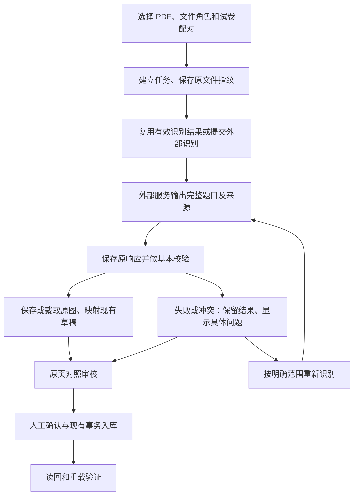

# 通用 PDF 识别方案 V2：外部理解、轻量整合与成本优先

设计日期：2026-10-13。状态：架构与选型设计，尚未实施或实测胜出。

## 1. 本次任务和用户最新取舍

用户要求设计整套新的 PDF 识别方案，不绑定 MinerU；尽量把识别、跨页、分题、字段和图像归属等难点交给外部大模型或托管服务，自己的软件承担必要且可维护的整合。费用与性能是首要优化目标，识别精度不下降是硬约束。

据此调整上一轮建议：复杂的本地块级重建、字符范围引用编译、全文覆盖证明和跨页语义规则不作为默认设计。它们会增加实现、适配和维护成本，未必比直接使用输出便宜的模型更划算。

本次允许增量：仅新增本文，以及 ignored 的 `local-run-artifacts/pdf-hosted-v2-design-2026-10-13/` 内现场快照、离线计算和验证日志。既有 dirty、源材料、历史报告、所有旧证据保留；不修改业务代码、配置、数据库、凭据或依赖，不调用真实 AI/OCR，不提交或推送。文档完成后停止，不把未来路线当作实施授权。

已按根规则执行 Git 预检。分支 `stage/program-c-corrective-r1`，HEAD `71dfe18770e5161a19d38c07842d0ab865f20c92`。这次新增前的非忽略文件与本地既有证据 hash 保存于 `before.json`，以本次基线区分历史改动。

## 2. 推荐结论

建立一个统一的“外部 PDF 识别 → 完整题目结果”边界。本地只维护任务、原始证据、少量结构/身份校验、图片资源、审核和入库。

外部如何完成识别属于可替换配置。开发评估两个候选，生产固定一条已验证主链：

1. **优先试低成本多模态模型直接输出完整题目。** 本地工作最少、少一个串行阶段、没有第二次全文生成费用。成立条件是全文、公式、跨页和图归属实际达标。
2. **直接路线未达标时，比较专业文档解析 API + 低成本整理模型。** 两个外部阶段分别承担读文档和组织题目。本地传递文本、页码及图片资源，不自己做题目理解。

第二条有任务分工优势，但不是必然更准、更快或更便宜。第一条与旧 V1 的任务形态接近，现有失败不能靠架构图抹掉：必须用新候选的实际结果证明改善。两条均未过门槛时，结论是候选未达标，不能把困难转为一套本地补丁。

“通用”指结果协议稳定、厂商适配可以替换；不要求第一版同时接入许多厂商，也不建设自动识别文档难度后切换模型的调度平台。

## 3. 目标如何排序

先限定可接受集合，再比较成本和速度：

```text
可接受集合 = 全文/公式/题号/归属质量达标
             且人工修订负担不增加
             且端到端效率达到预先冻结的门槛

在可接受集合中：优先选择完整使用成本最低、实现维护最简单的路线。
```

费用统计包含所有实际尝试、重试、局部重识别和用到的 OCR；人工修订时间另报，能确定时薪时再换算为总使用成本。工程维护成本用于比较方案，不能虚构金额。

不能同时承诺所有 PDF 上全局最低价、最快且绝无精度退化。可承诺的是：使用同源材料实测、质量作为准入条件、明确适用范围；精度不合格的便宜方案不切入生产。现有 V1 本身尚未通过完整机器质量验收，不能只以“不比它差”为终点，还须满足用户的全文和归属要求。

## 4. 整条产品链路



界面仍保持“选文件 → 选角色/配对 → 开始 → 审核 → 入库”。模型、厂商、窗口和成本档位属于配置及诊断信息，不要求教师逐次选择。没有明确配对的不同试卷不能仅凭同号合并。

识别进度按实际阶段展示：上传、等待服务、识别、整理（如果有）、准备草稿、待审核。服务未返回页进度时只显示正在处理，不能编造百分比。

## 5. 两种外部执行方式的取舍

| 项目 | A：低成本多模态直接识别 | B：文档解析 + 低成本整理 |
| --- | --- | --- |
| 外部输入 | PDF（服务确实支持时）或带原页号的原页图 | 第一阶段 PDF/原页图，第二阶段解析文本及资源 |
| 谁读公式、版面 | 多模态模型 | 专业解析服务 |
| 谁分题、接跨页、分字段 | 同一次外部识别 | 整理模型 |
| 返回给软件 | 完整题目结果 | 同一份完整题目结果 |
| 本地额外工作 | 通用传输及结果适配 | 多一个解析结果适配与任务依赖 |
| 主要费用 | 视觉输入 + 一次正文输出 | 解析费 + 整理输入 + 再次正文输出 |
| 主要性能风险 | 大输出串行生成，重复窗口 | 两阶段串行等待、队列和重复全文生成 |
| 已知质量风险 | 混合任务漏文、错挂、伪完整 | OCR 错误传播；整理阶段仍可能漏文或改写 |
| 选择条件 | 达标时优先考虑其简单性 | 质量/费用/效率实测形成净收益时采用 |

厂商如果能够直接交付达标的题目结构，也视为 A 的一种服务实现。本地不再额外调用整理模型。只返回普通 Markdown 的接口不能被宣传为已经完成分题和答案匹配。

## 6. 软件和外部模型分别承担什么

| 工作 | 责任归属 |
| --- | --- |
| 阅读文字、公式、小字、扫描页和多栏顺序 | 外部模型/解析服务 |
| 区分题号与公式编号，分题干、选项、答案、解析 | 外部模型 |
| 理解跨页续文、无题号尾段、题中小问 | 外部模型 |
| 识别图片位置、所属题目和字段 | 外部模型/解析服务 |
| 输出原题全文、保留公式与不确定项 | 外部模型 |
| 保存文件、页码映射、调用记录和原响应 | 软件 |
| JSON/终态、题号序列、文件与页号范围、字段形状检查 | 软件复用少量确定性校验 |
| 验证图片引用并下载/按明确框裁取原图 | 软件 |
| 明确同一试卷内按原题号配对 | 软件验证外部结果，不能语义猜测 |
| 显示问题、人工修订、确认、事务入库与回读 | 现有软件能力 |

第一版不新增：本地 OCR、本地模型、版面规则库、数学纠错器、语义相似度匹配、自动解题、题目碎片拼接器、字符偏移引用系统、多模型投票或每卷双模型全量复核。

这些边界不意味着软件能自动发现所有模型错误。保留原页审核并实测人工工作量；如果轻量校验加审核仍无法达到要求，应更换外部能力或否决候选，而不是暗中把重活重新堆回本地。

## 7. 通用结果协议：完整内容优先，保持小而稳定

对业务层只输出一个协议，例如 `pdf-external-v2`。以下是内部拟议字段，不冒充任何厂商当前返回 schema：

```text
RecognitionResult
  protocolVersion
  requestId / inputFingerprint / configurationFingerprint
  sources: 本次实际提供的 sourceId、角色、原页范围
  questions[]
    sourceQuestionNo / numberEvidence（原题号文字及来源页）
    sourceScope（试卷组；必要时明确章节）
    type
    stem
    options[{label, text}]
    answer
    solution
    fieldSources（题干/答案/解析分别来自哪个文件和哪些原页）
    images[{assetId 或 page+bbox, field, optionLabel?}]
    issues[]（缺字、缺续页、归属不明等具体问题）
  unassigned[]（无法归属的正文/图片及来源）
  usage / finishReason / providerRequestId（服务提供多少就保存多少）
```

本地注入或核对 requestId、文件身份和配置，不相信模型自行填写的任务身份。原题号观察仍须做序列检查；字段来源不能证明该字段内容真的被完整转写。

正文由外部模型完整输出，软件只做现有字段映射和必要的资源 token 替换。不再要求模型生成成百上千条字符范围引用，然后由本地恢复全文。此取舍增加了一次可能的正文生成量，但显著降低集成难度；是否值得用引用输出优化，只有输出成本实测仍是瓶颈时再单独研究。

协议不要求写解释性长报告、置信度长文、重复原文副本或知识点推理。必须保留的是题目实际内容和具体问题。不能删长证明、答案推导、图中文字来省 Token。

约束输出结构能减少格式错误，但不等于保证内容正确。`complete` 最多作为模型观察，不能作为正式入库资格。

## 8. 输入、跨页和长文档：控制重复工作

### 8.1 普通试卷

按一份明确配对的试卷组织上下文。优先尝试一次可承受的完整语义任务，但请求规模由实际输入计费档位、输出上限、全卷质量和时延共同决定，不能只看模型宣称的上下文长度。

A 路线让模型看到任务所需原页。B 路线先保存解析结果，再把原页标记、完整文字和资源标识传给整理模型；没有视觉证据无法判断的图选项或图归属，给该任务必要原页/区域，额外费用纳入 B，不假定纯文本必然能完成。

服务“支持 PDF 上传”不一定表示能看到其中的全部图像/版面，接入时必须核验实际输入语义。服务原始结果有页码则保持；临时子 PDF 必须映射回原页。

### 8.2 超过已验证容量的试卷

不让模型输出截断后把半份 JSON 当成功。需要拆分时，由外部模型给出少量连续页分组和跨页边界题的覆盖范围；软件只按页执行，并检查页范围合法、无漏页、任务输出规模可承受。拆分计划本身的调用和等待计入费用。

每道跨页题由一个任务输出完整候选；边界上下文可以重复输入，但只指定一个任务负责该题正文输出。模型违反约定产生不同候选时，保存冲突，不本地挑最长、不拼两个残段。

无法在允许容量内给某道长题提供完整上下文时，报告超出当前支持范围，保留原页待处理，不静默丢掉续页。第一版不承诺任意长度题目和任意复杂版式都自动成功。

这部分只有实际文档超出容量后才需要启用；普通卷不强制多一次规划调用。具体整卷/分组规模是离线估算后实测选择的一项配置，不对每页运行复杂动态路由。

## 9. 答案配对与图片

### 9.1 答案和解析

完整卷由模型直接输出题目结构；题卷与答案/解析卷分别保留来源，在用户明确的同一试卷组内按原题号建立关系。

软件复用原有序列规则：重复、回退、未知、越界与答案/解析序列不一致不能自动挂接。仅双流完整验证后的共同缺号才允许既有 subset 模式；单侧缺号不得按位置恢复。不能先排序再检查，排序会掩盖原始回跳。

答案卷缺第 8 题，不把第 9 题答案移到第 8 题；同号重复无法区分时进入待处理。来源只含答案、没有解析时，准确保留该角色事实，不能凭空生成解析。字段缺失与原卷确实没有该字段需要在审核中区分。

### 9.2 原图

外部服务定位和归属，软件保管原图。优先复用服务有明确来源的图片资源；需要裁图时使用已有 PDF 渲染能力，按明确原页与坐标裁取，不新增本地图形识别算法。

坐标单位、原点、页面旋转和页映射属于适配器的机械换算，必须核验。归属或框不可靠时提示人工裁图；不能把整页截图自动当作题目插图。图注、点名、坐标轴和选项标签均纳入图片验收。

下载资源后使用本地稳定 ID/Blob，不长期依赖可能过期的厂商 URL。文字字段中的图片 token 与资源 ID 必须一致，图片更换后相关确认失效。

## 10. 保留的轻量校验与审核

只做有明确边界、可复用的校验：

1. 请求终态成功、输出未截断、协议能解析，必需字段类型正确。
2. 引用的 sourceId、原页号和图片资源在本次任务范围内。
3. 原题号与答案/解析序列通过现有安全规则；候选重复/冲突显式保留。
4. 必需题干、选项和答案等按现有题型要求检查；公式能否渲染只是显示检查。
5. 模型报告缺续页、未归属内容、图片归属不明时，草稿保留问题且不自动确认。

不把合法 JSON、长度正常、渲染成功、自报置信度或来源页齐全当作全文正确的证明。也不建设一套本地“完整性证明引擎”来替代外部识别质量。

审核沿用现有草稿页，补足能快速跳到字段来源原页的入口及未归属问题展示。批量摘要区分“已生成草稿”和“已确认可入库”。人工编辑保存独立草稿版本，原响应保留；重识别结果作为新候选，不覆盖人工编辑或已入库数据。

选型时统计机器初始完整正确题数、人工修改题数、修改字符/公式/图片数、审核分钟数。不能以教师修好后的结果掩盖模型退步。

## 11. 性能和省钱的优先级

| 优先级 | 设计选择 | 保持精度的条件 |
| --- | --- | --- |
| P0 | 先比较通过质量门槛的低价模型/外部服务 | 不是按价格直接替换；全文、图和归属均实测 |
| P0 | 源文件及相同有效请求结果精确复用 | 缓存键覆盖源、页范围、角色、模型、提示和协议；坏结果不能命中成功缓存 |
| P0 | 恢复只处理失败任务或指定完整题目范围 | 复用成功证据，不重跑整卷；不能用缺上下文的局部图替代完整任务 |
| P1 | 一道题尽量只输出一次，减少重复窗口正文 | 边界上下文仍保留，跨页候选完整性实测 |
| P1 | 使用足够且不过量的输出上限；关闭不必要推理/工具 | 模型支持且对照达标才采用；不能截短正文 |
| P1 | 独立文件/完整题目任务有限并发 | 按厂商限流、CPU/内存和尾部延迟调优，不盲目提高并发 |
| P1 | B 路线复用解析，只改整理配置时不重复 OCR | 解析快照固定且可追溯 |
| P2 | 后台大批量任务使用厂商折扣批处理 | 用户能接受等待，且当前模型支持；不作为交互导入默认 |
| P2 | 按实际图像计费规则优化分辨率 | 小字、指数和图标注质量不下降；减 JPEG 字节不等于减少 Token |

省钱顺序不是先压缩 JSON 字段名。已有紧凑 JSON 实验节省很小且质量退化，不能重复把它当主方向。保留当前成功的失败恢复修复，也不能把旧坏缓存当成“便宜基线”。

不默认给每道题再加一个强模型审核；这同时增加费用和串行等待。只有可检测的特定问题才考虑局部重识别，且问题检测覆盖率要实测。模型自报低置信度不能可靠识别所有错误，“便宜模型 + 只升级难题”不能直接承诺不降精度。

## 12. 价格事实、计算方式与筛选结论

以下仅为 2026-10-13 查阅的公开价格筛选，不是这些候选在本项目的质量或实付结论。国内相关首档、元/百万 Token：

| 示例候选 | 输入 | 输出 | 用途 |
| --- | ---: | ---: | --- |
| 当前 Qwen3-VL-Plus | 1 | 10 | 现有费用对照 |
| Qwen3.7-Flash | 0.2 | 0.8 | A 的低成本多模态候选，或 B 的整理候选 |
| GLM-OCR | 0.2 | 0.2 | B 的解析候选；不等价完整录题能力 |

Qwen 首两项为北京输入不超过 32K 档，长输入档会变化；厂商按各次请求的实际档位计费。来源：[阿里价格](https://help.aliyun.com/zh/model-studio/model-pricing)、[智谱价格](https://docs.bigmodel.cn/cn/guide/start/pricing)。Qwen3.7-Flash 的图像输入与结构化输出能力见[官方能力表](https://help.aliyun.com/zh/model-studio/vision-model)；这些能力声明不证明本项目精度。

按页收费也要筛选：百度 PaddleOCR-VL 当前价格页列按量 0.05 元/页，20 页解析为 1 元，另加整理费用。这说明专用 OCR 不天然比通用模型便宜。新人资源包和免费额度单列，不作为持续成本基线。[百度价格](https://ai.baidu.com/ai-doc/OCR/tlrzzplc1)

对 A 和 B 使用各自真实计量：

```text
C_A = 视觉输入费 + 提示输入费 + 完整正文输出费 + 所有重试/重识别费
C_B = 文档解析费 + 整理输入费 + 完整正文输出费
      + 必要视觉补充费 + 所有重试/重识别费
```

服务若已把视觉 Token 包含在输入 usage 中，不能重复加一次图片费。缺 usage/账单的请求记未知，不能记 0。成本按完整导入、热缓存复用、失败恢复分别列，不用热跑摊薄首次费用。

一个只说明量级的假设算例：

- A：输入 20,000 Token，输出 10,000 Token，按 0.2/0.8 为 0.012 元。
- B：假设解析输入 20,000、输出 10,000，按 0.2/0.2 为 0.006 元；整理输入 12,000、输出 10,000，按 0.2/0.8 为 0.0104 元；合计 0.0164 元，尚无视觉补充与失败费用。
- 当前模型在输入 20,000、输出 10,000 的同 Token 算例为 0.12 元。

这些输入量是人为假设，不能据此报“20 页只要一分钱”、真实降费比例或跨模型精度。它说明两个设计判断：便宜模型完整输出可能已足够省钱，没必要先开发复杂引用引擎；多一个 OCR 阶段是否值得取决于实际质量和整条链成本。

请求大小还影响整档单价。以上述 Flash 价格为例，假设一请求输入 40,000、输出 10,000 Token，进入 0.6/2.4 档，费用为 0.048 元；如果同一内容确实可分成两个各输入 20,000、输出 5,000 的完整独立任务，合计为 0.016 元。这个例子尚未计拆分规划、重复上下文和重试，仅说明“整卷一次”和“请求数少”不等于最便宜。应比较少量完整任务与整卷请求；不能为卡 32K 价格阈值硬切一道跨页题。

对局部升级，设基础费用 C0、可检测且实际触发的升级率 r、每次升级费用 Cu，则期望 API 费用约 C0+r×Cu，再加重试等。此式没有计算漏检错误，不能单靠它批准便宜模型替代。

## 13. 延迟、任务恢复和缓存

首次导入记录：本地准备、上传、排队、服务处理、下载、整理、资源准备、审核、写入/读回。B 的解析和整理通常存在先后依赖；不能只以某个 API 的单次速度推断总速度。

普通任务并发从保守的小值开始，按同一条件测吞吐、完整耗时和尾部等待。没有足够重复样本时报告观测范围，不伪造 P95。大输出时“更少请求”可能更慢，适量独立任务并发需与跨页质量一起比较。

任务状态保持小集合：

```text
prepared → submitted → processing → received → validated → review
                       ↘ failed / submission_unknown / cancelled
```

B 在任务中额外记录 parse/organize 阶段及依赖结果，不建设分布式工作流平台。已取得服务任务 ID 的恢复只查询原任务；提交后丢响应的状态为 submission_unknown，不盲目新建收费任务。取消阻止后续提交，但不能假定已经送达外部的任务可取消或不计费。

请求前登记输入和预算，收到结果先保存原响应再解码。只有通过协议和终态检查的结果可以作为成功缓存；语义质量仍需审核。失败结果保留用于诊断，不冒充成功。

缓存至少区分：

- 原始识别缓存：文件 hash、实际页范围、服务/模型与可获得版本、配置、提示/协议版本。
- B 的整理缓存：解析结果 hash、角色/试卷组、上下文范围、整理模型/提示/协议版本。
- 草稿：识别结果版本、人工修改版本与确认状态，不能作为整次新导入的已提交响应复用。

模型版本别名漂移时记录实际返回版本；无法固定时不得宣称可重复同版本。重新识别新版本保留旧证据，不能继承旧结果的人工确认。

## 14. 模块和接入范围

最小实现按三类职责组织，不按流程图每个框新增一个模块：

1. **外部识别适配与任务执行。** 处理输入、限额、传输、同步/异步差异、原响应、usage、缓存和恢复。真正需要第二个供应商时再新增对应适配器，不提前编写全厂商插件框架。密钥由现有本机服务边界保管。
2. **通用结果契约与草稿映射。** 验证第 7/10 节，机械映射现有草稿及来源、处理图片 token，复用安全配对规则。没有题目语义算法。
3. **现有审核/入库及少量路由连接。** 保持人工确认、修改后确认失效、事务、去重和回读。`app.js` 只做小量调用。

需要实施时重点检查现有边界：

- `qisi-production-import-route-policy.js`：PDF 新批次固定已选路线；DOCX 继续原确定性路线。
- `qisi-normal-ui-import-controller.js`：复用有效识别子任务，不复用已提交导入的整份响应。
- `qisi-production-import-output-port.js`：目前仅 V1 有专用直通，新协议必须明确映射，不能落入旧候选评分/清洗路径。
- `qisi-docx-producer-identity-contract.js` 及正式准入：虽然文件名含 DOCX，存在共享身份契约；只在必要时增加明确新来源支持，保护 DOCX。
- `qisi-pdf-multimodal-contract.js`：现 V1 字段来源 blockIds 为空。新方案不为填这个字段虚构精确块证据，保留真实可得到的文件、原页、原响应和图片定位即可。

以上是未来影响面，本文没有修改它们。使用新的 producer 标识，不伪装 V1 结果。验收前保留原路线用于离线对照；切换后不建立失败时静默换模型的长期双链。历史草稿及证据保持可读。

## 15. 最省时间的实施和选择顺序

### 阶段一：先筛选，暂不扩产品复杂度

复用既有原页、金标和失败证据，准备两个候选：A 一个有明显价格优势的固定模型；B 一个合理价格的托管解析服务 + 同一个整理模型。厂商名称仅是可更换配置。

先用已知反例淘汰明显失败：深圳原第 13 页、河北原第 6/7 页。这个 3 页样本能看转写问题，不能证明整题跨页完整；边界题最终验收必须包含所需后续页。对已观察到的源字形不确定项保持不确定，不让模型用数学常识纠正。

如果 A 达标且明显更便宜/更快，优先采用 A；若 A 的混合任务问题仍存在，B 才有进一步增加阶段的理由。固定提示与参数比较，不变成无止境的提示词试错。

### 阶段二：验证完整任务与收益

从 13 页重点范围的重复对照到两卷 40 页/38 题完整验收；保留每轮原结果和失败，不挑最好一次。增加至少一份未据此调参的普通新卷检查泛化，实际材料与调用需另按任务范围执行。

验收分开报告：机器初始准确性、软件拦截、人工修订、最终入库回读；费用和端到端时延用相同输入、并发与可比网络条件。已录制的同版本基线可以离线复用；时延对比需要可比运行条件，不能拿旧网络时间硬比。

### 阶段三：只集成胜出的最小主链

先完成通用结果契约/fixture 回放和草稿映射，再接胜出适配器、恢复与界面连接；最后做隔离正常 UI 的审核、提交、图片 Blob 与重载验证，运行完整安全门禁和 DOCX 回归。

未达标则保留实验结果，明确尚无合格替代；不为使候选过关追加本地重型识别逻辑。阶段一、二可以用独立实验脚本推进，无须先把两个完整产品生产实现都造出来。

## 16. 验收标准与仍需实测的参数

硬门槛：题号/题目/答案/解析/图片错挂为 0；关键公式与原已正确字段无新增退化；长解析和证明完整；窗外续文不伪完整；人工修订量与审核耗时不能被平均值掩盖；DOCX、确认、事务和读回保持。

优化门槛：先冻结适用范围、比较口径和测量误差；费用专项要求真实完整费用下降，效率不下降。费用更低但需要明显更多人工、排队或失败恢复时，不算胜出。

仍待实测，不在文档里凭空指定：胜出的模型/服务、可靠的单次输入及输出规模、是否需要拆分、并发值、分辨率、实际输出速度、重试率、长期正常价格、每份合格试卷总成本。这些是有限的配置选择，不是要用户维护一套识别算法。

当前的下一项工作应是“通用方案的两个候选离线规格与同源成本/质量对照”，不是继续建设 MinerU 专用架构，也不是立即开发本地重建引擎。真实外发沿用各自明确范围，已有授权不重复询问，新厂商/新材料不能由本文推定获得授权。

## 17. 本次交付记录

本次只交付设计；业务流程、DOCX、PDF 配对、草稿数据和提交行为均未变更。真实 AI/OCR 调用 0，无材料上传、无新增识别费用，无 commit/push。

公开资料用于核价与确认能力，不证明候选精度。本文假设算例可离线复算；没有把它写成两卷实测费用。最终 `verify:safe` 日志、原文件/证据 hash 核验及增量范围保存在本次证据目录，具体结果见同目录 `final-verification.json`。

历史依据：[MinerU 交接与失败证据](PDF_V1_MINERU_API_HANDOFF_2026-10-04.md)、[识别/组织隔离诊断](PDF_V1_ISOLATION_DIAGNOSIS_2026-10-04.md)、[既有 API 调研](PDF_V1_MODEL_AND_PARSER_LANDSCAPE_2026-10-04.md)、[原成本与准入要求](PDF_V1_NEXT_ROUND_PLAN_2026-10-03.md)。旧报告中的建议以用户本次“通用、外部承担难点、性能价格优先”的要求更新；原证据不覆盖。
