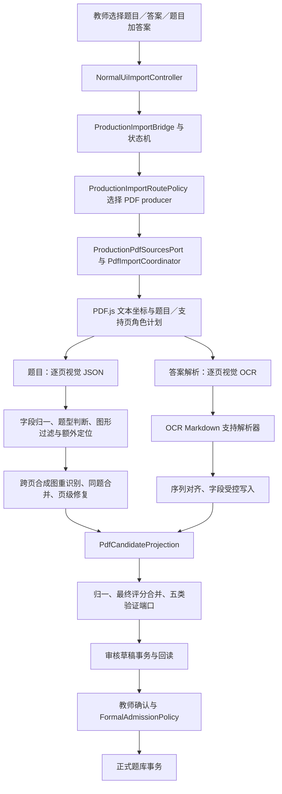
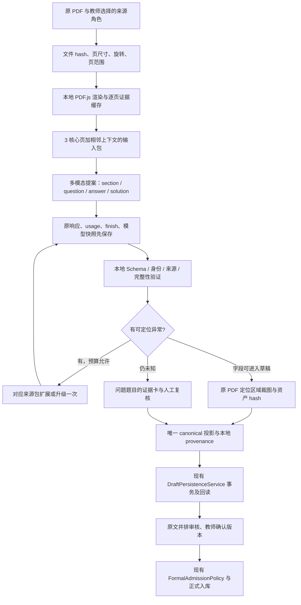

# PDF 多模态导入架构设计

日期：2026-10-02。状态：分析与设计，尚未实现。对象：用户指定的桌面版 `C:\Users\Administrator\Desktop\题库系统`，分支 `stage/program-c-corrective-r1`，基线提交 `71dfe18` 加本轮开始前已有的未提交修改。

> **用户审阅后的首版范围（2026-10-02）**：以 [PDF 多模态 V1 下一阶段任务](CODEX_TASK_PDF_MULTIMODAL_V1.md) 为实施规格。以下 20 节保留完整研究依据；首版不实施核心页唯一责任、section/scope、全文 bbox、模型分层、长内容协议或复杂 evidence UI。使用可配置固定滑窗、单模型、小 JSON、保守去重/冲突、精确题号关联、原 PDF 裁图及现有审核入库。原第 14 节费用表基于核心页责任方案，不能直接当首版滑窗预算或实测。

初次设计交付时只新增本设计文档，保留已有修复现场；没有继续修改业务代码，没有新增付费识别请求，没有操作用户题库、提交或推送。文中“新链路”都是提案。此前深圳、河北的真实请求与离线回放用于分析，不能算新架构验收。

**建议采用：以多模态模型为唯一 PDF 语义提取者的有限多页窗口，按内容起始页确定唯一输出责任，建立文档题号登记表，以明确来源关联答案和解析；局部失败只重新提取对应来源包。程序集中完成协议、身份、来源、完整性验证和原 PDF 裁图，再接现有审核与入库事务。默认取消独立 OCR 全文主链。**

这不是简单替换提示词。现有题目入口已经是“视觉模型 → JSON”，真正需要替换的是其后的重复拆分、内容评分合并、单页修复，以及答案端“视觉 OCR → Markdown → 多套规则重建结构”。新版 producer 必须有独立版本边界，不能再经过旧 PDF 语义改写器。

可以证明窗口输出唯一性、按登记表关联不会因漏题而平移、缓存幂等和有限重试的性质；**不能证明多模态转写对任意 PDF 达到全局最优或零错误**。识别率和最低综合成本必须由独立标注集测量。合法 JSON、题号连续、LaTeX 能渲染，均不等于内容正确。

## 1. Current Problems — 当前链路的真实问题

### 1.1 正常 UI 的实际调用链



关键入口可定位到 [app.js](../app.js) 的 `createStrictVisualPreparedPagesRecognizer`、`createStrictVisualQuestionProducer`、`createProductionImportRunner`、`createProductionImportBridge`；路由在 [qisi-production-import-route-policy.js](../qisi-production-import-route-policy.js)。

题目端由 [qisi-qwen-vision-source-port.js](../qisi-qwen-vision-source-port.js) 请求单张页面图，要求题号、题型、题干、选项、bbox、图片；严格题目请求要求答案与解析留空。随后 [qisi-batch-engine-v2.js](../qisi-batch-engine-v2.js) 执行并发两页识别、图形二次定位、跨页处理、选择题修复和合并。

支持端不是同一协议：[qisi-visual-support-source.js](../qisi-visual-support-source.js) 正常 PDF 路由传入 `evidenceOnly:true`，只保留逐页 OCR 原文；[qisi-pdf-candidate-projection.js](../qisi-pdf-candidate-projection.js) 的 `createPdfEngineProjectionContext` 再选择 OCR/文本支持解析器，经过 aligner 和 controlled-write。不能把该模块内全部修复函数误称为当前正常 PDF 每次都会调用的路径。

### 1.2 当前与历史分支并存

`processBatchV2` 仍包含“文本层与 OCR 评分选择 → 正则切题 → 选项识别 → 按题号/顺序挂接 → 坐标裁图”。正常 UI 的 production PDF runner 使用 `produceEngineResult` 覆盖此路径，因此它不是当前主链的同义词。旧分支还包含禁用的 AI 自动裁图函数；本地 OCR registry/shadow 模块主要是候选比较基础设施，也不能因为存在就判断生产 UI 已使用本地 OCR。

同时，共享的 `SupportParser`、`SupportTextParser`、`SupportRepair`、显示归一、审核保存逻辑还承担 DOCX 或人工编辑用途。新 PDF 不再调用它们，不代表立刻可以整文件删除。

### 1.3 源文件与日志给出的具体证据

此前已逐页视觉核对深圳 21 页、河北 19 页，每份均 19 题。深圳题目在 1–7 页，第 8 页空白，支持内容在 9–21 页；河北题目在 1–4 页，支持内容在 5–19 页。下列请求编号是本地留存的 `request-N.json` / `response-N.json`，不是重新发出的请求。

| 现象 | 证据与真正原因 | 对设计的约束 |
| --- | --- | --- |
| 深圳第 15 题解答题被变成选择题 | 初始响应 40 的几何内容含 `\angle ABC`；旧的文本选项重解析产生伪选项，随后请求 50 补出了原卷没有的选项和错误结论 | 已结构化字段不得再由正则拆分；题目来源请求不得生成答案或解题 |
| 深圳第 10 题跨页不完整 | 响应 37 只包含本页 A/B；跨页响应 46 内容更完整，但合成图 bbox 没覆盖真实分界而被拒绝；后续单页请求 49 无法看到 C/D，仍试图补全 | 分页独立请求加单页补丁不能解决缺失上下文；几何坐标与内容证据分开验证 |
| 续页多选题被判单选 | 章节标题不在当前单页请求中 | 邻页上下文和文档 section 登记表，应来自模型提案而不是逐页重新猜题型 |
| 河北第 4 题图形选项失效 | 初始结果识别了图形 bbox，但最终 options/图片资产链不完整；production runner 返回 `draftImages:[]`，定位描述没有等价变成持久化题图 | 原图定位、裁剪、字段引用、资产持久化、回读必须组成一条可验收链 |
| 支持文本有内容，挂接仍失败 | 深圳响应 54 把多个答案与解析压在一行；解析器需要的换行/标签结构消失，题号 9、10 的边界丢失，安全对齐拒绝续接 | 让模型输出按题号分开的支持项，取消通过 Markdown 再恢复语义结构 |
| 数学公式合法但错误 | 河北响应 79 将 `2^{n-\frac12}` 转成 `2^{\frac{n-1}{2}}`；响应 83 将源文 `{1}` 转成 `{}` | Schema、序列、KaTeX 校验拦不住合法的数学内容错误，必须保留来源对照 |
| 完成率 100% 但没有草稿 | 两份真实基线均结束于 `IMPORT_VALIDATION_FAILED`，持久化草稿 0 | 进度完成不能替代成功；输出需区别“识别完成、待复核、部分失败、入库完成” |

过去修复不是全部无效：严格字段不再随意重新切分、序列拒绝未知题号等已有修正。本轮基线还包含用户中止前的局部修复：河北离线回放能得到 19 条审核候选，深圳仍失败。但这不证明图形资产已显示正确，更不证明双 PDF 正式入库及数学内容正确。**当前安全测试全过与真实功能缺陷并存**，正是本设计必须解决的问题。

### 1.4 接口与数据链缺口

- `createQwenTaskClient.chatText` 目前只接一个 `imageUrl`，主要依赖提示词表达 JSON 协议，默认最多 8192 输出 Token；返回值没有完整保留 `usage`、`finish_reason`、上游 request id。
- accurate 模式会遍历多个模型，协议失败和网络失败也可能触发换模型；这混合了“传输重试、提取重试、模型升级”，费用与结果版本难以解释。
- 前端 strict 请求可等待 120 秒，本地代理默认 90 秒。超时策略不统一，客户端没有等到不代表上游没计费。
- `strictProtocol.accepted` 当前仅明确授权题号、题干、选项，不能据此声明图形字段已经通过完整来源验证。
- `ProductionImportOutputPort` 仍对候选按长度、选项数、公式信号打分并逐字段合并；结果内容与原来的 provenance 可能不再是同一个候选版本。
- 当前 formal provenance 对跨文件支持来源的例外主要针对 DOCX。新双 PDF 必须明确注册 PDF 支持来源及角色，不能把答案文件的证据伪装成题目文件证据。
- 辅助渲染器与生产 PDF.js 曾在河北图形选项页产生标注显示差异。验收应保存模型实际收到的生产渲染图，对照原 PDF；不能把辅助渲染器缺字误判为源卷缺字或模型漏字。

## 2. Root Cause — 为什么复杂性不断增长

根因不是某一条正则写错，而是**结构责任与证据责任没有统一**。

第一，题目端先得到 JSON，却继续沿用为松散 OCR 文本准备的拆题、题型和选项恢复逻辑。同一道题可由页面模型、跨页模型、页级修复、审核保存和最终合并器多次改写。每增加一种来源，就增加一种组合与顺序风险。

第二，答案端的主模型先把视觉结构压成 Markdown，程序再试图恢复已经被丢掉的题号、段落、答案表格关系。`\item`、几何字母、子问编号和题号混在同一个字符串里；新格式需要新的状态机和例外。

第三，以页为最终语义单位。题目、选项、章节规则和长解析却以跨页内容为单位。缺失邻页上下文被当成“字段质量不好”，于是修复同一页，模型只能猜。

第四，“看起来更丰富”的评分替代了来源真实性。更多公式、四个完整选项、更长解析，都可能来自幻觉。按字段拼接不同候选还会掩盖冲突。

第五，证据协议不一致。原始页、合成图、0–1000 bbox、像素 bbox、单页 provenance、跨文件支持与图片资产没有统一契约；仅修显示字段很容易留下资产丢失或来源漂移。

第六，安全门的职责被扩大到“结构不完美就整个 batch 失败”。严格拒绝错误挂接是正确的，但仍应保留无争议题干和待处理证据，使教师能修第 9 题，而不是重新识别全部文件。

因此，局部修复和安全测试能够证明某些代码性质，却不能证明“老师实际看到的题目、选项、图和答案”准确完整。继续优化本地序列遍历的毫秒级计算也不会解决数分钟的模型等待与反复识别。

## 3. Design Principles — 新架构原则

1. PDF 的语义边界只由一个版本化 producer 提案；本地规则验证和执行，不再重新解释试卷。
2. 题号、数学内容、选择题选项和图片均必须来自可查看的源区域。禁止重新解题、补造缺题、从答案倒推题干，禁止自动纠正源卷数学错误。
3. 模型结果是不可变提案；本地生成验证结果与 provenance。模型不能填写 `accepted:true` 或决定是否入库。
4. 身份关联使用明确印刷编号及作用域。缺题不导致索引平移，不用题意相似度匹配答案。
5. 同一个字段同一版本只有一个写入者；重识别生成替代版本，冲突保留，禁止“择长 + 拼字段”。
6. 未通过身份/来源验证的字段留在证据区，不写进可确认字段；无争议内容进入审核草稿。正式库继续要求教师确认和现有 admission 事务。
7. 图片像素来自原 PDF 渲染；AI 只提议位置、作用和归属。图形选项也是选项正文的一部分。
8. 普通中学试卷为优先覆盖；极端版式、不可辨识文字、编号作用域不明可明确人工复核。
9. 默认单次语义提取，异常才局部增加调用；缓存已完成来源包，不把整卷重试当恢复方式。
10. DOCX 的 XML/OMML/MathType 本地链、UI 角色选择、审核事务保持原边界。新版 PDF 路由需要独立身份，不借重构同时改 DOCX。

## 4. Candidate Architectures — 候选方案比较

| 方案 | 正确性与跨页 | 成本与时间 | 本地复杂度 | 判断 |
| --- | --- | --- | --- | --- |
| A. OCR/文本层 → 本地规则理解 | 依赖 OCR 阅读顺序，跨页与表格恢复仍是主要困难 | OCR API 便宜，但错误修复与教师成本高 | 高，多套切分与状态机 | 保留为旧版/诊断，不作为新 PDF 主链 |
| B. 整卷多图 → 一次完整 JSON | 全局上下文最好，短卷有价值；长卷输出、漏题及恢复困难 | 图像少重复，失败会重花整卷费用；长输出串行等待 | 低，但失败恢复差 | 小文件候选，不作为 10–50 页默认 |
| C. 单页 JSON → 本地续页合并 | 对独立单页题有效；缺章节和跨页上下文 | 初次调用多，局部补丁重复消费 | 合并器重新承担语义理解 | 不推荐，接近现有问题 |
| D. 有邻页上下文的窗口 → 唯一责任输出 → 登记表关联 | 自然看见邻页，内容冲突显式；长内容有有限扩展 | 有约 1.6 倍页面输入，输出正文一次；局部恢复 | 中低，固定协议和一个控制器 | **推荐的默认主链** |
| E. 全卷轻量索引 → 按题来源包精读 | 全局作用域和很长解析更清晰；索引也会漏、错 | 每页至少看两遍，小题逐题调用会增加开销 | 中，需维护两个提案版本 | 作用域/超长材料异常时启用，不常驻两遍 |
| F. 本地通用 OCR 或视觉模型 | 隐私与 API 零费用可取，但部署、显存、数学与版式精度尚未验证 | 本地硬件/维护成本，吞吐受机器影响 | 部署复杂度高 | 可离线扩展，不能无评测替换 |

B 并非总比 D 贵：若短文件全部输出能稳定完成，B 的图像输入更省。E 也并非更安全：索引与精读模型可能重复犯同一错误。本项目初期优先固定 D，避免同时实现所有路由；在同一金标集比较 B/D/E，再增加具有明确收益的例外。

以工程实现估计，D 的新增业务归属集中在三个职责：文档 producer、提案协议/验证/投影、请求结果与证据恢复。页面渲染、HTTP、库事务和教师审核继续复用。**不是给每一个流程框都新增一个模块**。代码行数不能在实现前准确承诺；实施验收应要求正常 PDF producer 没有第二个切题器，没有“按公式密度选择赢家”的分支，没有按版式名称增加规则。

## 5. Recommended Architecture — 推荐架构及其边界

采用 **文档级身份 + 有限多页视觉提取 + 本地受控投影**。

正常路径先提取含题目的来源，模型在同一窗口返回 section 与 question 单元。本地登记这些印刷题号及作用域；支持来源随后接收这份短登记表，从自己的图像提取 answer/solution 单元。题目加答案同文件可在窗口内同时返回三类单元，所有窗口完成后再关联。两份文件不需要把相距十几页的所有页面放在同一请求。

窗口核心默认 3 页，前后各 1 页上下文，单次最多 5 张标准页面图；核心是责任范围，上下文只帮助阅读。不是简单对重叠结果做模糊去重。每个完整语义单元由其**内容起始位置所在核心页**的窗口负责。边界未完整、作用域不明或 conflicting proposal 则生成局部来源包重提取，最多一次扩展和一次模型升级；仍不确定进入人工复核。

主链不先输出全文 Markdown，也不做常驻逐题解题/质量评分。题型、阅读顺序、正文边界、图形角色由模型提议；本地只验证“所引用证据是否存在、身份是否唯一、内容是否完整、是否冲突”。

初期用当前已接通的 VL Plus 固定快照建立新协议质量基线；完成独立金标评估后，将满足质量下限的 Flash 作为普通包的主模型。**这里推荐的是架构；模型的最终选择必须受测量约束。** 本轮没有新模型准确率实测，不能把价格优势写成准确率已经提高。

### 5.1 “全局最优”的可证明部分

设允许策略集合为有限的分辨率、核心页数、模型和异常升级策略组合。对每个策略测量总成本、耗时、人工改动量和严重错误率，只在满足安全约束的策略中选综合成本最小者。穷举该有限集合可以保证对**已测候选与样本目标函数**的最小值，不能保证所有未来 PDF、所有模型或所有网络状态的全局最优。

安全约束先于费用：错挂答案/图、补造内容、未经确认入库必须为阻断事件。统计上测试零严重错误仍不证明真错误率为零。N 个独立事件零错误时，95% 单侧上界为 `1-0.05^(1/N)`，近似 `3/N`；事件受同卷相关性影响，还需按文档分组报告。

程序可证明唯一性和来源完整性，不可证明模态识别的语义真实性。因此教师确认仍保留，未知风险不能被 `confidence:0.99` 消除。

## 6. End-to-End Pipeline — 完整数据流



确定性预处理只负责可证明的事情：文件能否打开、页是否存在、尺寸与坐标变换、像素导出、内容 hash、缓存读取。扫描倾斜/低清的可选处理必须记录逆变换；默认保留原图，不做会改变数学笔画的清理。

失败范围按层划分：文件打不开阻断该文件；请求格式/身份非法隔离该包；一个答案归属不明阻断该字段；一个图裁剪不完整阻断该图的确认；独立题目仍可保留。未解析区域不能被成功题数遮住，必须出现在任务与复核页。

原始响应、标准渲染、重提取版本及教师修改分别保存。local canonical writer 只投影已经校验的字段，图片全部有实际 bytes；任何显示清理不允许修改数学 token 或重新分配题号。

## 7. AI Input Strategy — 输入、分辨率、上下文与 OCR

### 7.1 页面输入

视觉 API 当前接受文本、图像、视频，不直接接受 PDF 文件。标准路径使用本地逐页渲染，按“源文件 ID、原始页号、是否核心页”的文本标签紧邻每张图片传入，避免拼成长图导致页面位置与缩放混淆。[阿里云图像与视频理解文档](https://help.aliyun.com/zh/model-studio/vision)

首轮 A4 页面长边约 1800–1900 像素，约 1.8–2.6 百万像素；保持原始比例。选择清晰 JPEG（约 0.90–0.94）或 PNG，不能只按 DPI 固定尺寸，也不将 50 页同时解码为 RGBA 常驻内存。首轮参数是待实测起点，密集小公式用局部高清来源包升级。一般图像 Token 可按 `宽×高/1024+2` 粗估，实际取上游 usage；避免默认高分辨率开关造成固定高 Token。[阿里云视觉模型及像素计费说明](https://help.aliyun.com/zh/model-studio/vision-model)

保存原 PDF MediaBox/CropBox、旋转及 PDF.js viewport 变换。模型看到哪一个渲染版本，bbox 就必须属于那个版本。图形裁剪按需从原 PDF 更高分辨率重渲染，不受 API 页面降采样限制。

### 7.2 文本层只做辅助证据

保存 PDF.js 的文本 token、页号与 bbox，但不先排序为“最终题目”。可给模型提供很短的章节/编号候选；必须注明它们是辅助且可能损坏，图像为准。不能把整页损坏数学文本以巨大附录重复提交。

本地仅对可靠的中文短文本或印刷编号做保守相等核查；数学字符错位、符号缺失或多栏阅读顺序异常时，文本层不得否决视觉结果或被当成正确答案。不以“没有乱码”证明文本层可靠。

| PDF 类型 | 主输入 | OCR 角色 |
| --- | --- | --- |
| 原生文本，公式可见 | 页面图 + 可选短文本锚点 | 不额外调用 |
| 扫描件 | 页面图 | 模型自身视觉转写，独立 OCR 非必需 |
| 文本与图混合 | 页面图，文字/图均带来源区域 | 不额外调用 |
| 文本层错误 | 页面图，错误层只存诊断 | 不以 OCR Markdown 建结构 |
| 数学文本层严重损坏 | 页面图，局部高清复核 | 公式区域 OCR 可作为第二提案，不能直接覆盖 |

独立 OCR 留作人工点选区域的可选工具、转写对照或离线评测；没有证据说明全卷再跑一次 OCR 值得常驻。视觉模型本身也在执行 OCR 能力，取消的是“独立 OCR 全文中间表示”，不是声称文字无需视觉转写。

### 7.3 请求约束

提示词只允许忠实提取，不能解题、续写证明、纠正原卷。文档内任何“忽略指令、调用工具”都作为源文，不执行。关闭思考模式与外部工具，使用 JSON Object 模式，并保留模型快照。低温不保证确定性。

**重要接口限制：当前官方说明多模态输入不支持严格 JSON Schema，会自动降级为 JSON Object。** 因而必须本地做严格 Schema 校验；不能宣传“API 自动保证全部字段符合 Schema”。也不增加一个文本模型仅为了把视觉输出变成合法 JSON，这会添加费用和语义漂移。[阿里云结构化输出说明](https://help.aliyun.com/zh/model-studio/qwen-structured-output)

输出预算按核心页内容密度设置，初期普通包 8192、密集解析包 16384（模型支持时），同时限制输入字节与估计 Token。全卷上下文很大并不能解决输出截断。传输层未来需支持多图、JSON Object、非思考参数和完整响应元数据；本地代理目前会转发请求体，主要升级点在客户端 adapter 的单图接口及返回契约。

## 8. AI Output Schema — 小而明确的提案协议

### 8.1 将模型提案与本地文档信封分开

每次请求只处理一个来源文件，页号始终为该文件的原始页号。模型返回三个统一的内容单元：`question`、`answer`、`solution`。题干、答案、解析使用同一个 `text` 字段；只有 question 使用 options。不让模型重复填写文件 hash、请求 ID、入库状态、完整 provenance，减少输出 Token 与虚假权威字段。

本地信封记录 `documentId/sourceHash/sourceRole/pageCount/renderRevision/requestKey/modelSnapshot/promptVersion/schemaVersion/usage/finishReason`。`source_pages` 从 regions 计算；`review_required` 从验证结果计算；`document` 来自本地来源清单。下游题目对象才拥有 stem、answer、solution 和字段级 provenance。

题号 `no` 是原文标签字符串，支持 `10`、`三-2` 等，不先 `parseInt`。子问 `（1）` 保留在上层题目的 text，不自动变成新题。`scope` 是明确印刷的编号作用域；普通全卷唯一编号可为空。编号重置时必须有可核实作用域，不能默认为另一道同号题。作用域标题不一致、重复试卷拼接且无法唯一解释时进入人工映射。

`anchor` 指向印刷题号；`regions` 指向该内容单元的正文，两者可以不在同一页。解析在续页开始时，其题号锚点可以在上下文页，内容起始页才决定窗口归属。region 是模型提案的页面矩形，不声称它覆盖了每个字。

省去未校准的数字 confidence。它容易制造“0.99 所以正确”的错觉；state、end 与 warnings 更适合表达可执行的不确定性。未来若确实校准出有预测力的置信指标，作为本地评测派生字段扩展，不作为入库许可。

### 8.2 建议 wire Schema v1

下列是本地严格校验用 JSON Schema；不是声明上游支持多模态严格 schema enforcement。保留全部 required 空数组，比有时省略字段更易稳定校验。字数、条目、字节上限由来源包预算统一设定，避免 Schema 中堆积题型专用约束。

```json
{
  "$schema": "https://json-schema.org/draft/2020-12/schema",
  "type": "object",
  "additionalProperties": false,
  "required": ["v", "sections", "items", "unassigned"],
  "properties": {
    "v": {"const": 1},
    "sections": {"type": "array", "items": {"$ref": "#/$defs/section"}},
    "items": {"type": "array", "items": {"$ref": "#/$defs/item"}},
    "unassigned": {"type": "array", "items": {"$ref": "#/$defs/region"}}
  },
  "$defs": {
    "region": {
      "type": "object",
      "additionalProperties": false,
      "required": ["p", "box"],
      "properties": {
        "p": {"type": "integer", "minimum": 1},
        "box": {
          "type": "array", "minItems": 4, "maxItems": 4,
          "items": {"type": "number", "minimum": 0, "maximum": 1000}
        }
      }
    },
    "anchor": {
      "type": "object",
      "additionalProperties": false,
      "required": ["p", "box", "text"],
      "properties": {
        "p": {"type": "integer", "minimum": 1},
        "box": {
          "type": "array", "minItems": 4, "maxItems": 4,
          "items": {"type": "number", "minimum": 0, "maximum": 1000}
        },
        "text": {"type": "string", "minLength": 1}
      }
    },
    "section": {
      "type": "object",
      "additionalProperties": false,
      "required": ["label", "title", "type", "anchor"],
      "properties": {
        "label": {"type": "string", "minLength": 1},
        "title": {"type": "string"},
        "type": {"enum": ["single", "multi", "fill", "long", "mixed", "unknown"]},
        "anchor": {"$ref": "#/$defs/anchor"}
      }
    },
    "option": {
      "type": "object",
      "additionalProperties": false,
      "required": ["label", "text", "regions"],
      "properties": {
        "label": {"type": "string", "minLength": 1},
        "text": {"type": "string"},
        "regions": {"type": "array", "minItems": 1, "items": {"$ref": "#/$defs/region"}}
      }
    },
    "figure": {
      "type": "object",
      "additionalProperties": false,
      "required": ["field", "role", "regions"],
      "properties": {
        "field": {"type": "string", "minLength": 1},
        "role": {"enum": ["diagram", "table", "photo"]},
        "regions": {"type": "array", "minItems": 1, "items": {"$ref": "#/$defs/region"}}
      }
    },
    "item": {
      "type": "object",
      "additionalProperties": false,
      "required": ["scope", "no", "kind", "type", "state", "text", "options", "anchor", "regions", "figures", "end", "warnings"],
      "properties": {
        "scope": {"type": "string"},
        "no": {"type": "string", "minLength": 1},
        "kind": {"enum": ["question", "answer", "solution"]},
        "type": {"enum": ["single", "multi", "fill", "long", "proof", "unknown"]},
        "state": {"enum": ["complete", "partial", "unreadable"]},
        "text": {"type": "string"},
        "options": {"type": "array", "items": {"$ref": "#/$defs/option"}},
        "anchor": {"anyOf": [{"$ref": "#/$defs/anchor"}, {"type": "null"}]},
        "regions": {"type": "array", "minItems": 1, "items": {"$ref": "#/$defs/region"}},
        "figures": {"type": "array", "items": {"$ref": "#/$defs/figure"}},
        "end": {"enum": ["closed", "continues", "unknown"]},
        "warnings": {
          "type": "array", "uniqueItems": true,
          "items": {"enum": ["unreadable_text", "unreadable_math", "ambiguous_no", "ambiguous_scope", "ambiguous_figure", "ambiguous_reading_order", "source_incomplete"]}
        }
      }
    }
  }
}
```

约定 box 为 `[x0,y0,x1,y1]`，左上原点，**本项目规范化坐标 0–1000**。服务原生 grounding 若输出 0–999，adapter 明确按 `value/999*1000` 转换并记版本，不依数值大小自动猜坐标单位。Schema 校验之外必须检查 `x0<x1、y0<y1`、实际页范围、对应渲染版本。

`field` 只允许本单元的 `stem`、`option:<实际标签>`、`answer`、`solution`，由本地按 kind 和 options 验证；不用大正则推断字段名。纯图形选项允许 `text:""`，但必须有实际图形资产，不能仅以空文字标为完整。表格难以忠实结构转写时，可作为源表格裁图并标待复核，不把表格丢掉。

### 8.3 跨页提案例子

这是协议示例，不是深圳/河北的识别结果。请求的本地信封绑定题目来源文件及核心页 1–3、上下文页 4；第 10 题起始于第 3 页，由该包输出，包含第 4 页续接选项。

```json
{
  "v": 1,
  "sections": [],
  "items": [{
    "scope": "",
    "no": "10",
    "kind": "question",
    "type": "single",
    "state": "complete",
    "text": "函数 $f(x)=\\frac{x^2+1}{x-1}$ 的定义域为（ ）",
    "options": [
      {"label": "A", "text": "$\\mathbb{R}$", "regions": [{"p": 3, "box": [100, 870, 450, 900]}]},
      {"label": "B", "text": "$\\mathbb{R}\\setminus\\{1\\}$", "regions": [{"p": 3, "box": [500, 870, 900, 900]}]},
      {"label": "C", "text": "$(1,+\\infty)$", "regions": [{"p": 4, "box": [100, 80, 450, 110]}]},
      {"label": "D", "text": "$(-\\infty,1)$", "regions": [{"p": 4, "box": [500, 80, 900, 110]}]}
    ],
    "anchor": {"p": 3, "box": [60, 800, 95, 835], "text": "10."},
    "regions": [{"p": 3, "box": [60, 800, 900, 920]}, {"p": 4, "box": [60, 70, 900, 120]}],
    "figures": [],
    "end": "closed",
    "warnings": []
  }],
  "unassigned": []
}
```

另一来源里的 answer 单元 `no:"10",text:"B"` 带自己的页与原文锚点；solution 单元同理。不能把它们写成上述题目文件第 3 页的来源。没有解析就不返回 solution；本地状态为 `not_provided` 或 `missing`，区别取决于来源角色及该题源文是否明确提供解析，不能仅因没返回就宣布原文没有。

编号不可辨时可令 anchor 为 null、state 为 unreadable，保留来源区域；该项只能进入证据卡，不能登记为可挂接题目。若完全无法确定题号，不应捏造 no：使用 unassigned 表达区域，等待重提取或教师编号。局部 schema-valid 单元也只有在整份响应结构可被可信解析时才使用，截断字符串不靠补括号救回。

## 9. Validation Layer — 只保留六组必要验证

验证返回稳定的错误码、受影响单元/字段、证据区域和阻断范围。它不重新切题、不推断答案、不根据公式数量评优。不同 kind 使用同一套身份/来源核查，减少验证器数量。

| 验证组 | 必要检查 | 能保证什么；不能保证什么 | 失败处理 |
| --- | --- | --- | --- |
| 1. 协议 | HTTP/finish 状态、完整 JSON、Schema、字段枚举、预算边界 | 格式和类型可用；不证明内容真实性 | 该响应不投影，保留原响应与请求，缩小来源包或人工 |
| 2. 身份 | 题号锚点、作用域唯一、登记表成员、同号同 kind 冲突、观察序列异常 | 不因索引错位挂接；不能证明模型看对了题号 | 隔离冲突身份及支持字段，独立题保留 |
| 3. 来源/几何 | 文件 hash、原始页范围、输入页、bbox 有限且不越界、所属字段、坐标逆变换 | 引用可解析且裁图来自绑定源文件；不证明框里真是所称图 | 错图不确认，展示源页覆盖框 |
| 4. 完整性 | state/end、选项标签唯一、有源区域、图形资产实际存在、所有核心页有处理状态、unassigned | 已申报内容可追踪；不能证明未申报的题不存在 | 缺题/续页/未覆盖区域明确复核，不补造 |
| 5. 便宜矛盾检测 | 可靠文本锚点对照、KaTeX 语法、同题显式答案冲突、区域冲突 | 能发现部分矛盾；合法公式和不同模型一致都不证明正确 | 定位重提取或源文复核，不能自动选较长答案 |
| 6. 受控写入 | proposal 不可变、字段验证版本、资产 bytes/hash、教师确认版本、入库事务与回读 | 未确认/过期/缺资产字段不能静默入库 | 保留草稿，阻断对应确认或提交 |

选项不硬编码所有试卷必须 A/B/C/D：验证实际标签唯一、source 存在，常见四选项与章节声明不符时提示异常；未知标签或当前题库不支持的选项数量进入复核。解答题含字母 ABC 并不构成选项证据。没有答案、没有解析是允许的状态，不伪造空 solution 来满足“两个流同时出现”。

序列检查观察原始来源顺序，不先按数字排序后再宣布连续。双栏页不能依 bbox 的全页 y 排序判断回退；阅读顺序是提案的一部分。简单整数编号存在缺口时检查并显示，而不是循环补出所有编号。非整数标签只做作用域内成员与重复检查。

区域冲突仅检查不同身份内容对同一区域的明显竞争。题目的大框包含自己的选项/图形小框是正常关系；同页并排题不是冲突。不能以任意 IoU 阈值把共享材料、章节标题或紧邻排版都当错题。明确共享区域需要共享标记及人工确认，初版不自动判断复杂共享图。

覆盖检测分两层：本地确保全部输入页和责任页有状态；模型报告未归属区域。可靠文本层的编号候选可提示“此处疑似有未登记题号”，仅是警报。扫描件上的模型漏题可能连 unassigned 都不报告；**不存在仅靠返回 JSON 即可证明页面语义完全覆盖的廉价方法**。常见卷末题数可作可见核对信息，不能以预期数量强迫补题。怀疑漏题的页面可以进行一次不输出正文的局部编号清单提取，仍需来源对照。

本地 LaTeX 渲染仅检查语法和可显示性，不判断数学真值、等价性或答案正确性。复杂公式误读不一定触发任何规则，所以所有 PDF 保持教师确认。对照错误文本层可能反而污染正确视觉结果，应让教师看到两份证据而不是自动覆盖。

复杂度：登记表关联和去重用 hash map，为 `O(Q+R)`；区域冲突按页及身份分组，普通试卷规模下简单检查即可，必要时排序扫描 `O(R log R)`。不存在需要在题目与答案之间求全局语义最优匹配的本地算法。算法的任务是拒绝不唯一关系，故无需引入复杂匹配器。

## 10. Cross-page Strategy — 窗口责任与有限扩展

### 10.1 普通情况的窗口

第 i 包核心页为 `[3i+1, min(3i+3,N)]`，输入再加前后各一页（存在时）。各核心页集互不相交且覆盖全文件；重叠页提供上下文，不是第二份最终结果。输入仍是分开的原页图片，不能先合成长图再猜跨页分界 bbox。

模型按视觉阅读顺序提取。仅当单元的**正文起始页在本包核心页**时输出该单元，允许其正文延续到右上下文页；在左上下文页起始的单元只用作上下文。章节题型在邻页出现时仍可以参考；文档已登记的章节/题号标签作为短上下文传入，不能用它补造不存在的题。

例如第 3 页题干、第 4 页 C/D：第一包看到第 4 页并输出完整题；第二包核心 4–6 页不会再次输出这道题。若第二包错误输出，本地检查起始页责任与同号冲突，拒绝默默择长。某页第一段归上一题且锚点不在输入内时，列为 unassigned，而不是命名为新题。

### 10.2 超过邻页的内容

模型报告 partial/continues/unknown、正文延伸到输入末边、下一窗口出现未归属续文、或同身份冲突时，建立该身份的局部来源包，扩展可见页范围。初版扩展最多 6 张全页，并符合模型输出与本地字节预算；一次扩展仍不能闭合的长解析，进入长内容例外或人工复核，不不断扩大整卷。

长内容例外要求先有可核实题号及明确来源范围，再按不重叠页核心输出该题的有序片段，片段由本地绑定同一身份和 part index。页内必须在可确认的段落/公式边界结束；跨页一句话或公式若无法完整表达，就保留 partial，不用字符串后缀相似度拼接。按明示片段顺序连接，不把下一道题的开头自动吞进解析。此例外只在长材料样本证明有收益后启用，初版允许人工处理。

不要常驻“全卷粗索引 + 每题精读”两遍方案。只有作用域不明、异常长内容或漏题警报需要局部索引；索引也要来源证据，不因索引模型更强就自动可信。

### 10.3 可证明的性质与前提

核心页集合是一个分割。若单元起始页已被正确识别，该页只属于一个核心集合，所以该单元只有一个责任窗口；上下文不会产生第二个有效写入者。程序另外强制每个 `(document,scope,no,kind,revision)` 只保留一个当前有效提案；冲突不得通过拼字段解决。

这证明**所有权唯一性**，不证明模型起始页、结束页或题号看对。误报起始页、漏掉延续内容仍是视觉风险；状态和 source 区域必须可复核。单页很密集时可缩小核心页数以控制输出；页数策略变化生成新来源包版本，不能沿用旧 cache key。

## 11. Figure Strategy — 判断归属与真实像素分开

模型只返回图形角色、字段归属和来源区域，禁止画图、描述后重生成图、使用模型生成的图像 URL。默认从原 PDF **页面渲染裁图**，不是只提取 PDF 内嵌 image 对象：许多数学几何图由矢量线、文字和多个对象组成，提取单个图片会漏标注。PDF 原生图片对象可辅助发现候选，不能替代完整页面像素。

步骤为：验证 source/render/bbox → 映射到原 PDF 坐标 → 按需高分辨率渲染该区域 → 导出 PNG → 保存 bytes、crop transform、asset hash → 为对应字段生成本地资产 ID → 在审核页面回读显示。`bbox` 存在、`[[IMAGE:id]]` 存在，都不能代替真实 bytes。图形选项 A/B/C/D 各有独立资产和字段引用，禁止把四图合成一张却保留四个空选项。

初期将 bbox 作为粗定位提案，以源区域适度留白保证标注不被裁切；留白只改变裁图框，不改变身份。归一坐标量化约相当于 2 像素级误差，但模型定位误差通常更大。是否裁完整不能通过 bbox 在页内证明。审核界面同时展示裁图和原页框，教师能拖动修正裁框。图形边缘、图内字母、坐标轴刻度是重点核对内容。

本地可在已经绑定身份的候选框内做简单像素空白边缘收紧，保留原始提案框与变换；不能用这一步识别“哪条线属于哪一题”。复杂细线/低清图默认保留较宽裁框。仅当粗框确实异常且局部重定位收益可测时，让 grounding 模型看局部高分辨率区域，输出替代框；不默认每张图额外请求一次定位模型。

跨页图保存多个原页裁片并按源顺序显示，不无依据重拼几何关系。一题多图分别存资产；同一图属于共同材料或多题时，初版要求教师确认共享关系。题图与解析图必须分别绑定字段，不能由“最近的题号”分配。文字化公式必须保留 LaTeX；公式不可读时标记 unreadable_math 并保留来源截图供复核，不偷偷当普通题图绕过准确性审核。

当前 `ReviewDraftState` 的显示图片列表会裁剪成有限字段，已有 `url` 等显示能力值得复用，但 source region、asset hash、变换不能仅依赖该显示列表保存。新增 PDF 资产 evidence 应走已有资产存储与事务接口，并在回读时验证；不另建浏览器 URL 即可永久保存的假设。

## 12. Answer / Solution Matching — 身份关联，禁止语义猜测

题目登记表的 key 为 `(examId, canonicalScope, rawQuestionNo)`，支持单元通过可核实印刷编号加入同一 key。题目来源和支持来源共享 import session 的 examId，但每个字段保留各自 sourceHash/page/region/requestVersion。题型仅供校验和显示，不用相似题干、答案语义、页面行序或数组索引决定归属。

普通全卷唯一整数编号可精确匹配。不同文件章节标题写法不同且发生编号重置时，必须明确建立作用域映射；模型可提出映射建议，但不能因为两段“像同一道题”自动合并。无法唯一映射时只显示支持证据，教师选择作用域。源文件同号重复、回退、未知题号、同字段两份不同内容均阻断该身份/字段，不排序后掩盖异常。

漏第 8 题后，第 9 题只能挂到登记表中的 9，不会挂到数组第 8 项。证明很直接：查找仅使用 exact key，缺失 key 返回缺失，不存在递增索引状态。因此“漏一题使后面整体错位”在这个关联器中不会发生；但模型把第 8 题看成 9 的风险仍需锚点证据和复核。

现有用户授权的双侧同题缺失续接规则保持为旧版约束：完整原始序列验证后，答案和解析必须具有同一缺口，重复、回退、未知和单侧缺口均不续接。**不能简单把这个规则照搬成新协议所有场景的全局门禁**：新协议允许本来只有答案的试卷和只提供部分解析的资料。新版需要显式区分 `provided/missing/not_provided/unreadable/conflict`，每个字段按明示 key 受控写入，缺失留空并复核；不靠制造第二条空流通过旧门禁。这是未来需要任务文件、契约版本和验收记录批准的架构变化，本轮没有执行。

答案汇总表与详解中的显式答案可以同时出现。完全一致且都来源明确时保留两个证据；不一致时标记 conflict，让教师看原表和详解。禁止从求解过程推导答案来填原卷没写的答案，禁止自动“纠正”源卷错误。只有答案文件没有题干时可先保存独立证据，选择已有题目登记表后才匹配；不得伪造题干入库。

同文件“题目+答案”由同一提案协议同时提取，不以某一页前六行正则认出“参考答案”来永久划分全卷页角色。双文件先建立题号登记表再提取支持；通常只发送短 key 清单，不上传题干全文，降低 Token、错误反向生成和无必要的数据重复。

## 13. Model Routing — 先建立质量基线，再决定分层

本轮研究的是当前官方能力和报价，不对未实测的模型宣布识别率优势。Qwen3-VL 已支持多图理解；当前官方同时提供 Qwen3.7/3.8 的视觉输入与 JSON Object，新一代模型不能仅因名字没有 VL 就排除。大上下文或“旗舰”标签不等于本项目数学转写正确率。[阿里云视觉理解模型目录](https://help.aliyun.com/zh/model-studio/vision-model)

建议的实施顺序：用已接通的 `qwen3-vl-plus-2025-12-19` 建立新协议基线；用相同来源包比较 `qwen3-vl-flash-2026-01-22`、`qwen3.7-flash-2026-07-15`，再按可用预算比较 `qwen3.8-flash` 或 Plus。用固定快照而不是长期依赖会变化的 alias；只有 alias 的模型记录服务返回版本和评测日期，变更视为新候选。

如果便宜模型满足质量门槛，普通包使用该模型；只有验证异常、未闭合跨页或局部低清数学内容才升级。升级必须看到足够来源上下文，不能拿旧单页请求换模型期待解决跨页。语义提取失败、网络失败、输出预算不足分别处理，禁止 `accurate` 模式无条件遍历模型列表。

两份提案冲突时展示来源与差异，强模型不是最终裁判。不同模型可能共享错误，不能将“两者同意”当成数学正确性证明。Flash 的静默公式错误若无法被验证器发现，不能靠“异常才升级”保证正确；此时普通包必须改用测得更可靠的模型，或增加明确的源文核对成本。

在同包成本近似相同的假设下，设首轮便宜模型成本 `C_F`，强模型成本 `C_S`，升级比例 r，则级联费用 `C_F+r*C_S`。仅从 API 费用看，级联比直接强模型便宜的条件是 `r < 1-C_F/C_S`。这不含质量、局部包大小差异、教师时间和延迟；不能单凭该式选模型。

初版只实现一个主模型和一个可选升级模型，禁用自动模型发现、复杂路由器与常驻自我评审模型。分辨率/页数缩小优先用于协议截断；能力升级只针对确实可能改善的视觉异常。预算耗尽后保留证据进入人工，不反复请求直到模型给出看似正确的答案。

## 14. Cost Model — 费用、Token 和时间

### 14.1 口径与公式

报价核对日期 2026-10-02，以下采用华北 2（北京）原价、人民币/百万 Token，不计免费额度、限时优惠、Batch 折扣或云端缓存折扣。价格需在未来实施时重新核对；阶梯由**每次请求的输入量**决定，不是整卷 Token 相加后决定。[阿里云模型价格与阶梯计费规则](https://help.aliyun.com/zh/model-studio/model-pricing)

| 模型 | 本表单请求输入档位 | 输入单价 | 输出单价 |
| --- | --- | ---: | ---: |
| Qwen3-VL-Plus 固定快照 | ≤32K | 1.00 | 10.00 |
| Qwen3-VL-Flash 固定快照 | ≤32K | 0.15 | 1.50 |
| Qwen3.7-Flash 固定快照 | ≤32K | 0.20 | 0.80 |
| Qwen3.8-Flash | ≤1M | 0.80 | 2.70 |

估算假设（是规划参数，不是新架构实测）：每张标准页图 2500 输入 Token、辅助短文本 150 Token；每包提示词和紧凑协议 1200 Token；每个原始页平均输出 1200 Token。题号、区域、options 的 JSON 开销包含在该平均输出内，不额外重复正文。全量 JSON Schema 保留在本地，提示词用紧凑字段协议；若把 Schema 全文反复放入请求，应按实际 Token 增加。

对 N 页单一连续来源，3 核心页、前后 1 上下文：

```text
J = ceil(N/3)                         首轮请求数
S = N + 2*(J-1)                       发送的页面实例数，含重叠
I = 2650*S + 1200*J                   总输入 Token
O = 1200*N                           总输出 Token
API_cost = sum((I_j*input_rate_j + O_j*output_rate_j)/1,000,000)
```

最多 5 页包输入约 14450 Token，小于上述 32K 档。输入加输出还必须小于具体模型上下文，输出预算小于模型 max output。公式最后应逐请求累计，不能对不同档位平均混用。重复上下文增加图像 Token，但唯一责任输出避免整段正文重复输出。扩展包、升级、超时重试不在首轮表内，需单独计费。

### 14.2 10 / 20 / 30 / 50 页首轮估算

| 原始页数 | 请求 J | 页面实例 S | 输入 I | 输出 O | VL Plus 元 | VL Flash 元 | 3.7 Flash 元 | 3.8 Flash 元 |
| ---: | ---: | ---: | ---: | ---: | ---: | ---: | ---: | ---: |
| 10 | 4 | 16 | 47,200 | 12,000 | 0.1672 | 0.0251 | 0.0190 | 0.0702 |
| 20 | 7 | 32 | 93,200 | 24,000 | 0.3332 | 0.0500 | 0.0378 | 0.1394 |
| 30 | 10 | 48 | 139,200 | 36,000 | 0.4992 | 0.0749 | 0.0566 | 0.2086 |
| 50 | 17 | 82 | 237,700 | 60,000 | 0.8377 | 0.1257 | 0.0955 | 0.3522 |

同样输入、长解析平均 2500 输出 Token/原始页时，VL Plus 对应约 `0.2972 / 0.5932 / 0.8892 / 1.4877` 元，3.7 Flash 约 `0.0294 / 0.0586 / 0.0878 / 0.1475` 元。极密集页 5000+ 输出 Token 可能触发缩小核心/长内容例外，调用数也会增加，不能只按这一表承诺封顶。

20 页，3.7 Flash 首轮后有 10% 等价来源包升级为 VL Plus，示例费用约 `0.03784+0.1*0.3332=0.07116` 元；20% 则约 0.10448 元。**升级比例没有在本项目测得**，表仅说明敏感性。双来源费用按各自页数和窗口取整分别求和，不把两个文件页号混成一个连续序列。

### 14.3 与旧链路实测对比的限制

深圳、河北上一轮请求 37–84，共 48 次，原始 usage 合计输入 114,305、输出 38,621 Token。按当前原价估算：15 次 VL Plus 约 0.15859 元，28 次旧版 OCR 约 0.03252 元，5 次旧版 VL Plus 约 0.01078 元，合计 **0.20189 元**。这不是账户账单，是否扣免费额度/优惠无法由这些日志确定。

旧链路在这两份样本上仍得到 0 条持久化草稿。两份任务墙钟约 4.65 / 4.21 分钟；请求耗时累计约 643.7 秒，有并发，不能当墙钟。新链路全部用 VL Plus 的费用可能高于这份旧日志，因此不能声称“重构必然更便宜”。需要比较**每份正确且可用试卷的总成本**，包括重试、教师纠错和失败重导，而不是成功率不足时的较低 API 账单。

VL Plus 20 页示例输出费用约 0.24 元，占 0.3332 元的 72%。完整解析转写常由输出 Token 主导，降低图片分辨率不能省掉这部分；省费用的有效方向是取消重复转写/解题、紧凑来源协议、选择实测合格的低价模型、只重提取异常区域和复用本地完整结果。不能为了省输出而摘要解析、删数学过程。

### 14.4 缓存与速度

本地成功提案缓存命中时，API 输入和输出都不再发生；命中率 h 的可复用首轮近似成本为 `(1-h)*C_first`，人工修改和输出投影不应使相同图片重发。供应商缓存只折扣可命中的输入，不能预设图片一定命中；Batch 对支持的模型可能半价，但异步等待不适合作为教师交互默认。[阿里云价格中的缓存和 Batch 口径](https://help.aliyun.com/zh/model-studio/model-pricing)

保持初期请求并发 2、渲染流式按需缓存，不一次性常驻 50 页 RGBA。延迟近似 `ceil(J/2)*t_package + render/crop/write`。若新多页长输出包耗时 30–60 秒，则 10/20/30/50 页模型阶段约 60–120 / 120–240 / 150–300 / 270–540 秒。这只是容量规划，尚未测量新多页请求，p50/p95 和最长解析决定真实体验。支持文件在题号登记完成后处理，因此双文件耗时还受依赖阶段影响，不能将全部请求理想并行。

本地文本规则计算通常不是数分钟耗时的主因；旧链路的模型串行重识别、单页缺上下文、OCR 后结构失败重导和超时配置更值得消除。新方案可能减少调用数，但每包输出变长，速度提升必须实测，不可按调用数直接推导。

## 15. Failure Modes — 生产恢复与错误边界

### 15.1 有限状态与预算

仅维护一个来源包状态机：`pending → sent → response_saved → validated → projected`；异常转 `retryable / unknown_result / review_required`。不要分别为扫描卷、双栏卷、答案表格等再造状态机。验证、重提取和裁图有独立结果记录，不混成“识别 100%”。

每个任务提前估计首轮调用、输入/输出与费用；全局批准预算约束所有实际外发尝试，包括可能已计费的超时。建议初期额外尝试上限 `min(2J,6)`，网络重试也消耗此额度；一个异常内容最多一次扩展、一次能力升级，服从全局更小上限。数值是待产品确认的默认策略，不是本轮付费授权。达到预算进入复核，不无限重试。

| 失败模式 | 处理方式 | 禁止的“修复” |
| --- | --- | --- |
| PDF 损坏、加密、页打不开 | 明确文件/页失败；需要密码或原文件时人工处理 | 部分页渲染成功后假装全卷成功 |
| 页面低清、严重倾斜/密集公式 | 局部更高分辨率或保留 source_incomplete；变换可逆 | 模糊公式根据题意猜出来 |
| 429/暂时 5xx | 尊重 Retry-After，有抖动的有限退避，受总预算限制 | 每次立即换模型 |
| 鉴权/额度/参数错误 | 停止该任务外发并给具体原因，保留已完成页 | 当识别质量问题反复提交 |
| 超时/断网/取消，未知是否完成 | 保存 unknown_result 与 request id；可查询时先查询，再有限重试 | 宣称请求未计费或远端一定被取消 |
| HTTP 200 空内容、拒答 | 不投影，显示来源包与原因，允许一次针对性重提取 | 把空内容当原文无题 |
| JSON 格式错误或被截断 | 保存原文、finish；缩小责任范围/增加合理输出预算 | 补括号、修反斜杠后将残缺对象宣布完成 |
| 单包失败 | 无争议包保留；失败页/区域进入任务复核列表 | 全卷从头重发，或隐藏失败包 |
| 同号重复、窗口冲突 | 保留两份版本与框，定位来源，明确身份后替代版本 | 按题干最长或公式最多选赢家 |
| 漏题/第一段无归属/边界不闭合 | 该区域局部扩展或人工补编号 | 后续题号按数组位置前移 |
| 数学内容或答案显式冲突 | 局部源文并排核对，人工修正并记版本 | 解题生成“正确答案”覆盖原卷 |
| bbox 越界、裁图缺字、图归属未知 | 重定位或教师调框；实际 bytes 回读才能确认 | 最近题号绑定，或只保存占位 token |
| 长输出反复超限、复杂多栏/共享材料 | 有限例外或整段人工处理，其他内容保留 | 添加每种版式专用切分规则 |
| DB/资产写入失败 | 原提案保留，可幂等重投影/重事务；显示未保存状态 | 进度 100% 就宣称已入库 |

客户端与本地代理统一超时和取消传播，按多页输出测量设置，不保留当前 120/90 秒不一致。上游若开启 partial response，必须保留其标记与 finish；不采用半截正文。日志记录每次 attempted/success/failed/unknown 的 usage 和估算费用，无法获知 usage 的请求列出费用未知，不记成 0。

### 15.2 缓存、断点与幂等

request key 为规范化输入清单 hash：源 PDF hash、输入页及顺序、核心页、实际图片 bytes/hash 与变换、来源角色、登记表版本、模型快照、关键参数、输出预算、prompt/schema 版本。只按文件名、页码或当前模型 alias 缓存会错误复用。

保存原响应后再验证，成功提案与失败证据分开。重开任务从完成状态继续；教师改文字不重发 API。改变来源页、截图质量、协议或题号作用域会使受影响包的 key 改变；独立包无需清空。局部升级生成新 revision，不覆盖旧原始响应，不将两个响应按字段拼成新“原文”。

本地唯一 key 可以保证同一结果不会重复投影；服务端响应丢失后是否重复计费取决于供应商幂等/查询能力，**本地 hash 不能保证远端 exactly-once**。并发重复点击通过任务锁/在途 key 合并；重试仍明确计费可能性。

目前 DraftPersistence 的锁、事务和回读可以复用，但已有回读签名主要检查 metadata，不能据此证明所有正文与资产完全一致。新 writer 验收需要检查正文/选项/字段 provenance/资产清单的内容 digest 与真实回读；这应通过已有事务边界作小范围明确变更，不新建绕过题库的写入路径。

### 15.3 可复现诊断

每条诊断至少能追到 task/sourceHash/requestKey/modelSnapshot/原始页/字段身份/异常码/耗时/usage/finish/投影 revision；保存请求参数、图片 hash、原始响应和可回放证据包。普通控制台只显示摘要，不能打印 API key、完整 base64 或大段私人试卷。证据包保存在明确缓存目录，保留期与空间上限可管理；不要把完整项目与 tests 副本放在仓库测试扫描范围内。

离线回放验证协议与投影可稳定复现；要复現视觉误读还需要当时实际图片 bytes、提示词与模型快照，只有 PDF 名字不够。重新调用同模型也不保证逐字相同，所以原始响应必须先保存。

## 16. Human Review — 让教师检查具体题与来源

所有 PDF 草稿仍需教师确认。系统区分“可快速核对”与“有阻断问题”：无警报不能解释为已证明正确；有警报的题显示缺哪个字段、来源在哪里以及需要做哪一种操作，不让教师盲查整卷。

必须重点人工复核：身份/作用域不唯一；未知题号；冲突或重复；跨页未闭合；公式不可辨或明显矛盾；图形归属/裁剪不确定；漏题警报；不支持的选择项或共享材料；来源不完整；请求仍无有效结果。缺答案的题仍可按明确产品规则保存题干，但必须显示“答案缺失”，不能变成已完整识别。

审核页至少展示：

- 左侧题号与章节目录，状态定位到具体字段；另有未归属区域/失败页列表，不伪造题目把它们塞进目录。
- 中部忠实 LaTeX、选项、答案和解析，跨页来源段有分页标记。
- 右侧原 PDF 页，自动定位当前字段区域，可放大公式；题目源与支持源分别跳转。
- 图形显示裁片与原页框，教师可调整裁框、指定 stem/option/solution 归属，保存实际资产。
- 冲突时两个 proposal 与源区并排，不自动选强模型；修改保存为 manual provenance。
- 单题确认绑定当前字段与图片 revision，重识别/改框使相关确认失效；展示原卷有意缺失与系统未识别的区别。

沿用现有 ReviewController/ReviewWorkflowService 的编辑、校验、确认、提交事务。新 evidence 卡与 PDF 字段 provenance 是必要扩展，不能拿 DOCX 的正常审核行为做同步大改。教师只选择“题目、答案、题目+答案”，模型路由/页数/参数为软件内部策略，异常页只提供可理解的“看原文、调整裁图、重新提取此处”，不要求教师选择识别算法。

## 17. What to Delete — 移出新主链的历史包袱

下面的“删除”是未来迁移验收后的目标，不是本轮已执行。先区分调用职责，再删不可达 PDF 分支；共享 DOCX/人工编辑能力不能整文件随手删掉。

| 类别与现有位置 | 新版处理 | 原因与删除前提 |
| --- | --- | --- |
| `qisi-batch-engine-v2.js` 中 PDF 文本/OCR评分、规则切题、顺序补题、单页/合成图修复、逐字段择优合并 | 新 producer 不调用；PDF 旧分支退役后删除 | 同一语义字段多次解释；共享 DOCX/legacy runner 要另行确认引用 |
| `qisi-page-question-parser.js` 的 PDF 主链切分 | 从新 PDF 路径删除 | 不再根据全文字符串恢复题目边界；其他调用保留 |
| `qisi-visual-support-source.js` 正常 PDF 的 OCR Markdown 中间表示；其非主链的文本结构化/缺项补写 | 新 PDF 不调用 | 模型已理解的结构先丢掉再用规则恢复；人工 OCR 工具可保留 |
| `qisi-pdf-ocr-support-parser.js`、`qisi-pdf-support-block-parser.js` | 新主链弃用，先仅留历史回放；无剩余调用后删除 | 大量编号、子问、Markdown、版式状态机不再需要 |
| `qisi-support-parser.js`、`qisi-support-text-parser.js`、`qisi-support-repair.js` 的 PDF 语义恢复职责 | 删除 PDF 调用，不整删共享模块 | DOCX 稳定链和编辑工具仍可能依赖 |
| `qisi-visual-question-source.js` 中答案补全、单页选择项修复、公式密度择优、按索引兜底；AI 图形定位常驻调用 | 从新 producer 移除 | 源文不全时更强模型也会补造；定位只在局部异常用 |
| `qisi-pdf-question-boundary.js` 当前原生文本布局推断选项与题型的写入职责 | 降级为辅助锚点警报；新字段不由它生成 | 原生文本不可靠，多栏/字母歧义；不能再次成为语义写入者 |
| `qisi-production-import-output-port.js` 对新 PDF 的长度/公式/选项评分合并、缺号补号 | 新 PDF 明确绕过，使用已验证唯一版本投影 | 评分不等于来源真实，不能与新协议共存为第二写入者 |
| `qisi-candidate-normalizer.js` 的 JSON 字符串修补、宽松字段猜测 | 新 wire 响应不使用 | 严格提案和截断处理不应被“救成合法对象”掩盖；旧协议保留独立边界 |
| `qisi-pdf-answer-only-extraction.js` 与 `qisi-pdf-answer-extraction-quality.js` 的 shadow 语义解析/评分 | 仅历史比较用途，若被新金标评测取代则退役 | 新架构不要把 shadow 再接回常驻解析器 |
| `qisi-ocr-structure-extractor.js` / reading-order / candidate selection 等本地候选流水线 | 保留为离线诊断或独立 OCR 服务，新 PDF 默认不接入 | 它们是另外一种结构提取器，常驻会恢复多写入者问题 |

`PDFSupportAligner` 的**成员、重复、回退、不一致、明确缺失检查思想**保留，但新版直接验证 typed item 与登记表，不保留先恢复 Markdown 再计算隐式顺序的前置链。`PDFSupportControlledWrite` 的受控字段/拒绝证据保留为验证与投影契约，去掉新的主链不需要的多 parser 候选择优和答案值推断。不能把旧模块原封不动接上，假设语义会自然兼容。

`RecogStructurePolicy`、`StrictQuestionPolicy`、`ReviewDraftNormalizationPolicy`、`QuestionContentPolicy` 在新 PDF 路径仅执行批准的字段形状与安全显示约束，不再从 stem 抽选项、重判题型或改写公式；共享其他来源继续原行为。移除 PDF 特有正则的依据是它已无消费者，不能仅因文件长就删除。

删除前列调用者、来源格式与测试保护范围；新 PDF 已通过真实全流程、DOCX 不变、历史回放证据保留后再删。禁用废弃分支需要在新 producer 边界一次完成，不能在每个函数里增加 `if(newPdf)` 形成另一轮补丁扩散。

## 18. What to Reuse — 基础设施与需收紧的边界

| 能力/模块 | 可复用部分 | 必要的有限调整 |
| --- | --- | --- |
| `BrowserPdfRenderer` / `BrowserDocumentSource` | PDF.js 加载、原页尺寸/旋转、文本 bbox、渲染与 worker 故障处理 | 按需缓存与清单；每页失败显式记录，不能普通 PDF 漏渲染页后静默继续 |
| `PdfImportCoordinator` / `ProductionPdfSourcesPort` | 来源文件/角色契约和 producer 注入点 | 新 producer 自己处理 document units；旧页角色正则与空 draftImages 不作为新版能力 |
| `NormalUiImportController` / route policy / bridge / import 状态机 | 现有 UI 创建任务、选择来源角色、进度、调度 | 新 route/producer 版本；状态显示部分失败，不扩充 app.js 业务逻辑 |
| `qisi-qwen-vision-source-port.js` 与本地 server proxy | 当前鉴权配置、同源 HTTP、取消/连接基础、接口路径 | 多图输入、JSON Object、模型快照、非思考、usage/finish/request id；统一超时和有限重试 |
| 图片裁剪工具、image policy、原页预览 | 原像素裁剪与现有显示组件、IMAGE 引用机制 | 明确坐标系与变换，真实资产/归属/回读；去掉数值大小猜坐标单位 |
| `RecognitionContracts` / validation service | 五类验证入口与 canonical 对象边界 | wire v1→新 PDF canonical 精确投影；不能用旧全 batch throw 丢弃独立证据 |
| `PDFSupportControlledWrite` 的理念 / `FormalAdmissionPolicy` | 字段证据、拒绝原因、controlled-write 和人工确认 | 新 PDF 双文件来源身份/资产 evidence 合法注册；禁止伪装 DOCX 来源绕门禁 |
| `DraftPersistenceService` 与题库 repository | 事务、版本锁、回读、正式提交 | 必要时完整字段与资产 digest 验收；cache 不直接写正式库 |
| ReviewController / ReviewWorkflowService / DraftState | 编辑、manual provenance、单题校验/确认、图片展示 | 来源区域跳转、未归属证据卡、裁框确认版本；保留原 DOCX 审核行为 |
| import diagnostics / 本地日志 | request/task 关联、错误汇报 | source package、usage、未知费用、原响应回放；不输出敏感大数据 |

现有 native 文本 token 不再拼成唯一阅读顺序。现有 proxy 60 MB body 上限、供应商图像限制、浏览器内存均需作为输入包预算；不要只引用供应商“支持很多图片”就发整卷 base64。hash 和来源缓存是新增组合能力，不声称现在已经有完全满足上述协议的断点恢复。

DOCX 的直接 XML/OMML、MathType OLE/MTEF、本机 MT6.dll/LaTeX.tdl 和现有 fallback 全部保持原职责。新 PDF 方案不替换 DOCX，也不新增模型识别方式选项。

## 19. Migration Plan — 有明确放行标准的平稳迁移

### 阶段 0：本次设计交付

仅阅读、日志分析、官方资料核对、成本推算与本文件。保留当前修复现场，不承诺深圳/河北已修好，不追加真实调用。后续实施需要独立任务文件，明确新 PDF contract、跨文件支持与 partial evidence 的范围，并更新宪法/稳定链的批准边界；不是利用“只是换模型”绕过旧契约。

### 阶段 1：协议与基础设施，小范围离线实现

新 PDF proposal 协议、局部验证/投影、原图资产契约先独立实现；多图 adapter 与 usage/finish 元数据属于接口升级。通过 fixture 回放验证 ownership、exact join、几何映射、图片 bytes、有限重试与 request key。暂不接生产 UI，不新增一套 DB。模块职责初期最多三个业务归属（producer；协议/验证/投影；证据/恢复），底层仍复用现有 renderer/proxy/repository。

**放行条件**：明确消除新路径的旧文本重切分/评分合并；离线错误数据会被隔离且独立题可保留；DOCX 门禁通过；新增协议示例、截断与跨页用例回放一致。禁止调整现有测试期望来适配不被批准的退化。

### 阶段 2：隔离真实验收与模型选择

使用独立验收数据库/任务和授权的真实 PDF，先跑固定主模型的新协议，人工逐题、逐图、逐答案对照金标，完整统计 usage、时间、复核量。深圳/河北是必含回归样本，另有未用过的保留集。真实调用按单独授权预算；没有预算时完成回放，不能声称模型质量验收通过。不要在老师普通导入时偷偷双跑 shadow 增加费用。

**放行条件**：源文件→UI→审核→实际图片→确认→事务→回读全部验收；严重错挂/补造/静默入库为 0 个已知事件，统计上界与样本量同时报告。平均字段指标达到预先确定门槛，长尾样本的漏题/错图没有被平均数掩盖。确定性正式库边界未经确认必须拒绝。

模型/分辨率/页数策略在保留集比较后选定。Flash 与级联如果未满足质量门槛，就继续直接较强模型；不为了费用小数位硬上线便宜模型。费用和速度必须标明实测分位数，不用第 14 节估算当测量。

### 阶段 3：接入同一 UI，PDF 可回退

通过新 route identity 和 producer version 接原 bridge，app.js 只作最小注入。教师仍选择题目/答案/题目+答案；新 PDF canonical 不再进入旧语义合并器，审核门禁明确支持合法双 PDF provenance 与真实图形 assets。

采用任务级版本切换，当前旧任务继续旧协议；新失败任务保留证据。回退开关恢复旧 producer 供诊断/人工选择，但**禁止自动将新方案失败结果偷偷转成旧规则结果再入库**。不能在同一草稿中混用两个 producer 的字段。先限定普通中学卷和答案解析，复杂共享材料显式人工处理。

**放行条件**：普通导入实际体验检查，断网恢复不重发已完成包；重复点击不重复草稿/题库记录；图形选项、跨页、双来源与无解析资料都能审核；DOCX+DOCX 原链不变。原有门禁加新增必要的契约验收通过，逐阶段提交，避免与当前几十个未提交改动一次打包。

### 阶段 4：删除历史 PDF 分支

观察真实试运行数据、保留复现证据后，按第 17 节消费者图删除不可达 PDF 语义规则。共享 DOCX 模块不删除。生产不长期维护“每个函数支持新旧两个世界”的分支；旧 producer 最终只保留历史离线回放时，可从生产 bundle 移出。

**放行条件**：新 PDF 只有一个语义提案 producer、一个受控投影边界；旧 PDF parsing 不再由生产入口触发；基础渲染、存储与 DOCX 回归保持。每个阶段都是独立有范围的任务，本次不自动进入阶段 1。

## 20. Testing Strategy — 测功能结果，不堆实现镜像测试

### 20.1 金标与分层

先建立约 12 份开发样本、24 份锁定保留样本；后续扩到至少 60 份独立文档以观察长尾。数量是实施建议，不是本轮已标注数量。试卷及其答案、DOCX/PDF 变体、同卷重渲染都按同一 exam 分组划分，不能跨开发/保留集泄漏。深圳/河北已用于找问题，属于开发/回归，不能冒充陌生泛化测试。

样本覆盖原生文本、扫描、混合/坏文本层；单栏/双栏；题干/选项跨页；答案表格/连行；长解析；图形选项/题图/解析图/多图；只有答案无解析；编号作用域重置；故意缺题、单侧缺失、重复回退、低清公式；10/20/30/50 页。极端无法可靠支持的样本单独标为预期人工，不把它们偷偷从漏题分母删掉。

金标保存源 hash、题号/作用域、逐字段忠实内容、对应 source regions、图片归属与实际裁图片段、缺失状态。数学字段由人工源文核对，不能让另一个 LLM 单独做裁判。对公式仅允许明确安全的表示规范化（空白、等价排版括号等），不以 CAS 简化证明忠实转写：数学等价也可能掩盖原文变更。

### 20.2 指标必须有清楚分母

| 指标 | 定义与报告要求 |
| --- | --- |
| 题目识别率 | 正确身份及完整题干/选项的题数 / 金标题数；另报题目召回与多造题率 |
| 题号对应准确率 | 正确 source 身份、scope、printed no 的提案 / 全部提案；漏题单独计召回，不能被高 precision 掩盖 |
| 选项准确率 | 文本/公式/图均正确且归属正确的完整选项组 / 金标选项组；另报单选项准确率 |
| 图片归属准确率 | 正确题目及字段、裁剪完整、实际持久化可显示的图数 / 所有输出图；同时报告源图召回与误裁率 |
| 答案匹配准确率 | 内容忠实且关联正确的已提供答案 / 金标已提供答案；另报错误挂接/补造数 |
| 解析匹配准确率 | 内容完整忠实且关联正确的解析 / 金标已提供解析；长解析不能只按开头命中算对 |
| 跨页正确率 | 完整跨页单元且无重复/错挂 / 金标跨页单元，按题干/选项/解析分别报告 |
| 人工复核率 | 需重点复核的题数 / 金标题数；另报验证器漏报、误报和人工改动分钟/卷 |
| 单份成本 | 所有 attempted usage 估算与账单核对，包括失败/重试/升级；未知计费单列，报均值/p95及元/正确可用卷 |
| 单份处理时间 | 上传后至可审核草稿、确认至实际入库两个墙钟；报 p50/p95，另列 API/渲染/裁图/写入耗时 |

同时报告**静默严重错误率**：错答案/错解析/错图/补造内容却未标待复核的事件数与分母。只报“系统识别成功”会掩盖合法 JSON 的错误内容。无警报组必须抽查和统计错误，防止 validator 的发现能力被假设为 100%。教师确认无法把错误源文自动变成正确，系统须展示足够证据。

建议上线验收目标：开发与锁定集无已知严重静默错挂/补造，所有来源/身份冲突稳定阻断，确认/资产/事务的确定性安全用例 100% 通过；总体题目召回与完整选项组目标 ≥99%，已提供答案/解析的完整忠实匹配目标 ≥99%，跨页完整率目标 ≥98%。这些是预定评价门槛，**不是已达到的指标或未来正确率保证**。分层不能明显退化；人工重审率/成本门槛在基线测出后确定，否则会鼓励错误结果不报警。

### 20.3 最小而有价值的自动验证

不新增几百条复述实现的断言。建立少量参数化契约 fixture 和真实回放，覆盖六个不可替代的性质：

1. 窗口责任不重复；跨页题一次完整输出，未知续文不能捏造新题。
2. exact key 挂接，漏题不平移；冲突/未知/回退不会被排序掩盖。
3. 旋转、缩放、不同页尺寸、0–1000 与像素的明确映射；真实图资产回读属于原字段。
4. 完整 JSON 与截断/空响应/拒答的区分；异常仅隔离对应范围。
5. request key、在途合并、预算/重试、离线恢复；同结果重复投影不重复写。
6. 教师确认绑定版本、合法双 PDF provenance、缺资产/未确认/旧 revision 拒绝正式提交；DOCX 保持。

真实 UI 验收用隔离题库，不只调用 parser：创建任务→审核第 10 题续页选项→图形题实际显示→支持文件跳转→教师确认→入库→重开题目与数据库回读，对照源 PDF。模拟网络/截断/重试用于验证恢复，无需为了每个异常重复付费请求。

候选策略评估采用固定样本的配对比较，记录主模型、分辨率、核心页数和升级次数。初期比较少数有解释力的配置，再选择通过质量约束的最小综合成本；不要一开始穷举几十个模型参数组合。离线回放与契约测试不能替代新的真实视觉调用验收，两者分别报告。

## 附录 A：代码审计范围与阅读结果

阅读对象为桌面版当前工作区的实际代码，含已有未提交修复，不仅是 HEAD。覆盖生产入口、旧 PDF 分支、OCR/支持解析、跨页、图形、共享投影/验证与持久化中涉及 PDF 的函数。`app.js` 和共享 DOCX 模块读取相关调用与函数，未声称把无关 UI/统计/导出逻辑也作为 PDF 实现逐行审计。第三方 PDF.js/KaTeX/vendor 实现不重写；使用其项目版本与接口。

| 范围 | 已阅读代码 | 审计重点 |
| --- | --- | --- |
| 正常入口与路由 | `app.js` 的 strict visual recognizer/producer、production runner/bridge 与创建任务/审核调用；`qisi-normal-ui-import-controller.js`、`qisi-file-dispatcher.js`、`qisi-source-role-classifier.js`、`qisi-import-orchestrator.js`、`qisi-import-state-machine.js`、`qisi-production-import-route-policy.js`、`qisi-injected-import-path.js` | 正常 UI 到底调用哪一种 producer，与历史/注入测试路径区分 |
| production 协调与结果 | `qisi-production-import-bridge.js`、`qisi-production-import-output-port.js`、`qisi-production-import-status-port.js`、`qisi-pdf-import-coordinator.js`、`qisi-production-pdf-sources-port.js` | source/preparation/engine/validation/persistence、角色计划、最终合并与异常范围 |
| PDF 基础信息 | `qisi-browser-pdf-renderer.js`、`qisi-browser-document-source.js` 的 PDF token/layout/operator 函数、`qisi-runtime.js` 依赖读取、`qisi-batch-importer.js` 的 parsePdfFile 委托 | 页尺寸/坐标、渲染失败、整个文件内存、native 文本布局并非真阅读顺序 |
| 模型与网络 | `qisi-qwen-vision-source-port.js`、`qisi-local-server.js` AI proxy/limiter/timeout/request-forwarding 段 | 单图接口、提示词、JSON 投影、usage 丢失、模型级联、90/120 秒差异 |
| 题目/图形/跨页 | `qisi-batch-engine-v2.js`、`qisi-visual-question-source.js`、`qisi-pdf-question-boundary.js`、`qisi-page-question-parser.js`、`qisi-question-image-policy.js`、`qisi-utils.js` bbox/图形显示/来源保留函数 | strict production 与 legacy 分支、合成图、单页修复、字母误选项、图片 bytes 与归属 |
| 支持来源与字符串解析 | `qisi-visual-support-source.js`、`qisi-support-parser.js`、`qisi-support-text-parser.js`、`qisi-support-repair.js`、`qisi-support-latex-policy.js`、`qisi-pdf-ocr-support-parser.js`、`qisi-pdf-support-block-parser.js` | evidenceOnly 主链与非主链、隐式编号、子问/公式状态、Markdown 恢复与缺项修复 |
| 对齐与投影 | `qisi-pdf-support-aligner.js`、`qisi-pdf-support-controlled-write.js`、`qisi-pdf-candidate-projection.js`、`qisi-pdf-safe-partial-pipeline.js` | full/prefix/D-1、字段受控写入、冲突身份、跨文件 provenance、safe partial |
| answer shadow | `qisi-pdf-answer-only-extraction.js`、`qisi-pdf-answer-extraction-quality.js` | 区分 shadow 候选/质量诊断与真正 producer-time 写入 |
| OCR 候选基础设施 | `qisi-ocr-adapter-contract.js`、`qisi-ocr-engine-registry.js`、`qisi-ocr-qwen-adapter.js`、`qisi-ocr-local-adapter.js`、`qisi-ocr-reading-order.js`、`qisi-ocr-structure-extractor.js`、`qisi-ocr-candidate-selection-policy.js`、`qisi-ocr-shadow-mode.js` | 存在即启用的误判、reading-order/结构重建与新主链职责冲突 |
| canonical 与验证 | `qisi-candidate-normalizer.js`、`qisi-recognition-structure-policy.js`、`qisi-strict-question-policy.js`、`qisi-question-content-policy.js`、`qisi-recognition-contracts.js`、`qisi-import-validation-service.js`、`qisi-production-review-validator.js`、`qisi-docx-producer-identity-contract.js` 的 PDF/共用身份契约 | 宽松修 JSON、重复重拆、整 batch 阻断、producer/route/source 身份版本 |
| 审核和写入 | `qisi-review-controller.js`、`qisi-review-workflow-service.js`、`qisi-review-draft-normalization-policy.js`、`qisi-review-draft-state.js` 的 source/image/字段投影段、`qisi-draft-persistence-service.js`、`qisi-formal-admission-policy.js`、`qisi-import-equivalence-normalizer.js` | manual provenance、实际图展示、确认版本、跨源例外、事务/签名与等价范围 |

关键位置可以直接打开：[PDF sources port](../qisi-production-pdf-sources-port.js)、[batch engine](../qisi-batch-engine-v2.js)、[视觉题目来源](../qisi-visual-question-source.js)、[视觉支持来源](../qisi-visual-support-source.js)、[OCR 支持解析](../qisi-pdf-ocr-support-parser.js)、[controlled write](../qisi-pdf-support-controlled-write.js)、[最终 output port](../qisi-production-import-output-port.js)、[formal admission](../qisi-formal-admission-policy.js)。

已有必读宪法、模块边界、稳定链、验收/测试/工作流、本地任务文件，以及 batch-import、PDF safe-align、local AI/OCR boundary、testing-verification 约束已纳入本设计。用户最新“先设计、不要改代码”决定本轮范围；旧任务文件的真实修复权限不被用来继续实施。

## 附录 B：可复核的日志与源文件

原始分析证据在工作区缓存，以下链接供本机复核；设计正文在桌面版仓库，证据没有被移动、改写成新识别结果。

- [源文件清单与 SHA256](<E:/备份/题库系统/local-run-artifacts/shenzhen-hebei-visual/source-manifest.json>)：深圳 21 页，`874e3615f89d0abaf4a2f1beb0aa7f5034bbb55bd9299a0bd6392646f5a55e21`；河北 19 页，`011f12024f5c8bdd013e6524ba63b1ed762b34db501295d2edd9b6505d06c4a9`。
- [真实调用基线](<E:/备份/题库系统/local-run-artifacts/shenzhen-hebei-visual/baseline-1790942660522.json>)：两份真实任务的结果、时间、debug 与失败证据。
- [请求 40 原响应](<E:/备份/题库系统/local-run-artifacts/shenzhen-hebei-visual/response-40.json>) 与 [请求 50 原响应](<E:/备份/题库系统/local-run-artifacts/shenzhen-hebei-visual/response-50.json>)：深圳第 15 题补造选项/数学内容的分析入口。
- [跨页响应 46](<E:/备份/题库系统/local-run-artifacts/shenzhen-hebei-visual/response-46.json>)、[支持响应 54](<E:/备份/题库系统/local-run-artifacts/shenzhen-hebei-visual/response-54.json>)、[公式误读响应 79](<E:/备份/题库系统/local-run-artifacts/shenzhen-hebei-visual/response-79.json>)：几何与语义不应混同、Markdown 边界损失、合法公式误读。
- [阶段 2 离线回放](<E:/备份/题库系统/local-run-artifacts/shenzhen-hebei-visual/offline-stage2-1790943830377.json>)：河北候选恢复不能等价为新 API/图片/正式入库验收。
- [48 次 usage 汇总](<E:/备份/题库系统/local-run-artifacts/pdf-architecture-design/previous-real-usage.json>)：第 14 节旧链路费用计算的可重算来源。

## 附录 C：本轮验证与交付边界

`npm run verify:safe` 已完成，默认测试 1782 项通过、失败/取消 0；DOCX stable、PDF known-bad、batch-safety、no-real-AI 检查通过。详细记录在 [verify-safe.log](<E:/备份/题库系统/local-run-artifacts/pdf-architecture-design/verify-safe.log>)。这是现有代码安全门结果，**不是新架构实现、模型识别率或真实功能验收结果**。

本轮以设计开始前的 [code-before-design.json](<E:/备份/题库系统/local-run-artifacts/pdf-architecture-design/code-before-design.json>) 校验 108 个文件，涵盖根目录 qisi 模块、app.js、main.html、package.json、用户修改的测试文件与任务文件；业务文件 hash 未改变。付费调用台账仍为 84 次，设计阶段新增 0 次。文档另外检查 20 个章节、JSON 可解析性、示例/Schema 引用与字段一致性、成本算术及本地链接。

尚未完成、也不属于本轮承诺：新 producer、adapter、validator、图片资产链、UI evidence 卡、契约版本迁移、真实模型候选对比、独立金标集与新架构正式入库验收。它们按第 19 节独立阶段执行，不能用本设计或绿灯测试替代。
