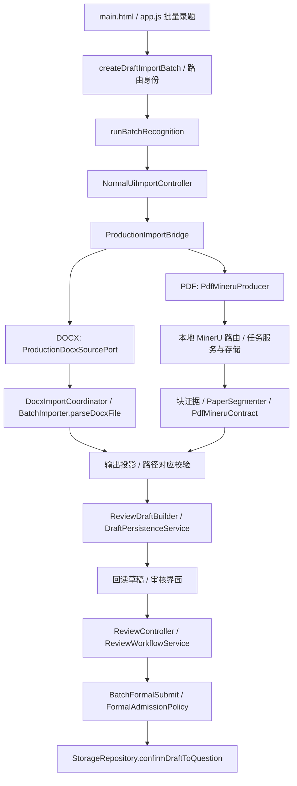

# 阶段 0 基线与交接 — 2026-10-20

状态：阶段 0 的链路图、源码快照、diff 清单已完成；当前基线门禁失败，停止后续实施。本报告不表示识别质量验收通过。

## 版本与快照

- 分支：`stage/program-c-corrective-r1`。
- HEAD：`3099a479ca4a8bd5e2a06f2365bb78bc5ff848af`。
- 快照采集时间：2026-10-20 12:23:59（Asia/Shanghai）。
- 正式快照目录：`C:/Users/Administrator/.codex/visualizations/2026/10/19/01a15551-7096-7170-a1b9-aae70343c32c/stage0-20261020-03/`。
- 当前源码归档：`worktree.zip`，1441 个文件，原文件总计 23,824,950 字节。
- 归档 SHA-256：`f37ce22915489732ce74b8dffa62cf4763fb4946935618222bee85c77ee3919f`。
- `head.zip` 保留 HEAD 的文件树；`staged.patch`、`unstaged.patch` 分别保留暂存与未暂存修改，支持二进制；`index.bin` 保存采集时索引证据，不能直接当作独立 Git 仓库。
- `worktree-manifest.json` 是逐文件大小与 SHA-256；`SHA256SUMS.txt` 校验快照产物；`snapshot.json` 保存采集范围与结果。
- 已把 `worktree.zip` 解压到外部 `restore-verification/`，1441 个文件全部逐字节哈希一致；采集结束时来源哈希和 Git 状态均未变。

这是源码恢复点，包含非忽略未跟踪的样式、脚本、字体及本地工作记录。被忽略的 `.env`、node_modules、用户试卷、运行缓存、原生 MathType 环境和浏览器题库不在其中；既有合成 HTTPS 测试证书属于测试素材，已随源码保存。运行环境完整复现和用户数据恢复尚未验收。外部 `01` 是失败的初次采集，`02` 是被 `03` 取代的中间采集，后续只使用 `03`。

恢复源码时使用新的空目录解压 `worktree.zip` 并按 manifest 核验，不覆盖当前工作目录，不将外部快照搬回项目测试扫描范围。需要 HEAD 文件树或暂存/未暂存差异时另查对应归档及补丁；归档不是 Git 提交历史备份。

## 实际主要链路（静态接线已核实）

| 环节 | 代码定位 | 已核实内容及边界 |
|---|---|---|
| 页面装配 | `main.html:1693`、`:1736`、`:1741`、`:1762` | 页面载入审核模块、MinerU 相关模块、生产桥接及 app |
| 批次创建 | `app.js:967`；`qisi-production-import-route-policy.js:65` | 普通 UI 按来源类型选择身份；DOCX 默认 `docx-deterministic`，PDF 为 `pdf` |
| 普通 UI 运行 | `app.js:1934`、`:1955`；`qisi-normal-ui-import-controller.js:22` | 进入 production bridge；包含活动任务去重、窗口锁、回读与审核模型应用 |
| DOCX | `app.js:1803`；`qisi-production-docx-source-port.js:85` | 实际注入确定性 runner，使用 coordinator 与 `parseDocxFile`；未运行真实 Word/MathType 材料 |
| PDF | `app.js:1846`；`qisi-pdf-mineru-producer.js:21` | 普通入口注入 MinerU producer；不是仅凭文件名推测主链 |
| PDF 来源与分段 | `qisi-pdf-mineru-producer.js:41`、`:62`、`:85` | 状态、文件摘要/协议校验、页面范围、原始块证据持久化、PaperSegmenter 分段与候选组装 |
| 服务端 | `qisi-local-server.js:785`、`:844`、`:915`；`qisi-mineru-task-service.js:23` | 已有任务回执、提取存储及图片路由；普通真实解析会涉及外部服务，本轮不触发 |
| 投影与校验 | `qisi-production-import-bridge.js:518`、`:553` | PDF canonical 协议使用各自 contract；不能把旧 PDF aligner 当成当前普通入口的唯一负责模块 |
| 草稿持久化与回读 | `app.js:1895`、`:1941`；`qisi-production-import-bridge.js:608` | 草稿、图片、文件证据交由持久化服务；之后回读应用到 review |
| 编辑及正式入库 | `app.js:88`、`:2573`；`qisi-batch-formal-submit.js:109` | ReviewController 已存在；人工编辑会使旧确认失效；提交由 admission 决策进入 repository |
| 最终写入 | `qisi-storage-repository.js:918` 的 `confirmDraftToQuestion` | 存在版本、幂等及入库决策检查；此处只定位，不证明所有路径均无绕过 |

`docx-vision` 和旧 PDF 协议的兼容代码仍存在；存在并不代表普通 UI 当前默认使用，亦不证明可以删除。当前 PDF producer 还把候选字段标成待人工处理；后续指标必须区分候选出现、人工采纳、可入库及实际入库，不能把候选答案计为可靠自动绑定。

## 未提交改动清单

完整逐路径清单：外部快照中的 `diff-inventory.csv`、`status-before.txt`、两份 numstat 和补丁。统计发生在本阶段两个新文档写入之前。

- 77 个路径有暂存修改，11 个路径有未暂存修改，两者重叠，不能直接相加。
- 79 个不同的已跟踪路径有变化，119 个非忽略未跟踪文件，共 198 个状态路径。
- 暂存 diff：5529 行新增、1122 行删除；未暂存 diff：464 行新增、73 行删除。不是本阶段新增改动。

| 分组 | 路径数 | 后续相关性与风险 |
|---|---:|---|
| 架构清单 | 6 | owner、layer、runtime 与 app 职责矩阵已有变动，后续不能重新覆盖 |
| 历史审计与任务文档 | 9 | 可作为线索，不替代本版本实际验证 |
| DOCX/分段/支持文本 | 5 | 稳定链与题号边界风险，阶段 1 应覆盖 |
| 导入协调 | 8 | producer、投影、校验、状态传递均已变化 |
| PDF/MinerU | 6 | 新任务生命周期、contract、producer 和 review records |
| 审核与存储 | 6 | 用户编辑、来源、入库与持久化边界 |
| 测试 | 32 | 包含既有用例新增、修改和删除，不能视为已完成验收 |
| UI 与字体 | 106 | 含字体分片及未跟踪 review-pane-layout.js；当前页面实际引用该脚本 |
| 验证脚本 | 2 | no-real-ai 与 write-boundary 已变化，安全门禁也属于待测基线 |
| 本地工作记录 | 12 | 只保全，不以其内容作为新的执行授权 |
| 其他 | 6 | 包括 app.js、package.json、本地服务、显示工具与 handout gate 等 |

该分组只是路径归类，不代表逐行审查完成，也不证明各组相互独立。`app.js`、`main.html` 等同时有暂存/未暂存修改，后续只能比较阶段增量，不能把总 dirty diff 误算成本轮工作。

## 已有能力与计划校正

1. 审核 controller、审核工作流、MinerU 回放和 PDF review records 已存在，阶段 1/2 优先验证和补缺，不重复新建。
2. 完整备份、备份读取验证、恢复预览与恢复前备份已有代码：`qisi-backup.js`、`qisi-backup-workspace.js:123`、`:135`、`app.js:3329`。已有 backup recovery/restore guard/browser 测试；真实用户数据恢复未演练。
3. 服务已绑定 `127.0.0.1`，存在 `/api/health`（`qisi-local-server.js:32`、`:577`）。原建议中的这些项目不能直接列成待开发。
4. 现有 `backup:stage0` 脚本会写 Desktop 同级目录，复制范围也不同；本轮采用外部受限目录中的源码白名单采集，不运行或修改旧脚本。
5. `ai/TESTING_GUIDE.md` 仍描述 verify:safe 为 check + test + mock smoke + no-real-ai；当前 package 实际为 no-real-ai → check → 全量 test → write-boundary。全量 test 会发现 batch mock 用例，但不是独立 smoke 命令。该文档偏差只记录，未改门禁。
6. 现有测试有离线 MinerU 注入及网络拒绝用例，可作为阶段 1 的复用点；这不是人工整卷金标准。

## 验证记录

- 源码快照完整性：1441/1441 解压文件哈希匹配；采集时原文件哈希及 Git 状态未变。
- `npm.cmd run verify:safe` 首轮：退出 1，Node 测试子进程被沙箱以 `spawn EPERM` 拒绝。日志 `verify-safe.log`；该轮不能作为产品失败统计。
- 同一命令解除子进程限制后执行：退出 1。`verify:no-real-ai` 与语法检查通过；2052 项测试中 2051 通过、1 失败、0 跳过、0 取消，测试耗时约 152.5 秒。日志 `verify-safe-process-enabled.log`。
- 唯一失败：`tests/e2e/review-draft-command-ui-recovery.test.js:83` 的 `N5/N6 metadata-only edits remain dirty, protect unload and persist before confirmation`。在第 96 行点击 `getByRole('button', { name: '标记已确认', exact: true })` 时等待超过 30000ms。尚未判定是 UI 文案/可见性/测试定位还是实际业务状态问题，不把它直接等同为数据保存缺陷。
- 因 npm test 返回失败，verify:safe 末尾的独立 `verify-write-boundary.js` 未执行，不能宣称该命令全部通过。没有修改用例、重试掩盖失败或单独放宽门禁。
- 阶段增量范围核对：原状态 198 条，新增两个允许的 ai 文档后 200 条，未出现其他状态变化。原 1441 文件与暂存区字节最终复核结果见外部 `final-integrity.json`。
- 真实 AI/OCR、真实文档识别、生产数据库操作：未执行。
- 提交：无；暂存区不做变动。

## 阶段 1 建议输入（尚未实施）

以这个源码快照而非 HEAD 单独作为基线。先复用现有 DOCX/MinerU/审核与备份测试，建立少量完整标注样例及两层回放；明确候选、确认与入库的统计口径。真实材料与既有 OCR 缓存必须以文件哈希配对，标注先由人工核实。未核实缓存和来源前，不公布 19 题、14/18 或零错挂等质量结论。

待核实清单：真实材料授权与来源清单、可复用缓存协议及坐标、人工标注负责人、完整备份表/图片覆盖、隔离恢复演练和运行环境依赖。只把影响基线复现与数据安全的问题列为阻断，不扩展到全仓审计或功能开发。

## 当前停止点及下一项建议

先设立一个限定任务复现上述审核用例的按钮等待失败，确认实际页面状态与测试预期是否一致；若是产品缺陷，在原有负责模块做最小修复；若是过期定位，先证明等价交互存在，再调整定位。不能为了绿灯删除断言或放弃“元数据修改必须保存并重新确认”的行为要求。恢复 verify:safe 通过后，再执行阶段 1。本轮未做该修复或阶段 1 工作。

## 本轮增量报告

- 新增文件：`ai/CODEX_TASK_STAGE0_2026-10-20.md`、本报告；没有修改原有业务文件、测试、任务文件、依赖或架构清单。
- `git status --short`：保留初始全部 dirty 内容，另有两个未跟踪 ai 文档；机器可读完整 before/after 状态在外部快照。
- `git diff --stat`：原有未暂存统计保持 11 文件、464 新增/73 删除；`git diff --cached --stat` 保持 77 文件、5529 新增/1122 删除。新文档未暂存，不出现在这两份统计中。
- DOCX/PDF/审核/提交行为及草稿 schema：本轮没有改动。默认测试覆盖不等同于真实材料质量验收。
- Commit hash：未提交；HEAD 仍为上述值。
- 未完成：基线门禁恢复、人工金标准、真实材料验证、用户数据恢复演练、后续阶段。
