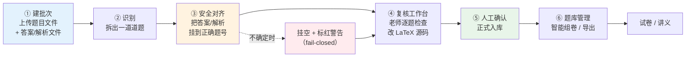
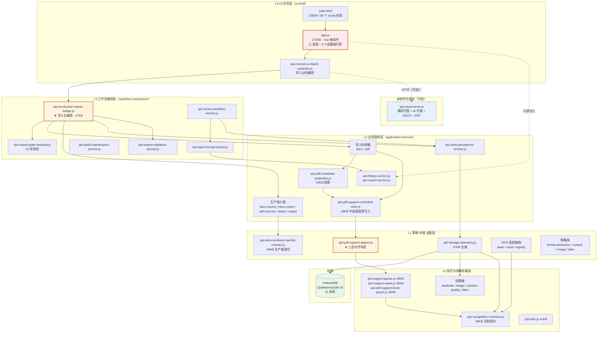
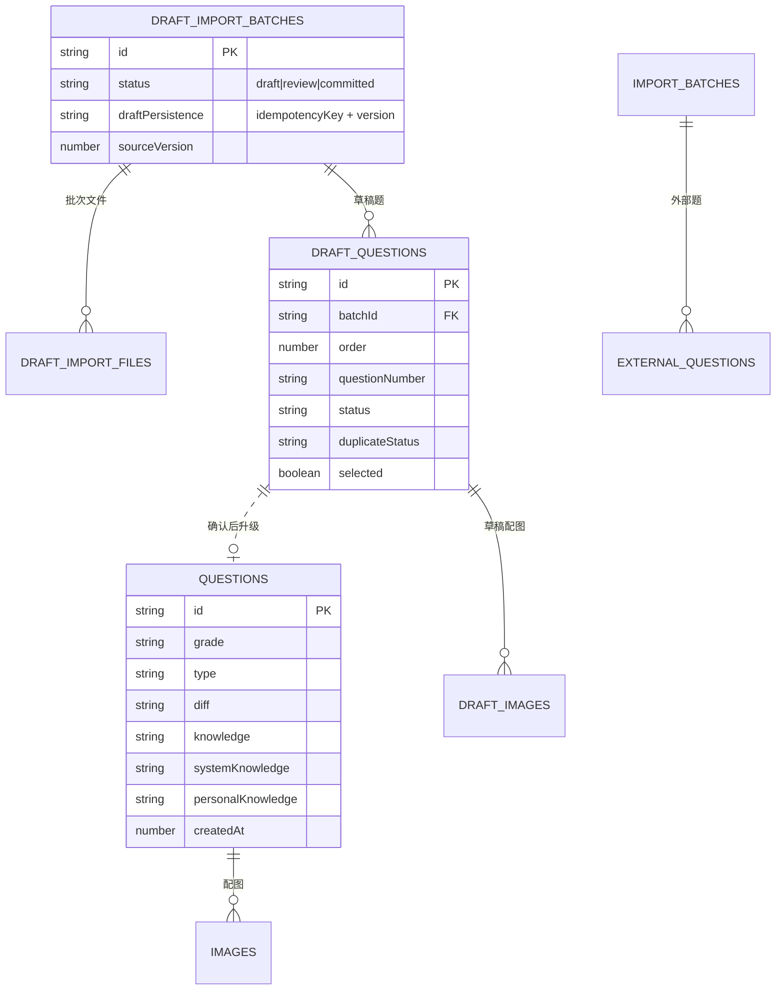
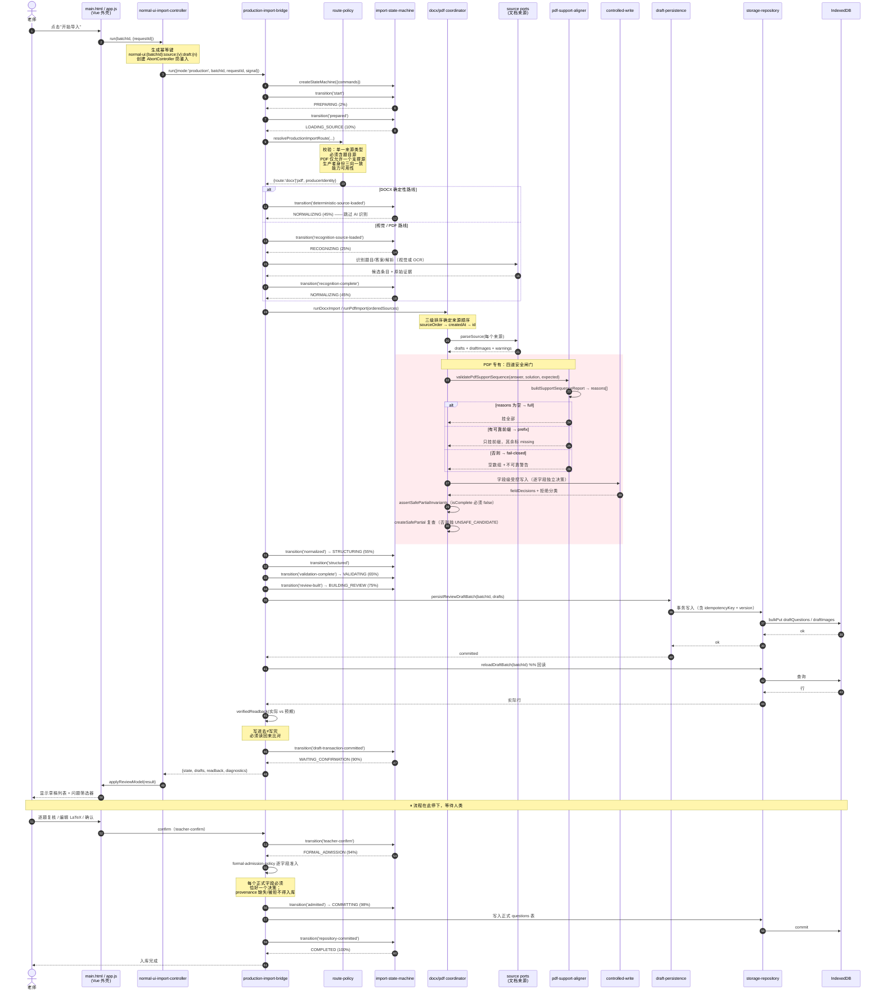
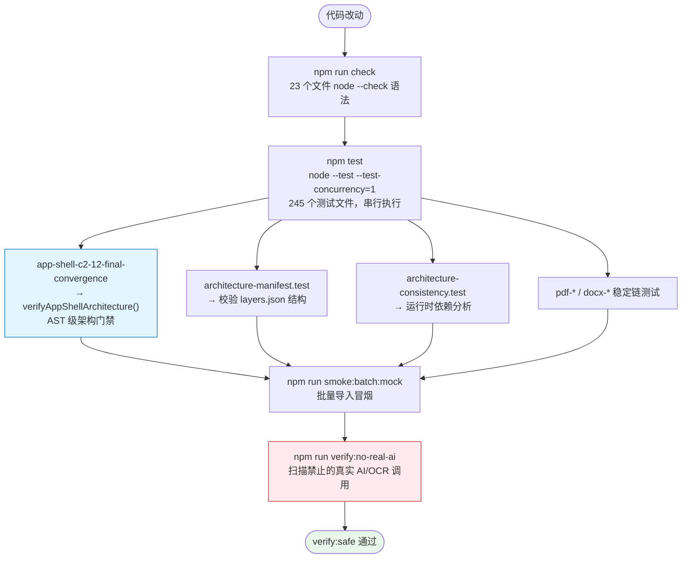

# 奇思数学 Pro — 架构审阅报告

| 项目 | 内容 |
|---|---|
| **审阅日期** | 2026-08-30 |
| **审阅人** | 高见远（架构师） |
| **审阅性质** | 纯只读审阅。未修改任何文件，未执行任何 git 写操作，未调用任何真实 AI/OCR 端点 |
| **代码位置** | `C:\Users\Administrator\Desktop\题库系统` |
| **分支** | `stage/program-c-corrective-r1` |
| **审阅目标** | 理解这个系统在做什么、怎么运转的。理解优先，评判其次 |

---

## 摘要：一句话说清这个系统

> **这是一个给高中数学老师用的「本地题库录入流水线」。你把一堆 Word / PDF 习题册扔进去，它把题目一道道拆出来、把答案和解析安全地挂到对应题号上，然后让你人工复核一遍，确认无误才放进正式题库。**

它最特别的地方不是"能识别"，而是**"宁可不挂，也绝不挂错"**。整份代码里反复出现的一条最高原则是：

> **挂错答案比没有答案更糟糕。不确定时，就关闭（fail-closed）。**

---

# 第一部分：这个系统到底在干什么

## 1.1 它解决的真实问题

一位高中数学老师的日常痛点：手上有成套的习题资料（Word 或 PDF），想建成自己的题库以便日后组卷。手工录入几百道题，每道题都要抄题干、四个选项、答案、解析，还要处理数学公式（LaTeX）。这件事枯燥、易错、工作量巨大。

这个系统要做的，是把这件事自动化到「**机器干 90%，人工只做最后 10% 的确认**」。

而这里真正的技术难点不在"识别文字"，在于：

- Word 里的数学公式是特殊格式，直接读会变成乱码；
- PDF 里的题目和答案往往**分成两个文件**，必须靠题号把它们对上；
- 一旦对错位（比如第 7 题的答案挂到第 8 题上），**整批题库就废了，而且很难发现**。

所以这个项目把 80% 的复杂度，花在了"怎么保证不错"上，而不是"怎么识别得更准"。

## 1.2 核心用户流程



**五个阶段对应的业务含义：**

| 阶段 | 老师看到的 | 系统内部在做 |
|---|---|---|
| 建批次 | 拖拽上传 2 个文件（题 + 答案） | 判定文件角色、来源类型、生产者身份 |
| 识别 | 进度条 0→25% | Word 走 XML 解析；PDF 走视觉/OCR 识别 |
| 安全对齐 | 进度条 25→65% | 题号序列校验，只有可信才挂答案 |
| 复核 | 草稿列表 + 问题筛选器 | 草稿入库 IndexedDB，等老师确认 |
| 正式入库 | 点"确认提交" | 准入校验（formal admission）后写正式表 |

关键点：**第 ④ 步永远不会被跳过**。宪法文件 `ai/AGENT_CONSTITUTION.md` 第 10 条明确规定：

> 系统可以自动生成草稿，但最终入库是高风险动作。不得绕过复核护栏。

## 1.3 主要功能模块

| 模块 | 面向用户的价值 |
|---|---|
| **批量导入** | 一次处理整本习题册 |
| **题库（Library）** | 按年级/题型/难度/知识点检索已入库题目 |
| **智能组卷** | 从题库挑题生成试卷 |
| **复核工作台** | 逐题检查草稿，直接编辑 LaTeX 源码 |
| **导入批次管理** | 查看历史批次、问题筛选、重复题检测 |
| **导出 / 备份** | 导出题库、创建快照备份 |
| **知识点管理** | 系统知识点 + 个人自定义知识点双轨 |

---

# 第二部分：整体架构长什么样

## 2.1 一句话技术画像

> **一个纯本地、无打包器、浏览器端 Vue 3 单页应用 + 一个可选的本地 Node 伴生服务，数据全部存在浏览器 IndexedDB 里。**

## 2.2 技术栈实况

| 层面 | 选型 | 说明 |
|---|---|---|
| UI 框架 | **Vue 3**（`vue.global.prod.js`） | 全局构建版，非 SFC |
| 样式 | Tailwind CSS（CDN） | 另有 77KB 自研 `app.css` |
| 数学公式 | **KaTeX** | 渲染 LaTeX |
| 数据 | **Dexie 3 → IndexedDB** | 库名 `QisiMathVueDB`，已到第 8 版 |
| 文档解析 | JSZip（DOCX）、pdfjs-dist（PDF） | 纯前端解析 |
| 本地服务 | **Express + multer + cors + dotenv** | `qisi-local-server.js` |
| AI/OCR | 阿里 DashScope（通义千问） | 经本地服务代理 |
| 测试 | `node --test`（串行） | 无浏览器依赖 |

## 2.3 关键架构决策：UMD 双环境模块模式

这是一个**非常值得肯定的设计**。89 个 `qisi-*.js` 每一个都长这样：

```js
(function (root, factory) {
    const api = factory();
    root.Qisi = root.Qisi || {};
    root.Qisi.XxxModule = api;              // 浏览器：挂到全局命名空间
    if (typeof module !== 'undefined' && module.exports) {
        module.exports = api;               // Node：直接 require
    }
})(typeof globalThis !== 'undefined' ? globalThis : this, function () {
    'use strict';
    /* ... 纯业务逻辑 ... */
});
```

**为什么这很重要：** 浏览器里靠 `<script>` 标签顺序加载（main.html 里有 **84 个 script 标签**），Node 测试里靠 `require`。同一份代码两边都能跑，于是**核心业务逻辑不需要浏览器就能测**——这是那 245 个测试文件能存在的前提。

对一个不懂编程的维护者来说，这意味着：**绝大多数逻辑改动都能被自动化测试验证，不需要手动点浏览器。**

## 2.4 分层架构总览



**依赖走向规则（由 `architecture/layers.json` 强制）：依赖只能向下，不能向上或跨层跳跃。** 例如 L0 的解析器绝对不许引用 L1 的存储——`layers.json` 里明确写着 `forbiddenDependencies: ["app-shell", "storage-repository"]`。

## 2.5 本地 Node 服务：`qisi-local-server.js`（21KB）

它**不是**业务后端，业务数据根本不经过它。它只做三件辅助的事：

| 端点 | 作用 |
|---|---|
| `express.static(ROOT)` | 把整个目录当静态网站托管（所以浏览器能打开 main.html） |
| `GET /api/ai/health` | 检查 AI 密钥是否配置 |
| `POST /api/ai/chat` | 代理到阿里云 DashScope 通义千问 |
| `POST /api/ai/ocr` | 代理到 DashScope 多模态 OCR |
| `POST /api/convert/docx-to-pdf` | **把 Word 转成 PDF**（先用 LibreOffice `soffice`，失败退回 Word COM） |
| `GET /api/convert/self-test` | 自检转换器是否可用 |

**为什么需要 DOCX→PDF？** 因为有些 Word 文档格式复杂，XML 直读不可靠，于是先把 Word 渲染成 PDF，再走视觉识别路线（这就是后面会讲的 `docx-vision` 身份）。这是两种"生产者身份"分野的物理来源。

**安全设计：** 模型名被严格限制（`/^qwen[-_.a-z0-9]+$/i`），密钥只在服务端 `process.env.DASHSCOPE_API_KEY`，浏览器永远拿不到。

## 2.6 数据存在哪

全部在**你自己电脑的浏览器数据库里**，不上传任何服务器。



**11 张表**（Dexie v8 schema）：`questions`、`images`、`customTemplates`、`personalKnowledge`、`externalQuestions`、`importBatches`、`mergeBatches`、`draftImportBatches`、`draftImportFiles`、`draftQuestions`、`draftImages`。

**设计要点：草稿（draft*）与正式（questions）物理分离。** 草稿怎么折腾都不会污染正式题库；"清空草稿工作区"这个操作在结构上就不可能删掉正式题。这是宪法第 1 条"绝不污染题库"在数据层的落地。

---

# 第三部分：89 个 `qisi-*.js` 是怎么组织的

## 3.1 先说一个重要发现：有 74 个是"已登记"的，15 个是"野生"的

项目自己维护了一份架构清单 `architecture/layers.json`（schemaVersion: `qisi.architecture-manifest.v1`），声明了 **74 个模块**，每个都标注了：

- `layer`（属于哪一层）
- `domainOwner`（领域责任人标识）
- `publicApi`（公开 API）
- `allowedDependencies` / `forbiddenDependencies`（**能依赖谁、禁止依赖谁**）
- `status`（`production-wired` 生产已接线 / `scaffold` 脚手架 / `deprecated` 已废弃 / `research-only` 仅研究）

我实际比对了磁盘上的 89 个文件，结果：

| 类别 | 数量 | 说明 |
|---|---|---|
| 清单中已登记 | 74 | 受分层规则约束 |
| **磁盘上有、清单中没有** | **15** | 见下表 |
| 清单有、磁盘无对应 | 3 | `local-ocr/server.js`、一个测试文件、`app.js`（路径前缀差异，非真缺失） |

**15 个未登记文件**（这是本次审阅最有价值的发现之一）：

| 文件 | 性质 | 判断 |
|---|---|---|
| `qisi-app-facade.js` | 极简 DI 容器（68 行） | 薄壳，可接受 |
| `qisi-storage-facade.js` | 单行记录工厂 | 薄壳，可接受 |
| `qisi-ui-renderer.js` | 空壳（420 字节） | **疑似死代码** |
| `qisi-runtime.js` | 依赖断言 + 启动引导 | 基础设施，应登记 |
| `qisi-config.js`、`qisi-ui-events.js`、`qisi-review-view-model.js` | 配置/事件/视图模型 | 基础设施，应登记 |
| `qisi-file-dispatcher.js` | 文件类型分派 | 有业务逻辑，应登记 |
| `qisi-db.js`、`qisi-backup.js`、`qisi-components.js`、`qisi-temp-job-manager.js` | 数据/备份/组件/临时任务 | 基础设施，应登记 |
| `qisi-local-server.js` | Node 服务 | 不在浏览器分层内，合理 |
| `qisi-batch-importer.js`（71KB）、`qisi-batch-orchestrator.js`、`qisi-docx-pipeline.js` | **遗留引擎** | 应显式标记 `deprecated` |
| `qisi-pdf-answer-only-extraction.js`、`qisi-pdf-answer-extraction-quality.js` | 实验性研究 | 应标记 `research-only` |

> **结论：** 架构清单覆盖了主体（83%），但"入口层基础设施"和"遗留/实验代码"处于清单之外。这意味着**它们不受分层规则保护，任何人（或任何 AI）都可以随意改动而不触发架构门禁**。对于一个靠 AI 辅助维护的项目，这是个真实的口子。

## 3.2 五层分布

| 层 | 名称 | 模块数 | 职责 | 代表模块 |
|---:|---|---:|---|---|
| **L0** | contracts-and-pure-parsers<br/>契约与纯解析器 | 14 | 不依赖任何东西的纯函数与数据结构定义 | `recognition-contracts`(39KB)、`support-parser`(46KB)、`support-repair`(26KB)、`utils`(41KB) |
| **L1** | policy-storage-and-adapters<br/>策略·存储·适配器 | 23 | 业务规则、数据访问、外部引擎适配 | `storage-repository`(37KB)、`pdf-support-aligner`、`docx-producer-identity-contract`(34KB)、OCR 适配器族 |
| **L2** | application-services<br/>应用服务 | 28 | 单个用例的完整实现 | `pdf-candidate-projection`(54KB)、`pdf-support-controlled-write`(35KB)、各 coordinator、各 port |
| **L3** | workflow-composition<br/>工作流编排 | 7 | 把多个服务串成流程 | **`production-import-bridge`(37KB)**、`import-state-machine`、`review-workflow-service` |
| **L4** | ui-shell<br/>界面外壳 | 2 | 只做界面与编排调用 | `normal-ui-import-controller`、`app.js` |

## 3.3 按业务族归类（89 个文件 / 1.36 MB）

| 族 | 数量 | 体积 | 职责 | 依赖关系 |
|---|---:|---:|---|---|
| **recognition** 识别与投影 | 9 | 209KB | 页面题解析、视觉源、候选投影、识别契约/结构策略 | → L0 契约 |
| **pdf** PDF 识别与安全对齐 | 8 | 172KB | PDF 块解析、安全对齐、受控写入、候选投影 | `aligner → support-parser`；`controlled-write → aligner` |
| **batch** 批量导入与引擎 | 5 | 168KB | 批量引擎 v2(85KB)、正式提交、上下文服务 | 遗留引擎，逐步被 bridge 取代 |
| **production** 生产导入编排 | 8 | 120KB | 路由策略、各来源端口、输出/状态端口、bridge | **编排中枢** |
| **ocr** 识别引擎适配 | 8 | 61KB | qwen/local 适配器、引擎注册表、结构提取、影子模式 | → `recognition-contracts` |
| **support** 答案/解析解析 | 4 | 89KB | 支撑文档解析、修复、LaTeX 策略 | L0，被 aligner 依赖 |
| **shell** UI 外壳与基础设施 | 7 | 86KB | app-facade、runtime、config、components、utils | 入口 |
| **docx** Word 文档链 | 5 | 77KB | 转换器、视觉协调器、生产者身份契约、导入协调器 | → `docx-producer-identity-contract` |
| **storage** 存储与备份 | 5 | 71KB | 仓储、数据库、备份、归档安全 | → IndexedDB |
| **import** 导入编排/状态机 | 5 | 49KB | 状态机、校验服务、诊断、等价归一化 | L2/L3 |
| **review** 复核工作台 | 6 | 55KB | 草稿状态、控制器、工作流、正式提交校验 | → `draft-persistence` |
| **draft** 草稿持久化 | 2 | 35KB | 持久化服务、维护服务 | → `storage-repository` |
| **question** 题目策略 | 3 | 23KB | 内容/图片/去重策略 | L0/L1 |
| **ai** AI/OCR 适配 | 2 | 36KB | qwen 视觉源端口 | → `ocr-qwen-adapter` |
| **library** 题库与导出 | 2 | 26KB | 题库服务、导出服务 | → `storage-repository` |
| **formal** 正式入库准入 | 1 | 23KB | 准入策略（23KB，最后一道闸） | → `recognition-contracts` |
| **infra** 日志/监控 | 3 | 8KB | 安全日志、性能监控、临时任务 | L0 |
| 其他独立模块 | 5 | 51KB | `strict-question-policy`、`solution-quality-policy` 等 | L0/L1 |

## 3.4 模块状态分布（清单内 74 个）

| 状态 | 含义 | 观察 |
|---|---|---|
| `production-wired` | 生产链路已接线 | 主体，约 60 个 |
| `scaffold` | 脚手架，未接入生产 | OCR 族偏多（local-adapter、structure-extractor、reading-order、shadow-mode、performance-monitor） |
| `deprecated` | 已废弃待清理 | `import-equivalence-normalizer`、`import-orchestrator`、`legacy-batch-run-coordinator`、`injected-import-path` |
| `research-only` | 仅研究用途 | `tests/pdf-answer-only-ai-pass.test.js` |

> **观察：** `scaffold` 状态集中在 OCR 本地化路线（local-ocr）。说明团队曾尝试做"本地 OCR 替代云端"，做了一半停在脚手架阶段。这是技术债，但被诚实标注了——**比藏着掖着强得多**。

---

# 第四部分：两条核心导入链

这是整个项目自称的生命线，也是代码质量最高的部分。

## 4.1 总览：两条链共享一个骨架，分叉在中间

```mermaid
flowchart TD
    START([老师点击"开始导入"]) --> CTRL["qisi-normal-ui-import-controller<br/>防重入 · 生成幂等键 · AbortController"]
    CTRL --> BRIDGE["qisi-production-import-bridge.run()"]
    BRIDGE --> ROUTE["qisi-production-import-route-policy<br/>★ 路由判定：docx / pdf + 生产者身份"]
    ROUTE -->|"docx-deterministic"| DOCXCHAIN
    ROUTE -->|"docx-vision"| VISIONCHAIN
    ROUTE -->|"pdf"| PDFCHAIN

    subgraph DOCXCHAIN["链 A：DOCX+DOCX 稳定链"]
        D1["LOADING_SOURCE"] --> D2["deterministic-source-loaded<br/>直接读 XML"]
        D2 --> D3["NORMALIZING → STRUCTURING<br/>→ VALIDATING"]
        D3 --> D4["BUILDING_REVIEW"]
    end

    subgraph VISIONCHAIN["链 A'：DOCX 转 PDF 视觉链"]
        V1["RECOGNIZING<br/>Word→PDF→视觉识别"] --> V2["NORMALIZING → ..."]
    end

    subgraph PDFCHAIN["链 B：PDF + PDF-support"]
        P1["RECOGNIZING<br/>视觉/OCR 识别"] --> P2["NORMALIZING"]
        P2 --> P3["★ validatePdfSupportSequence<br/>三态判定"]
        P3 -->|"full"| P4["挂全部答案"]
        P3 -->|"prefix"| P5["只挂可信前缀"]
        P3 -->|"fail-closed"| P6["一个都不挂 + 警告"]
    end

    DOCXCHAIN --> COMMON
    VISIONCHAIN --> COMMON
    PDFCHAIN --> COMMON

    subgraph COMMON["公共收尾（两条链完全一致）"]
        C1["BUILDING_REVIEW"] --> C2["PERSISTING_DRAFT<br/>事务写入草稿表"]
        C2 --> C3["readback 回读校验<br/>写进去≠写完，要读回来比对"]
        C3 --> C4["WAITING_CONFIRMATION<br/>停下来等人"]
    end

    C4 --> TEACHER{{"老师人工复核"}}
    TEACHER --> ADMIT["FORMAL_ADMISSION<br/>逐字段准入判定"]
    ADMIT --> COMMIT["COMMITTING → COMPLETED"]

    style ROUTE fill:#fff3e0,stroke:#e65100,stroke-width:2px
    style P3 fill:#ffebee,stroke:#c62828,stroke-width:3px
    style P6 fill:#ffcdd2
    style TEACHER fill:#e8f5e9,stroke:#2e7d32,stroke-width:2px
    style ADMIT fill:#e1f5fe
```

## 4.2 链 A：DOCX + DOCX 稳定链

### 4.2.1 主调用链

```
app.js (runBatchRecognition, 11 行)
  └→ qisi-normal-ui-import-controller.js
       └→ qisi-production-import-bridge.js  [createProductionImportBridge]
            ├→ qisi-production-import-route-policy.js  [resolveProductionImportRoute]
            ├→ qisi-import-state-machine.js            [createImportStateMachine]
            ├→ qisi-docx-import-coordinator.js         [runDocxImport]
            │    └→ commands.parseSource → qisi-production-docx-source-port.js
            │                            → qisi-production-docx-vision-source-port.js
            ├→ qisi-candidate-normalizer.js
            ├→ qisi-import-validation-service.js
            ├→ qisi-review-draft-builder.js
            └→ qisi-draft-persistence-service.js → qisi-storage-repository.js → IndexedDB
```

### 4.2.2 "稳定"靠什么保证（四道锁）

**锁 1：显式生产者身份，不许猜**

`qisi-production-import-route-policy.js` 要求批次必须声明 `producerMode`，且只能是三个值之一：

```js
const PRODUCER_IDENTITIES = Object.freeze(['docx-deterministic', 'docx-vision', 'pdf']);
```

并且三重校验：
- 批次声明的身份 vs 各来源声明的身份 → 不一致就报 `PRODUCER_IDENTITY_MISMATCH`
- 身份 vs 来源文件类型 → `docx` 身份不能配 PDF 来源，报 `producer-source-type-mismatch`
- 身份 vs 当前可用能力 → 环境不支持就报 `PRODUCER_CAPABILITY_UNAVAILABLE`

**为什么这很重要：** 系统**不允许"试试看哪种方式能解析"**。你必须明确告诉它"这是纯 Word 确定性解析"还是"这是转 PDF 视觉识别"。这条规定杜绝了 AI 自作主张换路线的可能。

**锁 2：来源顺序确定性**

`runDocxImport` 在开始前对来源排序：

```js
.sort((left, right) => leftOrder - rightOrder ||
    Number(left.source.createdAt || 0) - Number(right.source.createdAt || 0) ||
    String(left.source.id || '').localeCompare(String(right.source.id || '')))
```

三级排序键（显式 sourceOrder → 创建时间 → id），**保证同一批文件无论上传顺序如何，解析顺序永远一致**。题目序号不会因为你先拖了答案文件就错位。

**锁 3：幂等 + 乐观锁**

`qisi-normal-ui-import-controller.js` 里：

```js
const requestId = `normal-ui:${batchId}:source:${sourceVersion ?? 0}:draft:${version + 1}`;
```

请求 ID 里编码了「批次 + 来源版本 + 草稿版本」。重复点击不会重复生成；来源文件被换掉后 `expectedSourceVersion` 不匹配会直接拒绝。

**锁 4：回读校验（readback verification）**

这是最讲究的一环。**写进数据库不等于写对了**，所以持久化之后必须重新读出来比对：

```js
data.readback = verifiedReadback(
    await ports.reloadDraftBatch(batchId),   // 重新从库里读
    data.reviewDrafts,                        // 和内存里的预期比
    batchId
);
```

只有回读一致，状态机才推进到 `WAITING_CONFIRMATION`。

### 4.2.3 状态机（15 个状态，30 条转移）

```
IDLE → PREPARING → LOADING_SOURCE → RECOGNIZING → NORMALIZING → STRUCTURING
     → VALIDATING → BUILDING_REVIEW → PERSISTING_DRAFT → WAITING_CONFIRMATION
     → FORMAL_ADMISSION → COMMITTING → COMPLETED
                     ↘ CANCELLED / FAILED
```

注意 `LOADING_SOURCE` 有两条出边：
- `deterministic-source-loaded` → **直接跳到 NORMALIZING**（Word 确定性路线不需要 AI 识别）
- `recognition-source-loaded` → 进 RECOGNIZING（视觉路线要走 AI）

Bridge 里的对应代码：

```js
if (data.producerIdentity === 'docx-deterministic') {
    await step('deterministic-source-loaded');   // 跳过 RECOGNIZING
} else {
    await step('recognition-source-loaded');
    await step('recognition-complete');
}
```

每个状态都可取消（除 `COMMITTING` —— 正在写正式库，不许打断），取消会走到对应的 `IMPORT_CANCELLED_*` 错误码。

## 4.3 链 B：PDF + PDF-support 安全对齐

这是**全项目最精密的部分**，也是"fail-closed"理念的技术核心。

### 4.3.1 主调用链

```
qisi-production-import-bridge.js
  └→ qisi-pdf-import-coordinator.js  [runPdfImport]
       ├→ adapters.processSources → qisi-production-pdf-sources-port.js
       │                          → qisi-qwen-vision-source-port.js
       │                          → qisi-visual-question-source.js / visual-support-source.js
       │                          → qisi-pdf-candidate-projection.js (54KB)
       │                               └→ qisi-pdf-support-controlled-write.js (35KB)
       │                                    └→ qisi-pdf-support-aligner.js  ★三态判定
       │                                         └→ qisi-pdf-support-block-parser.js
       │                                              └→ qisi-support-parser.js
       └→ adapters.createSafePartial → qisi-pdf-safe-partial-pipeline.js  ★最终不变量断言
```

### 4.3.2 核心判定：三态决策

`qisi-pdf-support-aligner.js` 的 `validatePdfSupportSequence`：

```js
const mode = isSupportSequenceReliable(report)
    ? 'full'                                    // 全部可信
    : (prefix.length ? 'prefix' : 'fail-closed'); // 前缀可信 / 一个都不信
```

**`isSupportSequenceReliable(report)` 就是 `report.ok`，而 `ok` 的定义是 `reasons.length === 0`。**

`buildSupportSequenceReport` 会累积以下**任何一条**不成立就记入 `reasons`：

| 检查项 | 拒绝理由码 |
|---|---|
| 答案序列里有无法解析的题号 | `answer-question-invalid` |
| 解析序列里有无法解析的题号 | `solution-question-invalid` |
| 答案序列有重复题号 | `answer-question-duplicate` |
| 解析序列有重复题号 | `solution-question-duplicate` |
| 答案题号不是严格递增（**跳回**） | `answer-question-not-increasing` |
| 解析题号不是严格递增 | `solution-question-not-increasing` |
| 答案集合 ≠ 解析集合 | `answer-solution-question-set-mismatch` |
| 答案/解析集合 ≠ 期望题号集合 | `support-question-set-not-equal-expected` |
| 题号不连续（有缺号） | `answer-question-not-continuous` / `solution-question-not-continuous` |

**注意它的判定哲学：不是"找到一个匹配就挂"，而是"找不到任何毛病才挂"。** 这是典型的白名单 / fail-closed 思维。

### 4.3.3 prefix 模式：可信赖到哪里就挂到哪里

即使整体不可靠，也不一定全盘放弃。`findReliablePrefix` 逐位比对：

```js
for (let index = 0; index < limit; index += 1) {
    const answer = answerRows[index];
    const solution = solutionRows[index];
    const expected = expectedValues.length ? expectedValues[index] : (...);

    if (!expected || !answer.ok || !solution.ok ||
        answer.value !== solution.value ||   // 答案题号必须等于解析题号
        answer.value !== expected ||          // 必须等于期望题号
        result.includes(answer.value)) {      // 不能重复
        break;                                 // ← 任何一条不满足，立刻停止
    }
    result.push(answer.value);
}
```

**答案和解析必须逐位锁步对齐**（answer[i] 和 solution[i] 题号相同，且都等于期望的第 i 题），任何一处对不上就 `break`。前缀之后的题目一律不挂，标记为 `fusedQuestionNumbers` + 警告 `missing_answer` / `missing_solution`。

### 4.3.4 三态的输出差异

| 模式 | `safeAnswerItems` | `safeSolutionItems` | warnings |
|---|---|---|---|
| `full` | 全部 | 全部 | 无 |
| `prefix` | `slice(0, prefixCutoffIndex)` | 同左截断 | `pdf-support-prefix-only` |
| **`fail-closed`** | **`[]`（空）** | **`[]`（空）** | `pdf-support-sequence-unreliable` |

**fail-closed 时答案和解析数组是空的**——物理上就不可能挂错。

### 4.3.5 第二道闸：字段级受控写入

即使对齐判定通过，还有 `qisi-pdf-support-controlled-write.js`（35KB）做**逐字段**审查。它对 `answer` 和 `solution` 分别独立决策，并维护一套完整的拒绝分类学：

| 拒绝原因 | 语义 |
|---|---|
| `rejection-option-value-not-matched` | 答案文本匹配不上任何选项值 |
| `rejection-ambiguous-option-value` | 有歧义 |
| `rejection-options-missing` | 题目本身没有选项 |
| `rejection-unsafe-math-command` | 含不安全的数学命令 |
| `rejection-invalid-option-label` | 选项标签非法 |
| `rejection-multi-option-value-rejected` | 多选题却给了单选值 |
| `rejection-ambiguous-multi-value` | 多值歧义 |

**而且它有一条"就低不就高"的保守规则**：当解析器给的值和遗留逻辑给的值冲突时，**保留更安全的那个**（代码里的 `objective-legacy-preserved` 决策）。宁可用旧的、粗糙的、但确定的标签，也不用新的、精细的、但不确定的。

### 4.3.6 第三道闸：安全部分不变量（硬断言）

`qisi-pdf-safe-partial-pipeline.js`：

```js
const assertSafePartialInvariants = result => {
    if (result.isComplete) throw new Error('safe partial pipeline must not produce complete');
    return true;
};
```

PDF 路径产出的候选**永远**是 `isSafePartial: true, isComplete: false`。如果任何环节想宣称"这批已经完整了"，**直接抛异常**。

### 4.3.7 第四道闸：协调器复查

`qisi-pdf-import-coordinator.js` 对**每一个**草稿强制复查：

```js
const safePartialCandidates = result.drafts.map((draft, index) => {
    const candidate = adapters.createSafePartial(draft, {...});
    if (!candidate || candidate.isSafePartial !== true || candidate.isComplete !== false) {
        throw createError('PDF_COORDINATOR_UNSAFE_CANDIDATE');   // ← 硬失败
    }
    return Object.freeze({ ...candidate, draft: candidate.draft || draft });
});
```

**结论：PDF 链有四道独立闸门（序列三态 → 字段级受控写入 → 安全部分不变量 → 协调器复查），每一道都能单独阻止错误答案入库。** 这是防御性设计的教科书级实践。

### 4.3.8 明令禁止的做法（宪法第 3 条）

```
✗ 缺号之后继续挂
✗ 题号跳回之后继续挂
✗ 重复题号之后继续挂
✗ 答案序列与解析序列不一致时挂
✗ 基于语义相似度挂
✗ 基于关键词挂（三角形、向量、sin、cos、面积……）
✗ 只凭 AI 输出的 question 字段挂
```

最后三条尤其关键——**它禁止了当下最流行的"用大模型语义理解来匹配"的做法**。因为在题库这个场景里，语义相似是**极其危险**的启发式：一道"求三角形面积"的题和另一道"求三角形面积"的题，答案完全不同。

## 4.4 核心数据流时序图（完整导入）



---

# 第五部分：`app.js` 现在到底是什么角色

## 5.1 客观数据

| 指标 | 数值 |
|---|---|
| 体积 | 272 KB |
| 行数 | **5,092 行** |
| 函数总数 | **551 个**（其中 547 个箭头函数，只有 4 个传统函数声明） |
| 在清单中的层级 | **L4 ui-shell** |
| 允许的依赖 | 53 个模块（清单里最长的一行） |
| 实际身份 | **Vue 3 根组件定义**，`createApp(App)` 在第 5044 行——几乎是文件最后一行 |

**关键理解：这 272KB 里绝大多数是 Vue 组件的 reactive data / computed / watchers / methods / 模板绑定，不是"业务逻辑"。** 547 个箭头函数这个数字，正是 Vue 组件里大量小方法的自然结果。

## 5.2 它是怎么被"收敛"的：一套 AST 级架构门禁

项目没有重写 `app.js`（宪法明令禁止），而是给它**上了锁**。

### 锁的机制：`docs/architecture/APP_SHELL_RESPONSIBILITY_MATRIX_CORRECTIVE_R1.json`

这份文件把 `app.js` 中 **9 个关键函数**钉死：

```json
{
  "name": "runBatchRecognition",
  "file": "app.js",
  "range": [2035, 2045],        // ← 行号范围都被固定
  "class": "A",
  "allowedCalls": ["normalUiImportController.isRunning", "console.warn", "normalUiImportController.run"],
  "forbiddenCalls": ["productionImportBridge.run", "ProductionImportRoutePolicy.resolveProductionImportRoute",
                     "draftPersistenceService.persistReviewDraftBatch", "batchFormalSubmit.submit"]
}
```

9 个被钉死的函数：

| 函数 | 行数 | 允许调用数 | 禁止调用数 |
|---|---:|---:|---:|
| `runBatchRecognition` | 11 | 3 | 4 |
| `refreshBatchStats` | 6 | 1 | 2 |
| `markDraftReviewed` | 23 | 5 | 3 |
| `submitDraftQuestion` | 38 | 8 | 4 |
| `openBatchSubmitSummary` | 7 | 1 | 2 |
| `dedupeActiveBatchDraftsNow` | 17 | 3 | 3 |
| `cleanupActiveBatchDisplayPollution` | 13 | 4 | 3 |
| `confirmBatchSubmit` | 15 | 4 | 3 |
| `deleteBatchImport` | 5 | 3 | 3 |

**每个函数最长 38 行，全部远低于 60 行上限。** 它们只做一件事：**把界面动作转交给正确的模块，自己不实现任何业务规则。**

### 执行者：`scripts/verify-app-shell-architecture.js`

这个脚本用 `acorn` 把 `app.js` 解析成 AST，然后检查：

| 检查项 | 违规后果 |
|---|---|
| 9 个函数每个必须**恰好定义一次** | 报错 |
| 每个函数的**起止行号必须完全匹配**矩阵 | 报错 |
| 每个函数**不得超过 60 行** | 报错 |
| 函数体内**每一次调用**都必须在 `allowedCalls` 白名单 | 报错 |
| 出现任何 `forbiddenCalls` | 报错 |
| `resolveProductionImportRoute` 只能在 Bridge 组合处调用，**全局恰好 1 次** | 报错 |
| `QuestionDuplicatePolicy` 只能在仓储组合处注入，**全局恰好 1 次** | 报错 |
| `persistReviewDraftBatch` 只能作为 Bridge 端口出现，**全局恰好 1 次** | 报错 |
| `app.js` 直接写 `db.draftQuestions/draftImages/draftImportBatches/questions` 的 `put/add/bulkPut/update/delete/bulkDelete/clear` | 报错 |
| `app.js` 直接调用 `batchFormalSubmit.submit` | 报错 |
| `app.js` 出现测试夹具标记（testFixture、fixtureTransport 等） | 报错 |

### 我实际运行的结果

```
$ node scripts/verify-app-shell-architecture.js
{
  "decision": "APP_SHELL_CORRECTIVE_CLOSURE_ACCEPTED",
  "functionCount": 9,
  "errors": []
}
```

**✅ 通过，0 错误。** 而且这个门禁**确实被接进了默认流水线**——`tests/app-shell-c2-12-final-convergence.test.js` 会调用它，而 `npm test` 属于 `verify:safe`。所以每次跑门禁都会验证一次。

## 5.3 `qisi-app-facade.js` 的真相

名字听起来很重，实际读下来只有 **68 行**，本质是一个极简依赖注入容器：

```js
const createAppFacade = (dependencies = {}) => ({
    getDependency: name => dependencies[name] || null,
    hasDependency: name => Boolean(dependencies[name]),
    assertDependency: name => { if (!dependencies[name]) throw new Error(`Missing dependency: ${name}`); ... },
    getAppEnvironment: () => ({ isBrowser, isNode, hasVue, hasDexie }),
    assertAppDependencies: requiredNames => { ... }
});
```

**它不是一个大适配器，而是一个"依赖存在性检查器"。** 配合 `qisi-runtime.js`（断言 Vue/Dexie/JSZip/pdfjsLib/katex 五个全局依赖是否就位，缺了就在页面上显示红框错误而不是白屏），构成了启动期的依赖守卫。

同一个模式的还有几个极小文件：`qisi-storage-facade.js`（一个记录工厂函数）、`qisi-review-view-model.js`（727 字节）、`qisi-ui-renderer.js`（420 字节，基本是空壳）。

> **这里有个诚实的观察：** `qisi-app-facade.js` 的名气（被 team-lead 点名、有 2 个测试文件）**远大于它的实际作用**。真正的"架空"工作不是它完成的，而是靠 `production-import-bridge` + `normal-ui-import-controller` + 那份 AST 门禁矩阵完成的。Facade 只是个辅助工具。

## 5.4 效果评估

**做到了什么：**
- ✅ 关键业务入口（导入、复核、提交、去重、清理、删除）全部被收拢成 5–38 行的纯转交函数
- ✅ `app.js` **结构上不可能**再直接操作草稿数据库表（AST 层面禁止）
- ✅ 路由决策、去重策略、持久化生命周期各自**全系统只有唯一一处**
- ✅ 门禁是**可执行、可验证、已接入流水线**的，不是写在文档里的一句口号

**没做到什么（诚实的局限）：**
- ⚠️ 门禁只覆盖 **9 个函数 / 551 个**（约 1.6%）。其余 542 个 Vue 方法不受约束。
- ⚠️ `app.js` 的行号被**硬编码**进 JSON 矩阵。这意味着**在 `app.js` 中间插入任何一行都会让门禁失败**，哪怕改动本身无害。这是把双刃剑：极强的防漂移能力，但也意味着维护成本被转嫁到了每次编辑上。
- ⚠️ 272KB 的体积本身没变。"架空"是**行为层面**的，不是**体积层面**的。

> **一句话评价：`app.js` 没有被重写，它被"钉住"了。** 治理层接受它是一坨遗留代码，但用 AST 门禁确保这坨代码**只能按规定的 9 个口子对外说话**。对一个禁止重写的 272KB 遗留文件来说，这是现实约束下相当聪明、也相当务实的解法。

---

# 第六部分：工程治理水平评估

## 6.1 治理资产清单（我实测的数字）

| 资产 | 数量 | 实测说明 |
|---|---:|---|
| `qisi-*.js` 模块 | **89** | 共 1.36 MB |
| 架构清单登记模块 | 74 | `architecture/layers.json`，5 层 |
| `ai/` 治理文件 | 14 | 宪法、边界、稳定链、验收、工作流等 |
| 测试文件 | **245** | `tests/` + `tests/e2e`（team-lead 给的 230 是近似值） |
| 自研脚本 | **36** | `scripts/` + `scripts/benchmark/` |
| `docs/` 文档 | 407 篇 | 分 architecture/audit/benchmark/corrective/ocr/release/testing/archive |
| 技能文件 | 9 | `skills/*/SKILL.md` |

## 6.2 测试分布（按文件名前缀）

| 主题 | 文件数 | 说明 |
|---|---:|---|
| `qisi-*` | 35 | 模块单元测试 |
| `post-*` | 23 | 「修正后回归」测试（POST_R2_CORRECTION 系列） |
| `pdf-*` | 22 | **PDF 安全链（第二多）** |
| `ocr-*` | 19 | OCR 质量 |
| `import-*` | 17 | 导入流程 |
| `app-*` | 16 | **`app.js` 边界（门禁主力）** |
| `production-*` | 15 | 生产导入编排 |
| `docx-*` | 11 | DOCX 稳定链 |
| `review-*` | 9 | 复核工作台 |
| `batch-*` | 7 | 批量引擎 |
| `formal-*` | 5 | 正式准入 |
| 其他 | ~66 | storage / architecture / library / runtime 等 |

**分布是合理的**：PDF（22）+ DOCX（11）+ import（17）+ production（15）+ app（16）占了近一半，正好对应项目宣称的两条生命线。**测试投入与风险分布是对齐的**，这是健康信号。

## 6.3 门禁体系



**`verify:safe` = check + test + smoke:batch:mock + verify:no-real-ai**

几个细节值得称赞：
- `--test-concurrency=1` **强制串行**。因为 IndexedDB 状态是共享的，并行跑会互相污染。这种细节说明踩过坑。
- `verify:no-real-ai` 会扫描代码，确保普通开发路径里没有真实 AI/OCR 调用标记。**这是防"AI 助手偷偷烧你的 API 额度"的护栏**。
- `verify:diff-scope` + `QISI_ALLOWED_DIFF` 环境变量：可以限定"本次任务只允许改这些文件"，越界就失败。

## 6.4 我的专业判断

### 结论：**意图上完全必要，形式上有过度沉淀。它不是过度工程，但正在变成"文档债务"。**

#### ✅ 必要的部分（占大头，请保留）

**1. fail-closed 是真实的领域需求，不是洁癖。**
在题库场景里，挂错答案的后果是**静默的、批量的、事后极难发现的**。老师用错题教学生，可能一个月后才被发现。相比之下，"多花 10 分钟手工补 20 道题的答案"是可恢复的。所以"宁可不挂"这个权衡是**正确的领域判断**。

四道闸门（三态对齐 → 字段级受控写入 → 安全部分不变量 → 协调器复查）不是冗余，是**真正独立的四层防御**。我读过代码，每一层拦的错误类型确实不同。

**2. 分层清单 + AST 门禁是低成本高回报的。**
74 个模块声明 `allowedDependencies` / `forbiddenDependencies`，加上 `verify-app-shell-architecture.js` 这个可执行门禁——**这套东西让"AI 助手乱改架构"这件事从可能变成了会被自动拒绝**。对一个由非程序员 + AI 共同维护的项目，这不是锦上添花，是刚需。

**3. 幂等键 + 回读校验 + 15 状态机，是正确处理"半途失败"的成熟做法。**
批量导入是最容易出半成品状态的场景（跑到 70% 老师关了浏览器）。这个项目的应对是：状态机显式建模、幂等键防重复、回读校验防写脏。这些是**真·工程能力**，不是文档游戏。

**4. 每个模块 UMD 双环境导出，让核心逻辑脱离浏览器可测。**
245 个测试能存在的前提。**这是本项目最高明的一个技术决策。**

**5. 遗留代码被诚实标注。**
`deprecated`（4 个）、`scaffold`（~8 个）、`research-only`（1 个）都写在清单里。很多项目会把这些藏起来。

#### ⚠️ 值得警惕的部分

**1. 文档数量已经失控（407 篇）。**
对一个单人维护的项目，407 篇文档**不可能被完整读过**。我实测发现 `layers.json` 和 `owners.json` **在 `architecture/` 和 `docs/architecture/` 各存了一份**（`docs/architecture/owners.json` 34KB vs `architecture/owners.json` 4.7KB——内容已经不同步了）。

> **风险：文档不再是"事实来源"，而变成"考古现场"。** 当 AI 助手读到两份互相矛盾的架构清单时，它会挑一份，可能挑错。

**2. 15 个模块在架构清单之外。**
如 3.1 节所述，`qisi-db.js`、`qisi-file-dispatcher.js`、`qisi-batch-importer.js`（71KB！）等**完全不受分层规则约束**。71KB 的遗留批量导入引擎居然没有 `deprecated` 标记，这是个真实的口子。

**3. 36 个脚本里有 12+ 个是一次性基准脚本。**
`bm-a4-*`（12 个）、`bm24` 等，从名字看是某次 A4 性能优化活动的产物。它们被永久保留在 `scripts/` 里，会持续消耗维护者的注意力。

**4. 门禁覆盖面偏窄。**
`app.js` 有 551 个函数，门禁只管 9 个。分层清单管 74 个模块，磁盘上有 89 个。**治理是"点状精准"而非"面状覆盖"**。

**5. 行号硬编码是脆弱的。**
`APP_SHELL_RESPONSIBILITY_MATRIX_CORRECTIVE_R1.json` 把 9 个函数的精确行号写死。在 `app.js` 中间插一行就会失败。这带来一个副作用：**维护者可能为了"让门禁通过"而不敢做合理的结构调整**——护栏变成了牢笼。

**6. 治理复杂度本身需要被治理。**
14 份 `ai/` 治理文件、9 份 skill、5 份必读清单（`AGENTS.md` 要求改任何代码前先读 5 个文件 + 1 个对应 skill）。这个门槛对一个非程序员维护者来说，实际上意味着**他只能依赖 AI 助手遵守规则**——而 AI 助手每次都要消耗大量上下文去读这些治理文件。

#### 📊 综合评分

| 维度 | 评分 | 说明 |
|---|---|---|
| 领域建模准确性 | ⭐⭐⭐⭐⭐ | fail-closed 判断精准，四道闸门真正独立 |
| 架构分层清晰度 | ⭐⭐⭐⭐ | 五层 + 依赖白/黑名单，业界少见的自律；扣分项是 15 个模块在清单外 |
| 遗留代码治理 | ⭐⭐⭐⭐ | AST 门禁替代重写，务实且有效；但只覆盖 9/551 函数 |
| 测试充分性 | ⭐⭐⭐⭐ | 245 个测试，分布与风险对齐，串行执行细节到位 |
| 文档可维护性 | ⭐⭐ | **最弱环节**。407 篇 + 双份清单已不同步 |
| 抗 AI 误操作能力 | ⭐⭐⭐⭐⭐ | 这个项目的治理体系**仿佛就是为"AI 辅助维护"这一场景量身定做的** |

## 6.5 给维护者的三条具体建议

> 只提建议，不执行（遵守本项目"不做范围外改动"的约束）。

**建议 1：先解决双份架构清单不同步（最高优先级，成本极低）**
`architecture/owners.json`（4.7KB）与 `docs/architecture/owners.json`（34KB）内容已分叉。应明确一份为唯一事实来源（建议 `architecture/`），另一份改为引用或删除。这是当前**唯一一处已知的"治理数据自相矛盾"**，会直接误导 AI 助手。

**建议 2：给 15 个清单外模块补状态标记（成本很低，收益明确）**
特别是 `qisi-batch-importer.js`（71KB）标 `deprecated`，`qisi-pdf-answer-only-extraction.js` 标 `research-only`，`qisi-db.js` / `qisi-file-dispatcher.js` / `qisi-runtime.js` 补进 L0/L1。不需要重构，只需要往 `layers.json` 加条目。

**建议 3：把 `app.js` 门禁从"行号硬编码"升级为"函数名 + 调用白名单"**
保留调用白/黑名单（这是核心价值），去掉行号范围约束（这是脆弱性来源）。能大幅降低日常编辑的摩擦，同时保留 95% 的防护力。

---

# 附录 A：核心文件速查表

| 文件 | 大小 | 层级 | 一句话职责 |
|---|---:|---|---|
| `app.js` | 272KB | L4 | Vue 根组件；9 个业务入口被 AST 门禁钉死 |
| `main.html` | 135KB | L4 | 单页模板 + 84 个 script 标签（加载顺序即依赖顺序） |
| `app.css` | 77KB | L4 | 样式 |
| `qisi-production-import-bridge.js` | 37KB | L3 | **导入总编排**，状态机驱动 |
| `qisi-batch-engine-v2.js` | 85KB | L2 | 遗留批量引擎（清单未标记 deprecated） |
| `qisi-pdf-candidate-projection.js` | 54KB | L2 | PDF 候选投影 |
| `qisi-support-parser.js` | 46KB | L0 | 答案/解析文档解析 |
| `qisi-utils.js` | 41KB | L0 | 通用工具 |
| `qisi-recognition-contracts.js` | 39KB | L0 | 识别数据结构契约 |
| `qisi-storage-repository.js` | 37KB | L1 | 数据仓储（唯一数据出入口） |
| `qisi-docx-producer-identity-contract.js` | 34KB | L1 | 生产者身份契约 |
| `qisi-pdf-support-controlled-write.js` | 35KB | L2 | **字段级受控写入**（第二道闸） |
| `qisi-pdf-support-block-parser.js` | 35KB | L0 | PDF 块解析 |
| `qisi-pdf-support-aligner.js` | 18KB | L1 | **三态安全对齐**（第一道闸） |
| `qisi-formal-admission-policy.js` | 23KB | L1 | **正式入库准入**（最后一道闸） |
| `qisi-import-state-machine.js` | 8KB | L3 | 15 状态 / 30 转移 |
| `qisi-local-server.js` | 21KB | — | Express 伴生服务 |
| `architecture/layers.json` | 32KB | — | **架构清单（74 模块 × 5 层）** |
| `scripts/verify-app-shell-architecture.js` | 8KB | — | **AST 级架构门禁** |

# 附录 B：审阅方法与边界说明

**本次审阅执行的操作（全部只读）：**
- 完整阅读 6 份 `ai/` 治理文件（宪法、模块边界、稳定链、验收标准、工作流）
- 解析并统计 `architecture/layers.json`（74 模块）、`architecture/owners.json`
- 完整阅读：路由策略、DOCX/PDF 协调器、UI 控制器、状态机、安全部分流水线、`app-facade`、`runtime`、`storage-facade`、`file-dispatcher`、DB schema
- 精读 `qisi-pdf-support-aligner.js` 第 141–536 行（三态判定完整逻辑）
- 抽取 `qisi-production-import-bridge.js` 第 690–810 行（主流程）
- 运行 `node scripts/verify-app-shell-architecture.js`（只读，输出 ACCEPTED / 0 错误）
- 用 `acorn` 统计 `app.js` AST（5092 行 / 551 函数）
- 用 `node` 脚本统计模块族分布、清单覆盖率

**明确未做的事：**
- ❌ 未修改任何文件
- ❌ 未执行 git 写操作（未 add / commit / checkout / clean）
- ❌ 未调用任何真实 AI/OCR 端点（未触发 DashScope）
- ❌ 未运行完整测试套件（交由 QA 同事）
- ❌ 未读取 `.env`（避免接触密钥）
- ❌ 未清理工作树中的 `.bm_test_*` 临时文件（历史遗留，按指示保留）

**抽样说明：** 89 个模块中完整精读约 12 个（覆盖两条核心链的全部关键决策点），通读/抽样约 20 个，其余通过架构清单 + 导出 API + 依赖声明理解定位。**未逐一阅读的大文件**：`qisi-batch-engine-v2.js`(85KB)、`qisi-pdf-candidate-projection.js`(54KB)、`qisi-support-parser.js`(46KB) 等遗留/大体积模块——这些属于第二优先级，如需深入可由后续专项进行。

---

*报告完 · 高见远 · 2026-08-30*
